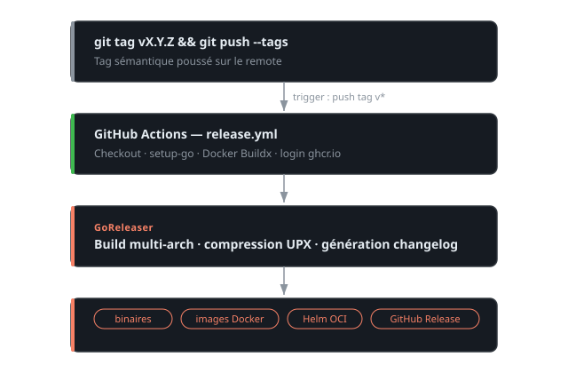

# GoReleaser : binaires, images OCI, signature et changelog

Une release Go publiée à la main demande de compiler pour chaque plateforme, d'empaqueter, de calculer les checksums, de signer et d'écrire les notes. Chacune de ces étapes peut être oubliée sans que rien ne le signale. Le pipeline décrit ici les enchaîne toutes à partir d'un simple push sur `main` et publie les binaires multi-arch, l'image OCI, la signature, le SBOM et les notes de release.

GoReleaser génère le changelog, les binaires, les archives et les images OCI (via ko) depuis un fichier de config. Le chart Helm n'est pas géré par GoReleaser et part dans un step à part du même workflow.

À chaque push, svu calcule la prochaine version depuis les Conventional Commits, pose le tag par l'API GitHub, puis GoReleaser publie dans le même job. Pousser un tag à la main reste possible et suit le même chemin.

!!! tip "Avant la release, la CI"
    GoReleaser intervient une fois le tag posé. Ce qui tourne *avant*, sur chaque push et PR (test, lint, scan de vulnérabilités, durcissement des workflows), est détaillé dans [CI GitHub Actions pour un projet Go](go-ci.md).

## Le flow d'une release



## Installation

```bash
# macOS
brew install goreleaser

# Linux (binaire direct)
curl -sfL https://goreleaser.com/static/run | bash
```

## Configuration de base

```yaml title=".goreleaser.yml"
version: 2

before:
  hooks:
    - go mod tidy
    - go mod verify

builds:
  - id: mon-binaire
    binary: mon-binaire
    main: .   # ko lit la valeur écrite, pas la valeur par défaut de GoReleaser
    env:
      - CGO_ENABLED=0
    goos:
      - linux
      - darwin
      - windows
    goarch:
      - amd64
      - arm64
    ignore:
      - goos: windows
        goarch: arm64
    flags:
      - -trimpath
    ldflags:
      - -s   # implique -w
      - -X main.version={{.Version}}
      - -X main.commit={{.Commit}}
      - -X main.date={{.Date}}

archives:
  - formats: [tar.gz]
    name_template: "{{ .ProjectName }}_{{ .Version }}_{{ .Os }}_{{ .Arch }}"
    format_overrides:
      - goos: windows
        formats: [zip]
    files:
      - README.md
      - LICENSE*

checksum:
  name_template: checksums.txt

release:
  draft: false
  prerelease: auto
```

## Réduire la taille des binaires

Un seul des 3 réglages de la config de base réduit la taille. Les 2 autres rendent le binaire reproductible et statique :

| Réglage | Effet | Rôle |
|------|-------|------|
| `-s` | Supprime la table des symboles et le DWARF avec | Taille |
| `-trimpath` | Supprime les chemins locaux embarqués dans le binaire | Build reproductible |
| `CGO_ENABLED=0` | Désactive CGO, le binaire est entièrement statique | Binaire statique |

Résultat mesuré sur [gopen](https://github.com/PixiBixi/gopen) avec ces 3 réglages : **3,0 Mo → 2,0 Mo (-33 %)**.

### `-w` est redondant avec `-s`

On voit `-s -w` partout, dans la doc GoReleaser comme dans la moitié des projets Go. Le linker dérive `-w` de `-s` quand il n'est pas passé explicitement et l'écrire en plus ne change rien.

```go title="$GOROOT/src/cmd/link/internal/ld/main.go:274"
*FlagW = *FlagS // -s implies -w if not explicitly set
```

Mesuré sur le contrôleur d'ingress HAProxy, `linux/amd64`, `-trimpath` sur les 4 builds :

| ldflags | Taille | `.symtab` | Sections `.debug*` |
|---|---|---|---|
| aucun | 103 276 329 o | oui | 8 |
| `-s` | 72 913 056 o | non | 0 |
| `-w` | 83 023 367 o | oui | 0 |
| `-s -w` | 72 913 056 o | non | 0 |

`-s` seul et `-s -w` produisent la même taille à l'octet près, avec les mêmes sections. L'inverse n'est pas vrai. Passé seul, `-w` ne retire que le DWARF et garde la table des symboles, soit 10 Mo de plus que `-s`. Écrire `-s` seul dit exactement ce qu'on demande.

### Ce que le strip ne coûte pas

L'objection habituelle est la perte des stack traces, alors qu'une trace Go se lit dans le `pclntab`, que le linker conserve quels que soient les flags. Le même panic sur 2 binaires, avec et sans `-s`, produit 2 traces identiques, noms de fonctions et numéros de ligne compris. Le profiling `net/http/pprof` reste intact pour la même raison, puisque la symbolisation se fait dans le runtime.

On perd en revanche le debug source-level avec delve sur un process vivant, `go tool nm` et l'analyse de core dump sous gdb.

!!! warning "Ce n'est pas du durcissement"
    Le flag `-s` ne complique pas sérieusement le reverse engineering d'un binaire Go, car le `pclntab` reste lisible et porte les noms de fonctions. C'est un gain de taille, pas une mesure de sécurité. Le présenter autrement fait prendre de mauvaises décisions.

## Compresser avec UPX, sous Linux seulement

UPX compresse le binaire et le décompresse au lancement. C'est cette décompression qui décide de l'intérêt d'UPX et son coût est rarement chiffré.

Gains mesurés sur la layer binaire de [kubearch](https://github.com/PixiBixi/kubearch) (`ghcr.io/pixibixi/kubearch`) :

| Arch | Sans UPX (v0.2.0) | Avec UPX (v0.3.1) | Gain |
|------|-------------------|-------------------|------|
| amd64 | 14,91 Mo | 8,34 Mo | **-44 %** |
| arm64 | - | 6,61 Mo | - |

```yaml
upx:
  - enabled: true
    ids: [mon-binaire]
    compress: best
    lzma: true
    goos: [linux]
```

!!! warning "UPX et macOS/Windows"
    Sur macOS, UPX casse la notarisation Apple. Sur Windows, les antivirus le signalent. On le limite à `goos: [linux]`.

### Ce que la décompression coûte

UPX ne produit pas un binaire que le kernel charge en lazy depuis le disque. Il décompresse **l'intégralité** du binaire en mémoire à chaque `exec`, avant que la première ligne du programme ne tourne. Les mesures suivantes portent sur linux/arm64 en conteneur, avec 50 invocations de `--help` par variante et le page cache chaud :

| Binaire | Sans UPX | `--best --lzma` | `upx -1` |
|---|---|---|---|
| kubectl-klens (42 Mio) | **5,8 ms** | 669 ms (x115) | 220 ms (x38) |
| gopen (2,2 Mio) | **1,6 ms** | 62,7 ms (x40) | 17,1 ms (x11) |

Le coût suit la taille du binaire, pas celle du programme utile : klens embarque `client-go` et doit décompresser 42 Mio avant d'afficher une aide. Baisser le niveau de compression ne règle rien, puisque `upx -1` multiplie encore le démarrage par 38.

### Un gain UPX plus faible dans le `.tar.gz`

Le pourcentage annoncé par UPX porte sur le binaire nu, alors qu'un utilisateur télécharge un `.tar.gz` que gzip a déjà compressé :

| Binaire | Sur disque | Dans le `.tar.gz` |
|---|---|---|
| kubectl-klens | 41,75 vers 6,48 Mio (-84 %) | 11,00 vers 6,48 Mio (**-41 %**) |
| gopen | 2,19 vers 0,67 Mio (-70 %) | 0,89 vers 0,66 Mio (**-25 %**) |

Une layer OCI est elle aussi compressée en gzip et le même effet vaut pour une image. Les tailles de layer kubearch plus haut sont déjà des tailles compressées. Pour une release téléchargeable comme pour une image, c'est le chiffre de droite qu'il faut regarder.

### Compresser les binaires de serveur, pas les CLI

L'arbitrage dépend du nombre de fois où le binaire sera lancé.

Un serveur paie la décompression **une fois au démarrage du pod** puis sert pendant des semaines. Personne ne voit 669 ms au boot d'un conteneur, alors que le gain sur la layer se répète sur chaque node qui pull l'image. C'est le cas de kubearch et du webhook [external-dns-akamai-webhook](https://github.com/PixiBixi/external-dns-akamai-webhook), où le binaire linux passe de 35,16 à 7,61 Mio.

Une commande one-shot paie la décompression **à chaque invocation**. Une session de debug qui enchaîne une dizaine de sous-commandes klens perd 7 secondes pour économiser 4,5 Mio une seule fois, à l'installation. klens et gopen n'utilisent délibérément pas UPX.

La clé `goos: [linux]` de l'exemple protège macOS et Windows, mais elle ne suffit pas pour un CLI, dont le binaire linux se lance aussi à la main. C'est la clé `ids:` qui choisit les builds compressés et on n'y met que les binaires de serveur.

## Prouver qui a publié, comment et quoi

Une release sérieuse répond à 3 questions : qui l'a publiée (la signature), comment elle a été construite (la provenance) et ce qu'elle contient (le SBOM). Chacune a son outil et se vérifie séparément.

### Signer avec cosign

[Cosign](https://github.com/sigstore/cosign) signe en mode keyless, sans clé à gérer. L'identité vient de l'OIDC GitHub Actions et chaque signature est enregistrée dans le transparency log de [Sigstore](https://www.sigstore.dev/).

```yaml title=".goreleaser.yml"
signs:
  - cmd: cosign
    signature: "${artifact}.sigstore.json"
    args:
      - sign-blob
      - "--bundle=${signature}"
      - "${artifact}"
      - "--yes"
    artifacts: checksum   # signe checksums.txt, qui couvre tous les binaires/archives

docker_signs:
  - cmd: cosign
    args:
      - sign
      - "--yes"
      - "--recursive"
      - "${artifact}"
    artifacts: manifests   # le manifest multi-arch et, via --recursive, chaque image par arch
```

!!! note "Pourquoi signer le checksum plutôt que chaque archive ?"
    `checksums.txt` contient les SHA256 de tous les artefacts. Signer ce fichier couvre tout : on vérifie la signature une fois, puis le SHA256 de chaque archive.

Les 2 blocs ne se recouvrent pas et il faut les 2 dès qu'on publie une image. Le bloc `signs:` signe un fichier de `dist/` alors que l'image n'y passe jamais, puisque ko la pousse directement au registry et que son digest n'apparaît nulle part dans `checksums.txt`. Un projet qui ne livre que des binaires se contente de `signs:`. Un projet qui livre une image sans `docker_signs:` la publie sans rien à vérifier au `docker pull`, car ko ne signe pas de lui-même.

On signe la référence telle que GoReleaser la fournit, sans y ajouter le digest. L'artefact `Docker Manifest` expose bien un `extra.Digest`, mais sans son préfixe `sha256:`. Un `"${artifact}@${digest}"` produit alors une référence malformée. Le flag `--recursive` couvre les images par architecture derrière le manifest.

### Le login que ko ne fait pas pour cosign

Le bloc `docker_signs` a une exigence de plus, facile à rater quand on publie avec ko. ko s'authentifie seul sur ghcr avec le `GITHUB_TOKEN`, mais cosign non. cosign pousse la couche de signature vers le même registry et lit `~/.docker/config.json` pour s'y authentifier. Il faut donc un `docker/login-action` même quand ko n'en a pas besoin. Sans lui, l'image est publiée puis la signature échoue sur `UNAUTHORIZED` et l'image reste en ligne sans signature. La signature keyless demande aussi la permission `id-token: write` et cosign dans le `PATH`, tous 2 présents dans le [workflow complet](#le-workflow-complet) :

```yaml
permissions:
  id-token: write   # signature keyless : l'identité vient du token OIDC du run

steps:
  - uses: sigstore/cosign-installer@6f9f17788090df1f26f669e9d70d6ae9567deba6 # v4.1.2
```

```yaml
      - uses: docker/login-action@06fb636fac595d6fb4b28a5dfcb21a6f5091859c # v4.5.0
        with:
          registry: ghcr.io
          # repository_owner et pas github.actor : l'actor est qui a déclenché le
          # run (`renovate[bot]` sur un merge d'automerge), alors que le
          # namespace où on pousse est celui du owner.
          username: ${{ github.repository_owner }}
          password: ${{ secrets.GITHUB_TOKEN }}
```

### Vérifier les artefacts côté utilisateur

```bash
# 1. Vérifier la signature du checksum
cosign verify-blob \
  --certificate-identity 'https://github.com/monorg/mon-repo/.github/workflows/release.yml@refs/heads/main' \
  --certificate-oidc-issuer 'https://token.actions.githubusercontent.com' \
  --bundle checksums.txt.sigstore.json \
  checksums.txt

# 2. Vérifier l'intégrité des binaires
sha256sum --ignore-missing -c checksums.txt

# 3. Vérifier l'image Docker
cosign verify \
  --certificate-identity 'https://github.com/monorg/mon-repo/.github/workflows/release.yml@refs/heads/main' \
  --certificate-oidc-issuer 'https://token.actions.githubusercontent.com' \
  ghcr.io/monorg/mon-image:vX.Y.Z
```

La ref de l'identité est celle **du run**, pas celui du tag. Avec le [workflow complet](#le-workflow-complet), `svu` pose le tag par API puis GoReleaser publie dans le même job, lequel a été déclenché par le push sur la branche : le certificat porte donc `@refs/heads/main` et une vérification sur `@refs/tags/vX.Y.Z` échoue avec `no matching CertificateIdentity found`, alors que la signature est parfaitement valide. Un pipeline déclenché en poussant un tag à la main donne l'inverse. Dans le doute, l'erreur de cosign affiche la valeur réellement présente. Le job `verify` du workflow complet accepte les 2 avec une regexp ancrée des 2 côtés.

### Attester la provenance des artefacts

La signature dit **qui** a publié, pas **comment** l'artefact a été construit. C'est ce que couvre l'attestation SLSA, qui n'a rien de spécifique à Go ni à GoReleaser et dont le détail est dans [l'article sur le durcissement](hardening.md#attester-comment-lartefact-a-ete-construit). Le seul point propre à ce pipeline est la liste des fichiers à attester. GoReleaser écrit tout dans `dist/`, y compris les archives et le `checksums.txt` déjà signé par cosign.

```yaml title=".github/workflows/release.yml"
      - name: Attest build provenance
        uses: actions/attest-build-provenance@4d101475d8b20a2381f78447822ac1eab6504dd8 # v4.2.2
        with:
          subject-path: 'dist/*.tar.gz,dist/*.zip,dist/checksums.txt'
```

Si le pipeline pousse aussi une image (via [`kos:`](#construire-des-images-multi-arch-sans-dockerfile)), son digest se récupère dans `dist/artifacts.json`, que GoReleaser écrit en fin de run avec une entrée par artefact produit.

### Décrire le contenu de l'artefact (SBOM)

La signature dit qui a publié et la provenance dit comment c'est construit. Aucune des 2 ne répond à « est-ce que ce binaire embarque la lib qui vient de sortir en CVE ? ». Le SBOM répond à cette question et GoReleaser le génère avec syft en 2 lignes :

```yaml
sboms:
  - artifacts: archive
```

GoReleaser écrit un `.sbom.json` à côté de chaque archive, au format **SPDX 2.3** (format par défaut de syft) et pas en CycloneDX. Ces fichiers sont dans `dist/` comme les autres et entrent dans l'attestation de provenance. Un SBOM substitué fait alors échouer la vérification :

```yaml
          subject-path: 'dist/*.tar.gz,dist/checksums.txt,dist/*.sbom.json'
```

GoReleaser appelle le binaire syft et ne l'embarque pas. Quand syft manque, GoReleaser n'ignore pas l'étape mais fait échouer toute la release, une fois les binaires compilés et les archives déjà écrites.

```text
⨯ release failed after 2m31s   error=exec: "syft": executable file not found in $PATH
```

Le [workflow complet](#le-workflow-complet) l'installe avec `anchore/sbom-action/download-syft`. `goreleaser check` ne détecte pas son absence, puisqu'il valide la config et pas ce que le runner a dans son `PATH`. Un snapshot le détecte en revanche, car il exécute aussi les SBOM tant qu'on ne passe pas `--skip=sbom`.

ko publie déjà un SBOM par image. Le bloc `sboms:` couvre les archives, pour qui récupère le binaire sans passer par l'image.

## Construire des images multi-arch sans Dockerfile

[ko](https://ko.build) est un builder d'images OCI natif Go : il cross-compile le binaire et le place dans une image distroless **sans Dockerfile, sans Docker daemon, sans buildx**. GoReleaser v2 l'intègre nativement via la clé `kos:`.

```yaml
kos:
  - id: mon-binaire
    main: .   # obligatoire depuis Go 1.27
    repositories:
      - ghcr.io/monorg/mon-image
    base_image: gcr.io/distroless/static:nonroot
    platforms:
      - linux/amd64
      - linux/arm64
    tags:
      - "{{ .Version }}"          # 1.2.3
      - "{{ .Major }}.{{ .Minor }}" # 1.2
      - "{{ .Major }}"             # 1
      - '{{ if not .Prerelease }}latest{{ end }}'
    bare: true   # ghcr.io/monorg/mon-image:1.2.3 (sans suffixe binaire)
```

ko génère automatiquement un manifest multi-arch et publie un SBOM par image. Il utilise le `GITHUB_TOKEN` pour s'authentifier sur `ghcr.io` et n'a besoin ni de `docker login` ni de buildx. Le login reste nécessaire pour [cosign, qui signe l'image](#le-login-que-ko-ne-fait-pas-pour-cosign).

!!! note "Pas de Dockerfile nécessaire"
    Pour un binaire Go pur (`CGO_ENABLED=0`), ko remplace entièrement le duo `Dockerfile.release` + `docker_manifests`. Pour les builds locaux de développement (avec un vrai Dockerfile multi-stage), on peut garder un `Dockerfile` séparé.

GoReleaser 2.17 affiche déjà un avertissement de dépréciation sur `dockers` et `docker_manifests`, au profit d'un `dockers_v2` qui n'existe pas encore dans cette version. Une config neuve écrite sur ces clés impose une migration plus tard.

!!! warning "Visibilité GHCR"
    La première image publiée est privée par défaut sur GHCR, même pour un repo public. On la rend publique à la main dans **GitHub → Packages → mon-image → Package settings → Change visibility**.

!!! warning "Go 1.27 impose un `main:` explicite"
    GoReleaser reprend pour `kos[].main` le `main:` du build correspondant, qui vaut `""` tant qu'on ne l'a pas écrit. ko passe cette chaîne vide à `go list`. Go 1.26 la résolvait silencieusement en répertoire courant, Go 1.27 la rejette avec `go: invalid package: ""`. Le symptôme est trompeur : les binaires, les archives, les checksums et la formule Homebrew se construisent normalement, puis le run échoue à la toute fin sur `ko: does not contain a valid local import path ()`, sans release GitHub ni image. Poser `main: .` dans `kos:` et dans `builds:` évite l'erreur des 2 côtés.

## Publier le chart Helm sur un registry OCI

GoReleaser ne gère pas nativement le push Helm. On l'ajoute en step après GoReleaser, dans le même job. Avec svu, le run démarre sur un push sur `main` et `GITHUB_REF_NAME` vaut `main`. La version se lit alors dans la sortie du step svu.

```yaml
- name: Push Helm chart to OCI
  if: github.ref_type == 'tag' || steps.tag.outputs.new_tag != ''
  env:
    TAG: ${{ github.ref_type == 'tag' && github.ref_name || steps.tag.outputs.new_tag }}
  run: |
    CHART_VERSION="${TAG#v}"
    helm registry login ghcr.io \
      --username "${{ github.repository_owner }}" \
      --password "${{ secrets.GITHUB_TOKEN }}"
    helm package charts/mon-chart \
      --version "$CHART_VERSION" \
      --app-version "$CHART_VERSION"
    helm push "mon-chart-${CHART_VERSION}.tgz" oci://ghcr.io/monorg/charts
```

## Publier un cask Homebrew sans warning

GoReleaser a déprécié `brews` au profit de `homebrew_casks`, qui pousse un cask dans un tap. Un cask Homebrew est mis en quarantaine à l'installation, contrairement à une formule. Un binaire non notarisé se fait donc bloquer par Gatekeeper au premier lancement. Le réflexe est de retirer l'attribut dans `hooks.post.install`. GoReleaser rend alors ce hook en bloc `postflight do`, que Homebrew a déprécié, et chaque `brew install` affiche à l'utilisateur :

```text
Warning: Calling `postflight` is deprecated! Use `postflight_steps` instead.
Please report this issue to the monorg/homebrew-tap tap (not Homebrew/* repositories), or even better, submit a PR to fix it:
```

Le remplaçant `postflight_steps` n'accepte plus de Ruby arbitraire, seulement un DSL déclaratif (`run`, `move`, `symlink`, `on_macos`...). Tant que GoReleaser ne sait pas le générer, on passe par `custom_block`, qui injecte le texte tel quel dans le cask :

```yaml title=".goreleaser.yml"
homebrew_casks:
  - name: mon-binaire
    repository:
      owner: monorg
      name: homebrew-tap
      token: "{{ .Env.HOMEBREW_TAP_TOKEN }}"
    directory: Casks
    binaries: [mon-binaire]
    custom_block: |
      postflight_steps do
        on_macos do
          run "/usr/bin/xattr", args: ["-dr", "com.apple.quarantine", "{{ "{{staged_path}}" }}/mon-binaire"]
        end
      end
```

L'échappement de `{{staged_path}}` est indispensable. Homebrew utilise les mêmes délimiteurs que les templates Go pour ses placeholders et GoReleaser repasse le cask entier dans son moteur de templates après l'avoir rendu, `custom_block` compris. Sans échappement, la release échoue sur `function "staged_path" not defined`. Le bloc `on_macos` remplace l'ancien `if OS.mac?`, car le cask porte aussi les archives Linux, où `/usr/bin/xattr` n'existe pas.

On valide sans rien publier avec un snapshot, puis on lit le cask généré :

```bash
HOMEBREW_TAP_TOKEN=x goreleaser release --snapshot --clean --skip=publish,sign
rg -n -A4 'postflight_steps' dist/homebrew/Casks/mon-binaire.rb
```

Le bloc arrive en tête du cask, avant `version`. Homebrew l'installe sans erreur et seul `brew style` signale l'ordre des stanzas, au milieu des les lignes vides et autres écarts de mise en page que GoReleaser génère de toute façon.

!!! note "Correctif amont en cours"
    À la date du 2026-10-22, l'issue [goreleaser#6870](https://github.com/goreleaser/goreleaser/issues/6870) est ouverte et la PR [goreleaser#6873](https://github.com/goreleaser/goreleaser/pull/6873) ajoute `hooks.post.install_steps` ainsi qu'un champ `{{ .StagedPath }}` qui évite l'échappement. Une fois mergée, le `custom_block` repasse dans `hooks`.

## Le workflow complet

C'est le `release.yml` de [klens](https://github.com/PixiBixi/kubectl-klens), qui publie des binaires et un plugin krew. Les 3 ajouts propres à une image et à un chart (permission `packages: write`, login ghcr, step Helm) sont marqués en commentaire.

```yaml title=".github/workflows/release.yml"
name: Release

on:
  push:
    branches: [main]
    tags:
      - 'v*'   # release manuelle, hors svu

permissions: {}

jobs:
  release:
    runs-on: ubuntu-24.04
    outputs:
      tag: ${{ github.ref_type == 'tag' && github.ref_name || steps.tag.outputs.new_tag }}
    permissions:
      contents: write
      packages: write      # image et chart seulement : push vers ghcr.io
      id-token: write      # signature cosign keyless et attestation
      attestations: write  # provenance SLSA
    steps:
      - uses: step-security/harden-runner@e14015d583714f6e62063499dc959a02595150a1 # v2.21.1
        with:
          egress-policy: audit
      - uses: actions/checkout@3d3c42e5aac5ba805825da76410c181273ba90b1 # v7.0.1
        with:
          fetch-depth: 0   # svu et le changelog lisent tout l'historique
          persist-credentials: false
      - uses: actions/setup-go@b7ad1dad31e06c5925ef5d2fc7ad053ef454303e # v7.0.0
        with:
          go-version-file: go.mod
          cache: false   # un cache empoisonné finirait dans les artefacts publiés

      # svu renvoie la version courante quand aucun commit ne justifie de release
      - name: Compute next version
        id: tag
        if: github.ref_type == 'branch'
        env:
          GH_TOKEN: ${{ secrets.GITHUB_TOKEN }}
          # renovate: datasource=github-releases depName=caarlos0/svu
          SVU_VERSION: v3.4.1
        run: |
          set -euo pipefail
          GOBIN="${RUNNER_TEMP}/bin" go install "github.com/caarlos0/svu/v3@${SVU_VERSION}"
          svu="${RUNNER_TEMP}/bin/svu"
          current=$("$svu" current)
          next=$("$svu" next --v0)
          if [ "$next" = "$current" ]; then
            echo "No releasable commit since ${current}"
            exit 0
          fi
          gh api "repos/${GITHUB_REPOSITORY}/git/refs" \
            -f "ref=refs/tags/${next}" -f "sha=${GITHUB_SHA}" --silent
          echo "new_tag=${next}" >> "$GITHUB_OUTPUT"

      # le tag a été créé par l'API, le clone local ne le connaît pas encore
      - name: Fetch tags
        if: github.ref_type == 'tag' || steps.tag.outputs.new_tag != ''
        run: git fetch --tags --force
      - name: Install cosign
        if: github.ref_type == 'tag' || steps.tag.outputs.new_tag != ''
        uses: sigstore/cosign-installer@6f9f17788090df1f26f669e9d70d6ae9567deba6 # v4.1.2
      - name: Install syft
        if: github.ref_type == 'tag' || steps.tag.outputs.new_tag != ''
        uses: anchore/sbom-action/download-syft@3ad7283483fc7af8ff2b4ea19663c2d5ca935e26 # v0.24.2
      # image seulement : cosign signe l'image et ne réutilise pas l'auth de ko
      - name: Log in to ghcr.io
        if: github.ref_type == 'tag' || steps.tag.outputs.new_tag != ''
        uses: docker/login-action@06fb636fac595d6fb4b28a5dfcb21a6f5091859c # v4.5.0
        with:
          registry: ghcr.io
          username: ${{ github.repository_owner }}
          password: ${{ secrets.GITHUB_TOKEN }}

      - name: Run GoReleaser
        if: github.ref_type == 'tag' || steps.tag.outputs.new_tag != ''
        uses: goreleaser/goreleaser-action@f06c13b6b1a9625abc9e6e439d9c05a8f2190e94 # v7.2.3
        with:
          version: '~> v2'
          args: release --clean
        env:
          GITHUB_TOKEN: ${{ secrets.GITHUB_TOKEN }}

      - name: Attest build provenance
        if: github.ref_type == 'tag' || steps.tag.outputs.new_tag != ''
        uses: actions/attest-build-provenance@4d101475d8b20a2381f78447822ac1eab6504dd8 # v4.2.2
        with:
          subject-path: 'dist/*.tar.gz,dist/checksums.txt,dist/*.sbom.json'

      # chart seulement : le step "Push Helm chart to OCI" vu plus haut se place ici

  # une signature qui ne se vérifie pas ne vaut rien : on la vérifie après chaque release
  verify:
    needs: release
    if: needs.release.outputs.tag != ''
    runs-on: ubuntu-24.04
    permissions:
      contents: read
      attestations: read
    env:
      TAG: ${{ needs.release.outputs.tag }}
      GH_TOKEN: ${{ secrets.GITHUB_TOKEN }}
    steps:
      - uses: sigstore/cosign-installer@6f9f17788090df1f26f669e9d70d6ae9567deba6 # v4.1.2
      - name: Download the published artifacts
        run: |
          set -euo pipefail
          gh release download "$TAG" --repo "$GITHUB_REPOSITORY" \
            --pattern '*.tar.gz' \
            --pattern 'checksums.txt' \
            --pattern 'checksums.txt.sigstore.json'
      - name: Verify checksums
        run: shasum -a 256 --check --ignore-missing checksums.txt
      # le $ final compte : cosign n'ancre pas la fin, heads/main matcherait heads/main-evil
      - name: Verify the cosign signature
        run: |
          set -euo pipefail
          cosign verify-blob \
            --certificate-identity-regexp "^https://github\\.com/${GITHUB_REPOSITORY}/\\.github/workflows/release\\.yml@refs/(heads/main|tags/v[0-9]+\\.[0-9]+\\.[0-9]+)\$" \
            --certificate-oidc-issuer 'https://token.actions.githubusercontent.com' \
            --bundle checksums.txt.sigstore.json \
            checksums.txt
      - name: Verify the build provenance
        run: |
          set -euo pipefail
          for f in *.tar.gz; do
            gh attestation verify "$f" --repo "$GITHUB_REPOSITORY"
          done
```

Les actions sont épinglées par SHA et le checkout ne garde pas le token, pour les raisons détaillées dans [l'article sur le durcissement](hardening.md). Un workflow de release détient `contents: write` et c'est le dernier endroit où accepter un tag mutable.

Chaque step de release porte la même condition `if:`, celle du pipeline piloté par svu décrit dans [l'article sur la CI](go-ci.md#le-workflow-taguer-puis-publier-en-un-seul-job). Un push sur `main` sans commit releasable s'arrête donc après le calcul de version, sans rien installer.

### Garder cosign même sans rien signer

Le step `Install cosign` est à garder **même dans un pipeline qui ne signe rien**. `goreleaser-action` télécharge le binaire GoReleaser depuis les releases GitHub, vérifie son checksum, puis contrôle la signature cosign du `checksums.txt` d'où vient ce checksum. Sans cosign dans le `PATH`, elle renonce à ce second contrôle et le signale par une simple ligne de log :

```text
Checksum verified for goreleaser_Linux_x86_64.tar.gz
cosign not found in PATH, skipping signature verification
```

Le run reste vert et l'absence de contrôle passe inaperçue. Le checksum seul ne prouve que la cohérence entre 2 fichiers servis par la même release. C'est la signature keyless qui rattache ce `checksums.txt` au pipeline de release de GoReleaser. Le step `Install cosign` se place donc avant `Run GoReleaser`.

!!! note "fetch-depth: 0"
    Par défaut, `actions/checkout` fait un shallow clone d'un seul commit. Sans l'historique, svu ne trouve pas le dernier tag et GoReleaser ne peut pas générer le changelog.

## Commandes utiles

```bash
# Valider la config sans déclencher de release
goreleaser check

# Tester localement (snapshot = pas de tag requis, pas de push)
goreleaser release --snapshot --clean

# Release manuelle, hors svu (le workflow se déclenche aussi sur un tag)
git tag -a v1.2.3 -m "Release v1.2.3"
git push origin v1.2.3
```

## Générer des notes de release lisibles

GoReleaser génère le changelog entre 2 tags. On peut filtrer et regrouper :

```yaml
changelog:
  sort: asc
  abbrev: -1
  filters:
    exclude:
      - '^docs(\([^)]*\))?:'
      - '^test(\([^)]*\))?:'
      - '^chore(\([^)]*\))?:'
      - '^ci(\([^)]*\))?:'
  groups:
    - title: Features
      regexp: '^feat(\([^)]*\))?:'
      order: 0
    - title: Bug Fixes
      regexp: '^fix(\([^)]*\))?:'
      order: 1
    - title: Performance
      regexp: '^perf(\([^)]*\))?:'
      order: 2
    - title: Others
      order: 999
```

### Filtrer des commits qui portent un scope

Le groupe `(\([^)]*\))?` est indispensable. Les Conventional Commits rendent le scope optionnel et la forme qu'on lit partout, `'^docs:'`, ne matche pas `docs(wiki):`. Un projet qui scope ses commits, souvent dès qu'il a plus d'un package, voit alors apparaître dans ses notes exactement les types qu'il croyait exclure.

L'échec est silencieux, puisque la config est valide et que `goreleaser check` renvoie 0. Les notes contiennent simplement des commits que personne n'a demandés. Sur un webhook Go où la config datait de l'origine, la release publiée listait `test(server)` et `ci(fuzz)` alors que `'^test:'` était dans l'`exclude` depuis le premier jour.

Les `groups` ont le même défaut et il se voit encore moins : un `feat(server):` qui ne matche pas `'^feat:'` ne disparaît pas mais tombe dans `Others`. La section Features reste vide et toutes les nouveautés finissent dans `Others`. On attribue volontiers ce résultat à un mauvais typage des commits plutôt qu'à la regex.

Le `ci` dans la liste d'exclusion est un choix, pas un oubli à corriger. Ces notes servent à décider d'une montée de version et un changement de workflow ne dit rien au lecteur.

### Ne pas exclure ce qui déclenche une release

Exclure tout `chore` devient un piège quand l'outil de versioning publie sur `chore(deps)`, comme le recommande [l'article cocogitto](cocogitto.md) pour que les mises à jour de dépendances sortent. La release est publiée avec des notes vides. Le moteur regex de Go n'a pas de lookahead pour écrire « tout `chore` sauf `deps` ». La clé `include` résout le problème, car elle remplace la liste d'exclusion dès qu'elle est renseignée :

```yaml
changelog:
  filters:
    include:
      - '^feat(\([^)]*\))?!?:'
      - '^fix(\([^)]*\))?!?:'
      - '^perf(\([^)]*\))?!?:'
      - '^chore\(deps\)!?:'
```

GoReleaser ignore alors `exclude` (`filterEntries` dans `internal/pipe/changelog/changelog.go`) et on ne liste que ce qu'on veut voir.

### Retirer le SHA plutôt que le raccourcir

`abbrev` accepte une longueur d'abréviation et la valeur qui vide le champ est `-1` :

```go title="internal/pipe/changelog/changelog.go"
func abbrevEntry(sha string, abbr int) string {
    switch abbr = max(abbr, -1); abbr {
    case 0:
        return sha
    case -1:
        return ""
    default:
        if abbr > len(sha) {
            return sha
        }
        return sha[:abbr]
    }
}
```

La valeur `0` garde le SHA complet et c'est la valeur par défaut. Sans `abbrev`, chaque ligne commence par 40 caractères hexadécimaux avant le sujet du commit et se lit comme une sortie de `git log`. Ce format disqualifie les notes pour le critère `release_notes` du badge OpenSSF Best Practices, qui exclut explicitement le journal de contrôle de version brut.

### Le changelog vit dans la release GitHub

GoReleaser n'écrit rien dans le dépôt, seulement `dist/CHANGELOG.md`, que `--clean` efface au run suivant. La vraie destination est le corps de la release GitHub, assemblé dans le pipe release dans l'ordre header, changelog puis footer. Committer un `CHANGELOG.md` en plus crée un doublon qui divergera à la première release où on oublie de le mettre à jour. klens garde un `CHANGELOG.md` de 3 lignes qui renvoie vers la page Releases.

Avec cocogitto, qui committe son propre `CHANGELOG.md`, il faut choisir une seule source. Soit le corps de release GoReleaser fait foi et le fichier renvoie vers les Releases, soit le fichier de cocogitto fait foi et GoReleaser reprend la section de la version avec `--release-notes`. GoReleaser ne génère alors pas son propre changelog.

La clé `release.header` accueille ce que la liste de commits ne peut pas dire, comme la référence d'image à puller et les liens d'installation :

```yaml
release:
  header: |
    ```
    ghcr.io/owner/project:{{ .Version }}
    ```
```

Le mode snapshot ignore le pipe changelog et ne produit aucun `CHANGELOG.md`. Les notes ne se prévisualisent pas en local et le premier résultat réel arrive au tag suivant.
