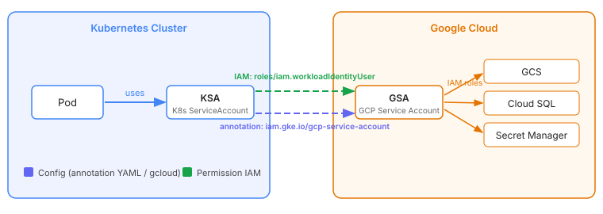

# GKE Workload Identity : lier un KSA à un GSA sans clé JSON

2 façons de s'identifier sur les services Google : les service accounts (SA) avec leur clé JSON ou Workload Identity (renommé Workload Identity Federation for GKE).

La clé d'un SA est un secret qu'il faut stocker, distribuer à chaque pod qui en a besoin et rotate en cas de compromission...

Workload Identity règle ça : on lie un service account K8s (KSA) à un service account GCP (GSA) et les SDK GCP récupèrent automatiquement un token depuis la metadata API du nœud. Cette approche marche sur tous les types de nodes, y compris les [Spot Nodes](spot_nodes.md).

Workload Identity se décline en 2 variantes : on lie le KSA à un GSA qu'il impersonne (ce que décrit l'article), ou on donne les rôles IAM directement au KSA, sans GSA ni annotation (section « Accès direct sans GSA » plus bas). Google présente l'accès direct comme la voie par défaut et l'impersonation comme une option, à garder quand un service Google a des limitations avec l'identité fédérée.



## Câbler le cluster, le GSA et le KSA

Sur un cluster Standard, 2 points à activer : le cluster (`workload_pool`) et chaque node pool (`GKE_METADATA`). Sur Autopilot, c'est toujours activé, rien à faire côté cluster ni node pool. L'impersonation d'un GSA demande aussi l'API IAM Service Account Credentials (`iamcredentials.googleapis.com`) activée dans le projet du cluster.

!!! warning "Node pools existants"
    Une fois le cluster configuré, les nouveaux node pools passent en `GKE_METADATA` d'eux-mêmes, mais les node pools existants restent comme ils sont. Sans `workload_metadata_config { mode = "GKE_METADATA" }` sur ceux-là, Workload Identity ne fonctionne pas même si le cluster est configuré.

```hcl
# Cluster - activer le workload pool
resource "google_container_cluster" "main" {
  # ...
  workload_identity_config {
    workload_pool = "${var.project_id}.svc.id.goog"
  }
}

# Node pool - activer GKE_METADATA (déclenche un rolling update si existant)
resource "google_container_node_pool" "default" {
  # ...
  node_config {
    workload_metadata_config {
      mode = "GKE_METADATA"
    }
  }
}

# GSA et ses permissions
resource "google_service_account" "app" {
  account_id   = "my-app-sa"
  display_name = "my-app service account"
}

resource "google_project_iam_member" "app_storage" {
  project = var.project_id
  role    = "roles/storage.objectViewer"
  member  = "serviceAccount:${google_service_account.app.email}"
}

# Liaison KSA → GSA
# Le format du member est strict : PROJECT.svc.id.goog[NAMESPACE/KSA_NAME]
resource "google_service_account_iam_member" "workload_identity" {
  service_account_id = google_service_account.app.name
  role               = "roles/iam.workloadIdentityUser"
  member             = "serviceAccount:${var.project_id}.svc.id.goog[${var.namespace}/${var.ksa_name}]"
}

# KSA annoté
resource "kubernetes_service_account" "app" {
  metadata {
    name      = "my-app"
    namespace = var.namespace
    annotations = {
      "iam.gke.io/gcp-service-account" = google_service_account.app.email
    }
  }
}
```

## Accès direct sans GSA

Sans GSA, on donne le rôle directement au KSA via son identifiant `principal://`, qui demande le numéro du projet (pas son ID). Pas d'annotation sur le KSA, pas de binding `roles/iam.workloadIdentityUser` :

```hcl
data "google_project" "current" {
  project_id = var.project_id
}

resource "google_project_iam_member" "app_storage_direct" {
  project = var.project_id
  role    = "roles/storage.objectViewer"
  member  = "principal://iam.googleapis.com/projects/${data.google_project.current.number}/locations/global/workloadIdentityPools/${var.project_id}.svc.id.goog/subject/ns/${var.namespace}/sa/${var.ksa_name}"
}
```

Chaque API Google a ses limitations avec l'identité fédérée (listées dans la doc Google de Workload Identity Federation for GKE) : si l'une bloque, on revient à l'impersonation d'un GSA.

## Utiliser l'identité dans le pod

Le pod ne référence que le KSA, les SDK GCP récupèrent le token tout seuls via ADC :

```yaml
spec:
  serviceAccountName: my-app
  containers:
    - name: my-app
      image: my-app:latest
      # Les SDK GCP utilisent ADC automatiquement, rien d'autre à faire
```

## Vérifier que ça fonctionne

Un pod jetable monté sur le KSA suffit à valider toute la chaîne :

```bash
kubectl run -it --rm workload-identity-test \
  --image=google/cloud-sdk:slim \
  --namespace=${K8S_NAMESPACE} \
  --overrides='{"spec":{"serviceAccountName":"'${KSA_NAME}'"}}' \
  -- bash
```

Dans le pod :

```bash
gcloud auth list
# ou via la metadata API directement
curl -H "Metadata-Flavor: Google" \
  "http://metadata.google.internal/computeMetadata/v1/instance/service-accounts/default/email"
```

## Troubleshooting

| Symptôme | Cause probable |
|----------|---------------|
| `could not find default credentials`, `cannot find the metadata server` | Metadata server injoignable : NetworkPolicy qui bloque `169.254.169.252/32` port 988 (`169.254.169.254/32` port 80 en Dataplane V2), DNS de `metadata.google.internal` |
| `403`, `Permission 'iam.serviceAccounts.getAccessToken' denied` | Binding `roles/iam.workloadIdentityUser` manquant sur le GSA, propagation IAM pas finie (2 à 7 minutes), API IAM Service Account Credentials désactivée |
| `403` sur l'API visée, email `PROJECT_ID.svc.id.goog` dans la metadata | Annotation KSA manquante : le pod tourne avec l'identité fédérée du KSA, sans les rôles du GSA |
| Email du SA des nodes dans la metadata | Node pool sans `GKE_METADATA` |

Pour vérifier que le cluster a bien un workload pool et que le node pool est en `GKE_METADATA` :

```bash
gcloud container clusters describe ${CLUSTER_NAME} \
  --format="value(workloadIdentityConfig.workloadPool)"

gcloud container node-pools describe ${NODEPOOL_NAME} \
  --cluster=${CLUSTER_NAME} \
  --format="value(config.workloadMetadataConfig.mode)"
```

Les 2 commandes qui tranchent entre un problème d'IAM et un problème de metadata :

```bash
# Vérifier la liaison IAM
gcloud iam service-accounts get-iam-policy \
  ${GSA_NAME}@${PROJECT_ID}.iam.gserviceaccount.com

# Debug metadata API depuis un pod
curl -H "Metadata-Flavor: Google" \
  "http://metadata.google.internal/computeMetadata/v1/instance/service-accounts/"
```

## Voir aussi

- [GKE Spot Nodes](spot_nodes.md) - Accorder des permissions IAM aux pods Spot
- [Commandes utiles pour la CLI Gcloud](gcloud_commands.md) - Commandes de diagnostic gcloud
