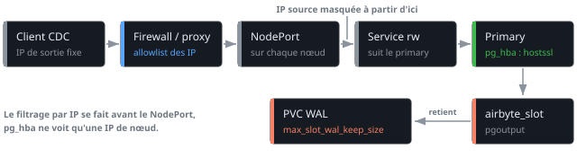
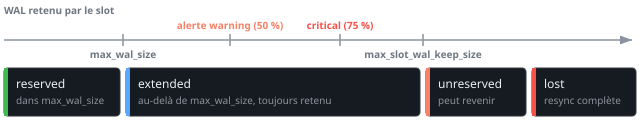

# CDC sur CloudNativePG : accès, rétention WAL et monitoring

Brancher un outil de CDC sur une base de prod, c'est ouvrir un port vers le primary et laisser un client externe décider de la quantité de WAL que la base garde sur disque. Un rôle trop large expose tout le flux de changements de la base, alors qu'un consumer qui s'arrête remplit le PVC WAL jusqu'au crash du primary.

Le montage qu'on fait tourner pour [Airbyte](https://airbyte.com/) sur un cluster [CloudNativePG](https://cloudnative-pg.io/) repose sur un rôle limité, une publication et un slot créés côté base, des règles `pg_hba` dans la spec du `Cluster`, un Service exposé, un plafond de WAL retenu et une alerte avant que le slot ne soit invalidé. La réplication physique entre les instances du cluster est un autre sujet, traité dans [PostgreSQL Replication](postgresql_replication.md).

Le chemin d'une connexion, du client jusqu'au WAL que son slot retient :



## Un rôle REPLICATION aux droits minimaux

Un client de CDC ouvre une connexion de réplication logique, son rôle doit donc porter l'attribut `REPLICATION`. Il lit ensuite les tables publiées pour le snapshot initial, donc `SELECT` sur ces tables et rien d'autre. Un rôle de ce type, déjà exposé à Internet, ne doit pas pouvoir créer de base, de rôle ni ouvrir plus de quelques connexions :

```sql
CREATE ROLE airbyte_repl LOGIN REPLICATION NOSUPERUSER NOCREATEDB NOCREATEROLE CONNECTION LIMIT 5;
GRANT CONNECT ON DATABASE appdb TO airbyte_repl;
GRANT USAGE ON SCHEMA public TO airbyte_repl;
GRANT SELECT ON TABLE public.orders, public.customers TO airbyte_repl;
```

Le `GRANT SELECT` cible les tables une par une. Un `GRANT SELECT ON ALL TABLES IN SCHEMA` ou un `ALTER DEFAULT PRIVILEGES` donnerait au rôle toutes les tables présentes et futures du schéma, publiées ou non.

### Ce que REPLICATION ouvre vraiment

Un audit automatique de notre MR a levé un point que le `GRANT SELECT` ciblé ne règle pas : l'attribut `REPLICATION` n'est pas borné par la publication. Un rôle qui le porte peut ouvrir une connexion `replication=database` et créer son propre slot logique avec n'importe quel plugin de décodage installé (`test_decoding` par exemple, selon l'image) et décoder ainsi les changements de toutes les tables de la base, plus seulement ceux de la publication. Il peut aussi créer des slots qui retiennent du WAL, jusqu'à `max_slot_wal_keep_size`.

Le client a besoin de l'attribut, on ne peut donc pas le retirer. Le risque se réduit ailleurs :

- le slot est créé par un superuser côté infra, le client n'a donc pas à en créer
- `CONNECTION LIMIT` et le mot de passe en `scram-sha-256` restent la barrière au niveau Postgres
- `pg_hba` n'autorise que `hostssl` sur la base voulue (section suivante)
- le filtrage par IP source se fait en amont, sur un firewall ou un proxy (la section sur l'exposition explique pourquoi `pg_hba` ne peut pas le faire)
- un certificat client (`hostssl ... cert`) à la place du mot de passe ajoute un second facteur

Le mot de passe passe par un Secret monté et un `ALTER ROLE` lu sur stdin, pas par un argument de commande qui finirait dans `ps` et dans l'historique. CloudNativePG sait aussi déclarer le rôle (`login`, `replication`, `connectionLimit`, `passwordSecret`) dans [`spec.managed.roles`](https://cloudnative-pg.io/docs/devel/declarative_role_management/), mais les `GRANT` restent à faire en SQL.

## Publier les tables et créer le slot

La publication liste les tables que le client a le droit de voir. Si une table partitionnée est listée, `publish_via_partition_root` fait émettre les changements sous le nom du parent, celui que l'outil de CDC connaît. Les partitions futures sont ainsi couvertes sans toucher à la publication :

```sql
CREATE PUBLICATION airbyte_pub FOR TABLE public.orders, public.customers WITH (publish_via_partition_root = true);
```

Pour changer la liste plus tard, `ALTER PUBLICATION airbyte_pub SET TABLE ...` remplace l'ensemble. Il faut refaire le `GRANT SELECT` en même temps. Dans notre Job idempotent, une seule liste (un fichier `tables.txt`) pilote le `GRANT` et la publication, pour que les deux ne divergent jamais.

Chaque table publiée a besoin d'une clé primaire ou de `REPLICA IDENTITY FULL`. Sans l'un des deux, PostgreSQL refuse les `UPDATE` et les `DELETE` sur la table dès qu'elle est publiée. Cette requête liste les tables publiées qui n'ont ni clé ni identité complète :

```sql
SELECT pt.schemaname || '.' || pt.tablename AS table_without_pk
FROM pg_publication_tables pt
JOIN pg_class c ON c.relname = pt.tablename
JOIN pg_namespace n ON n.oid = c.relnamespace AND n.nspname = pt.schemaname
WHERE pt.pubname = 'airbyte_pub'
  AND c.relreplident = 'd'
  AND NOT EXISTS (SELECT FROM pg_index i WHERE i.indrelid = c.oid AND i.indisprimary);
```

Le slot se crée côté infra, avec le plugin `pgoutput`, seulement quand l'équipe qui consomme est prête à démarrer la connexion. Un slot qui n'est lu par personne retient du WAL depuis sa création :

```sql
SELECT pg_create_logical_replication_slot('airbyte_slot', 'pgoutput')
WHERE NOT EXISTS (SELECT FROM pg_replication_slots WHERE slot_name = 'airbyte_slot');
```

Un slot logique est propre à la base dans laquelle on le crée, donc la commande se lance connectée à `appdb`. CloudNativePG règle `wal_level` sur `logical` par défaut (upstream PostgreSQL est sur `replica`), donc rien à changer côté paramètres pour décoder.

## Verrouiller la connexion avec pg_hba

CloudNativePG génère `pg_hba.conf` en 4 blocs dans cet ordre : les règles fixes de l'operator (`streaming_replica`, le pooler), les règles utilisateur de `spec.postgresql.pg_hba`, une section LDAP optionnelle, puis la règle par défaut `host all all all scram-sha-256`. Le premier match gagne, donc tout ce qu'on ne rejette pas explicitement retombe sur cette dernière ligne, qui accepte aussi le non-SSL.

Il faut donc 3 lignes pour le rôle de CDC :

```yaml
spec:
  postgresql:
    pg_hba:
      - hostnossl all airbyte_repl all reject
      - hostssl replication airbyte_repl all reject
      - hostssl appdb airbyte_repl all scram-sha-256
```

- la première ferme le non-SSL, sinon un login sans TLS tombe sur la règle par défaut
- la deuxième rejette la réplication physique : dans `pg_hba`, le mot-clé `replication` ne matche que les connexions physiques. Sans cette ligne un rôle `REPLICATION` pourrait lancer un `pg_basebackup` du cluster entier
- la troisième autorise la connexion logique, qui, elle, matche sur le nom de la base

Un `pg_hba` bien écrit ne remplace pas un filtrage réseau en amont. Pour une règle qui suit des pods du cluster, CloudNativePG sait (depuis la 1.29) résoudre des labels en IP avec `podSelectorRefs`, mais ça ne sert pas pour un client externe.

## Exposer le primary

Le client doit toujours atterrir sur le primary, y compris après un failover. CloudNativePG sait créer un Service additionnel dont le sélecteur suit le primary (`selectorType: rw`) via `spec.managed.services.additional` (depuis la 1.24), avec le type de Service de son choix :

```yaml
spec:
  managed:
    services:
      additional:
        - selectorType: rw
          serviceTemplate:
            metadata:
              name: my-db-cdc
            spec:
              type: NodePort
              externalTrafficPolicy: Cluster
              ports:
                - name: postgres
                  port: 5432
                  targetPort: 5432
                  nodePort: 30432
```

Notre cluster tourne en 1.19, qui n'a pas `managed.services` : on a écrit un Service à part, avec le sélecteur `cnpg.io/cluster: my-db-cluster` et `role: primary`. Le label `role` est déprécié au profit de `cnpg.io/instanceRole` (l'operator pose les deux), donc un Service neuf utilise le second. Un `LoadBalancer` fait la même chose quand le cloud en fournit un. Le NodePort reste le choix quand un proxy devant le cluster (HAProxy, par exemple) fait déjà le filtrage.

2 conséquences de ce choix :

- avec `externalTrafficPolicy: Cluster`, n'importe quel nœud accepte le trafic et kube-proxy le renvoie vers le primary. L'IP source est masquée, Postgres voit une IP de nœud et `pg_hba` ne peut pas filtrer par client. Le filtrage par IP se fait donc sur le proxy ou le firewall, qui n'accepte que les IP de sortie du client (un Cloud NAT, par exemple)
- le port ne doit pas être ouvert sans protection : TLS obligatoire dans `pg_hba`, firewall ou allowlist devant, avec si possible une `NetworkPolicy` qui limite le NodePort aux hôtes du proxy

## Plafonner le WAL retenu par le slot

Un slot retient tout le WAL dont son consumer n'a pas encore confirmé la lecture, y compris celui des tables qui ne sont pas publiées : le WAL est celui de la base entière. Avec la valeur par défaut `max_slot_wal_keep_size = -1`, la rétention est illimitée : un consumer arrêté remplit le PVC WAL jusqu'au crash du primary. La documentation de CloudNativePG recommande de toujours fixer ce paramètre dès qu'il y a des slots.

```yaml
spec:
  postgresql:
    parameters:
      max_slot_wal_keep_size: "15GB"
```

Une fois le plafond dépassé, PostgreSQL préfère invalider le slot plutôt que de saturer le disque. Le paramètre se recharge à chaud, sans restart des pods. Pour le vérifier après l'apply, `pending_restart` doit rester à `f` :

```console
$ kubectl -n my-namespace exec my-db-cluster-1 -c postgres -- \
    psql -c "SELECT name, setting, unit, pending_restart FROM pg_settings WHERE name = 'max_slot_wal_keep_size';"
          name          | setting | unit | pending_restart
------------------------+---------+------+-----------------
 max_slot_wal_keep_size | 15360   | MB   | f
```

Un `ALTER SYSTEM` ne ferait rien de propre ici : il écrit dans le `postgresql.auto.conf` de l'instance où on le lance seulement. Il masque ensuite le manifest sans qu'on le voie, alors que le manifest doit rester la source.

Le paramètre `wal_sender_timeout` mérite le même soin. CloudNativePG le règle à 5s par défaut (60s dans PostgreSQL upstream) pour couper les connexions de réplication inactives, y compris celles des standbys et du walsender du consumer CDC : un client lent qui se fait déconnecter en boucle ne rattrape jamais son retard. Les timeouts de session (`statement_timeout`, `idle_session_timeout`) se posent par rôle avec `ALTER ROLE ... SET`, jamais en global, pour ne pas couper le walsender, les dumps ou les backups.

## Un slot invalidé ne se répare pas

Le symptôme côté client est une sync qui échoue, avec ce message dans les logs Postgres :

```text
This slot has been invalidated because it exceeded the maximum reserved size.
```

Entre 2 syncs, le slot avait retenu plus de WAL que le plafond. Côté base, `wal_status` passe par 4 états : `reserved` (dans `max_wal_size`), `extended` (au-delà, mais retenu), `unreserved` (le WAL va être supprimé au prochain checkpoint, l'état peut encore revenir en arrière) et `lost`, où le slot est inutilisable. Les alertes plus bas se déclenchent bien avant ce dernier état :



Cette requête donne l'état et le volume retenu :

```sql
SELECT slot_name, active, wal_status,
       pg_size_pretty(pg_wal_lsn_diff(pg_current_wal_lsn(), restart_lsn)) AS retained
FROM pg_replication_slots;
```

`invalidation_reason` (valeurs `wal_removed`, `rows_removed`, ...) n'existe qu'à partir de PostgreSQL 17 : sur la 16, la requête qui le sélectionne échoue et `wal_status = 'lost'` reste le seul signal.

La réparation tient en 3 étapes : dropper le slot (`pg_drop_replication_slot`), le recréer, puis lancer une resync complète côté client, puisque les changements entre le dernier LSN lu et aujourd'hui sont perdus. Sans changement de configuration, ça recommence.

Le plafond sert de budget : le débit WAL multiplié par l'intervalle entre 2 syncs doit rester sous `max_slot_wal_keep_size`. Les leviers, par ordre de coût :

- raccourcir l'intervalle de sync côté client (gratuit)
- mesurer le débit réel avant de toucher au reste : `cnpg_collector_wal_bytes` (PostgreSQL 14+) est une valeur cumulée exposée par chaque instance (déclarée en gauge, mais qui ne fait que croître), donc `rate()` donne le débit WAL moyen
- passer `wal_compression` de `on` (pglz, la valeur par défaut upstream est `off`) à `lz4` ou `zstd` sur PostgreSQL 15+ : ça ne compresse que les full-page images, le gain dépend de leur part dans le WAL, que `cnpg_collector_wal_fpi` rapporte à `cnpg_collector_wal_records`
- agrandir le PVC WAL et le plafond ensemble (section sur le dimensionnement)

Baisser le plafond ou le passer à `-1` pour faire taire l'erreur retire la protection du primary.

## Surveiller le slot avant l'invalidation

Les métriques par défaut de CloudNativePG incluent la requête `pg_replication_slots`, qui expose `cnpg_pg_replication_slots_active` et `cnpg_pg_replication_slots_pg_wal_lsn_diff`, le retard du slot en octets depuis son `restart_lsn`, avec les labels `slot_name`, `slot_type` et `database`. C'est le WAL retenu qu'on veut. Le seuil se pose en fraction du plafond : 50% pour le warning, 75% pour le critique, avec un plafond de 40GB dans cet exemple.

```yaml
groups:
  - name: cnpg-cdc-slot
    rules:
      - alert: CNPGLogicalSlotRetainedWALHigh
        expr: cnpg_pg_replication_slots_pg_wal_lsn_diff{slot_type="logical"} > 0.5 * 40 * 1024^3
        for: 15m
        labels:
          severity: warning
        annotations:
          summary: "Logical slot {{ $labels.slot_name }} retains {{ $value | humanize1024 }}B of WAL"
          description: "The consumer is behind. Past max_slot_wal_keep_size the slot is invalidated and needs a full resync."
      - alert: CNPGLogicalSlotRetainedWALCritical
        expr: cnpg_pg_replication_slots_pg_wal_lsn_diff{slot_type="logical"} > 0.75 * 40 * 1024^3
        for: 5m
        labels:
          severity: critical
        annotations:
          summary: "Logical slot {{ $labels.slot_name }} is close to invalidation"
          description: "Retained WAL is past 75% of max_slot_wal_keep_size."
      - alert: CNPGLogicalSlotInactive
        expr: cnpg_pg_replication_slots_active{slot_type="logical"} == 0
        for: 30m
        labels:
          severity: warning
        annotations:
          summary: "Logical slot {{ $labels.slot_name }} has no consumer"
          description: "An inactive slot keeps retaining WAL."
```

Le seuil `40` est celui du plafond : si on le change, on change aussi l'alerte, sinon elle ne prévient plus à temps. Un slot inactif depuis moins d'une demi-heure est normal entre 2 syncs, d'où le `for: 30m`, à adapter à l'intervalle du client.

Ces métriques disent combien de WAL le slot retient, pas combien il en reste avant l'invalidation. Aucune ne porte `wal_status`. Une requête custom, déclarée dans une ConfigMap référencée par `spec.monitoring.customQueriesConfigMap`, expose le budget restant (`safe_wal_size`, `NULL` quand le plafond est à `-1` ou que le slot est perdu) ainsi que l'état `lost` :

```yaml
apiVersion: v1
kind: ConfigMap
metadata:
  name: my-db-cdc-monitoring
  namespace: my-namespace
  labels:
    cnpg.io/reload: ""
data:
  custom-queries: |
    pg_logical_slot_budget:
      query: |
        SELECT slot_name,
          COALESCE(safe_wal_size, -1) AS safe_wal_size_bytes,
          (wal_status = 'lost')::int AS lost
        FROM pg_catalog.pg_replication_slots
        WHERE slot_type = 'logical' AND NOT temporary
      metrics:
        - slot_name:
            usage: "LABEL"
            description: "Name of the replication slot"
        - safe_wal_size_bytes:
            usage: "GAUGE"
            description: "Bytes that can still be written before the slot is lost, -1 when unbounded or lost"
        - lost:
            usage: "GAUGE"
            description: "1 when wal_status is lost"
```

La ConfigMap vit dans le namespace du `Cluster`. Le label `cnpg.io/reload` évite un `kubectl cnpg reload` à chaque modification. Les séries s'appellent `cnpg_pg_logical_slot_budget_safe_wal_size_bytes` et `cnpg_pg_logical_slot_budget_lost`. Seule une alerte sur `lost == 1` signale un slot déjà mort :

```promql
cnpg_pg_logical_slot_budget_lost == 1
```

## Dimensionner le stockage WAL

Le PVC WAL doit contenir le WAL normal du cluster, plus ce que le slot peut retenir au maximum. Le plafond `max_slot_wal_keep_size` est donc la seule vraie borne : un PVC plus gros que lui est une marge, un PVC plus petit ne protège de rien. Chez nous, le slot a été invalidé avec 15GB de plafond sur un PVC WAL de 20Gi. On est passé à 40GB de plafond sur 50Gi, soit 10Gi gardés pour le WAL hors slot, avec un `wal_compression` laissé actif.

Sur un provisioner sans quota réel comme `local-path`, la taille déclarée du PVC n'est pas appliquée : data et WAL partagent le filesystem du nœud, donc c'est le `df` vu depuis chaque instance qui compte. Pour que 50Gi soit sûr, l'espace libre du nœud doit couvrir le WAL en plus, la croissance de la data jusqu'à sa taille cible et une marge de 10 à 15%. Cette boucle donne les 2 volumes de chaque instance :

```bash
for p in $(kubectl -n my-namespace get pod -l cnpg.io/cluster=my-db-cluster -o name); do
  echo "--- $p"
  kubectl -n my-namespace exec "$p" -c postgres -- df -h /var/lib/postgresql/data /var/lib/postgresql/wal
done
```

Agrandir un PVC existant demande `allowVolumeExpansion: true` sur la StorageClass, sinon l'API refuse le patch du PVC et CloudNativePG le retente à chaque reconcile. Ce champ se modifie sur une StorageClass existante avec un `kubectl patch`, contrairement à `reclaimPolicy`. Sur `local-path`, qui n'a pas de resizer, le PVC affichera la nouvelle taille demandée sans que la capacité change. Le détail d'un resize propre se trouve dans [Resize les PVC de son StatefulSet](../../kubernetes/troubleshooting/resize_pvc_statefulset.md).

## Failover : le slot ne suit pas toujours

Un slot logique vit sur le primary. Sur PostgreSQL 16 avec CloudNativePG 1.19, il n'est pas copié sur les standbys : tout failover ou switchover le fait disparaître. Le client doit alors refaire une synchronisation complète. On recrée le slot avec la même procédure qu'à l'installation, à relancer après chaque bascule.

CloudNativePG sait synchroniser les slots logiques sur les standbys depuis la 1.27, avec `spec.replicationSlots.highAvailability.synchronizeLogicalDecoding: true`. Sur PostgreSQL 17 et plus, il faut aussi `sync_replication_slots: "on"` et `hot_standby_feedback: "on"`. Le slot doit être marqué `failover` (colonne `failover` de `pg_replication_slots`, argument `failover` de `pg_create_logical_replication_slot`). La documentation décrit ce dernier point pour une `Subscription` CloudNativePG. On ne l'a pas testé avec un slot créé à la main pour Airbyte. Sur PostgreSQL 16 et moins, l'operator s'appuie sur l'extension `pg_failover_slots`. Ces options sont celles à regarder en premier si les resyncs après failover deviennent trop coûteux.
