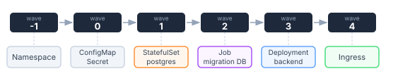

# ArgoCD : Sync Waves & Hooks

Par défaut ArgoCD applique tout d'un coup, dans un ordre fixé par le kind (Namespace, Secret et ConfigMap avant les Deployment, les custom resources en dernier), sans attendre que quoi que ce soit soit `Healthy`. En pratique ça pose problème : une custom resource appliquée avant que son operator soit prêt, un backend qui démarre avant que sa base réponde, une migration qui tourne pendant que l'appli reçoit du trafic...

2 solutions s'offrent ici à nous : on attend le retry d'ArgoCD ou on gère ça proprement avec les _waves_ et les _hooks_. Pour contrôler d'autres aspects du sync (comme `PruneLast` ou `ServerSideApply`), voir [Sync Options](sync_options.md).

## Sync Waves

ArgoCD applique wave par wave en ordre croissant et attend que tout soit `Healthy` avant de passer à la suivante, plus 2 secondes de délai entre 2 waves (réglable avec la variable d'environnement `ARGOCD_SYNC_WAVE_DELAY`). Au prune, c'est l'inverse : les waves les plus hautes sont supprimées en premier.

```yaml
metadata:
  annotations:
    argocd.argoproj.io/sync-wave: "5"
```

Wave par défaut : `0`. Les waves négatives passent avant les ressources sans annotation.

### Exemple : postgres avant le backend



```yaml
# namespace.yaml
metadata:
  annotations:
    argocd.argoproj.io/sync-wave: "-1"
---
# postgres-statefulset.yaml
metadata:
  annotations:
    argocd.argoproj.io/sync-wave: "1"
---
# migration-job.yaml
metadata:
  annotations:
    argocd.argoproj.io/sync-wave: "2"
spec:
  backoffLimit: 0
  template:
    spec:
      restartPolicy: Never
      containers:
        - name: migrate
          image: my-app:1.2.3
          command: ["./migrate", "--run"]
```

!!! danger "Blocage total du sync"
    Pour passer à la wave suivante, toutes les ressources de la wave courante doivent être
    `Healthy`. Si un StatefulSet reste en `Progressing`, tout le déploiement est gelé -
    l'app ne se met plus à jour jusqu'à intervention manuelle.

!!! warning "À utiliser avec parcimonie"
    Dans beaucoup de cas, les sync waves ne sont pas la bonne solution. Elles introduisent
    une dépendance d'ordre rigide difficile à maintenir et un seul composant unhealthy bloque
    tous les autres. Préférer les hooks (`PreSync`) pour les cas simples comme une migration DB
    et réserver les waves aux topologies vraiment complexes avec des dépendances fortes.

## Hooks

Des ressources (souvent des Jobs) qu'on branche sur des moments clés du sync : les phases. Les waves continuent de s'appliquer à l'intérieur de chaque phase (détail plus bas).

```yaml
metadata:
  annotations:
    argocd.argoproj.io/hook: PreSync
    argocd.argoproj.io/hook-delete-policy: HookSucceeded
```

### Types de hooks

| Hook | Quand |
|------|-------|
| `PreSync` | Avant le début du sync |
| `Sync` | Une fois les `PreSync` réussis, en même temps que les manifests (avec sa wave, `0` par défaut) |
| `PostSync` | Après que tout soit `Healthy` |
| `SyncFail` | Si le sync échoue |
| `PreDelete` | Avant la suppression des ressources, uniquement quand on supprime l'Application (pas sur un sync, même avec prune). Un échec bloque la suppression. Depuis ArgoCD 3.3 |
| `PostDelete` | Après la suppression de toutes les ressources de l'Application, pratique pour nettoyer des objets externes. Depuis ArgoCD 2.10 |
| `Skip` | Jamais appliqué |

### Politiques de suppression

| Politique | Comportement |
|-----------|-------------|
| `HookSucceeded` | Supprime si le hook réussit |
| `HookFailed` | Supprime si le hook échoue |
| `BeforeHookCreation` | Supprime l'ancienne instance avant re-création |

On combine généralement `HookSucceeded` + `BeforeHookCreation` pour les Jobs de migration.

### Migration DB en PreSync

```yaml
apiVersion: batch/v1
kind: Job
metadata:
  name: db-migrate
  annotations:
    argocd.argoproj.io/hook: PreSync
    argocd.argoproj.io/hook-delete-policy: BeforeHookCreation,HookSucceeded
spec:
  backoffLimit: 0
  template:
    spec:
      restartPolicy: Never
      containers:
        - name: migrate
          image: my-app:{{ .Values.image.tag }}
          command: ["python", "manage.py", "migrate", "--noinput"]
          env:
            - name: DATABASE_URL
              valueFrom:
                secretKeyRef:
                  name: my-app-secrets
                  key: database-url
```

### Smoke test en PostSync

```yaml
apiVersion: batch/v1
kind: Job
metadata:
  name: smoke-test
  annotations:
    argocd.argoproj.io/hook: PostSync
    argocd.argoproj.io/hook-delete-policy: HookSucceeded
spec:
  backoffLimit: 2
  template:
    spec:
      restartPolicy: OnFailure
      containers:
        - name: smoke
          image: curlimages/curl:latest
          command:
            - sh
            - -c
            - curl -f http://my-app.my-app.svc.cluster.local/health || exit 1
```

### Alerte en SyncFail

```yaml
apiVersion: batch/v1
kind: Job
metadata:
  name: notify-failure
  annotations:
    argocd.argoproj.io/hook: SyncFail
    argocd.argoproj.io/hook-delete-policy: HookFailed
spec:
  template:
    spec:
      restartPolicy: Never
      containers:
        - name: notify
          image: curlimages/curl:latest
          command:
            - sh
            - -c
            - |
              curl -X POST "$SLACK_WEBHOOK" \
                -H 'Content-type: application/json' \
                --data '{"text":"Sync failed on my-app!"}'
          env:
            - name: SLACK_WEBHOOK
              valueFrom:
                secretKeyRef:
                  name: slack-secrets
                  key: webhook-url
```

## Dans quel ordre ça se passe

ArgoCD trie d'abord par phase, puis par wave à l'intérieur de la phase, puis par kind, puis par nom. L'ordre des phases c'est toujours : PreSync → Sync (waves de -N à +N) → PostSync. Un `PreSync` s'exécute donc toujours avant la wave `-1` de la phase Sync.

Les hooks respectent quand même les waves dans leur phase : 2 Jobs `PreSync` se trient avec `sync-wave`, par exemple une migration en wave `-1` puis un seed en wave `0`. Un hook sans annotation est en wave `0`, comme le reste.

## Debug

L'état des hooks et des waves se lit dans l'Application elle-même :

```bash
# État des hooks du dernier sync
argocd app get my-app --show-operation

# Logs d'un Job hook
kubectl get jobs -n my-app
kubectl logs -n my-app job/db-migrate
```

## Voir aussi

- [Sync Options](sync_options.md) - `PruneLast`, `ServerSideApply` et autres comportements de sync
- [ApplicationSet](applicationset.md) - déployer la même app sur plusieurs clusters avec les waves
