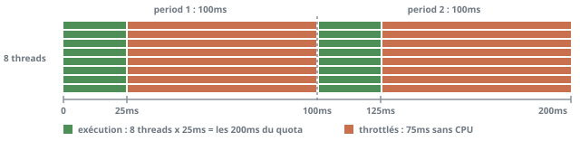
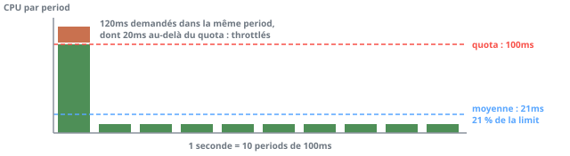

# CPU throttling sur Kubernetes : quota CFS, QPS et rightsizing

Un service a un P99 qui double aux heures de pointe alors que son CPU usage plafonne à 30% de la limit et qu'aucun dashboard n'a l'air anormal. Le coupable est souvent le throttling CFS, que la moyenne sur 5 minutes lisse jusqu'à le rendre invisible. Les compteurs du kernel le rendent visible, on retire la `limits.cpu` quand elle ne protège rien et on dimensionne les `requests` à partir de l'usage réel.

Le cas particulier de Go, où `GOMAXPROCS` fabrique du throttling tout seul, a [son propre article](gomaxprocs_gomemlimit_kubernetes.md).

## Le quota CFS : un budget de temps, pas des cœurs

Une `limits.cpu` n'est pas une réservation de cœurs, c'est un budget de temps CPU par fenêtre. Le kubelet l'écrit dans le cgroup du conteneur sous la forme d'un quota et d'une period : dans chaque period, le groupe reçoit au plus `quota` microsecondes de CPU, tous threads confondus. Le quota consommé, les threads du groupe sont stoppés jusqu'à la period suivante, même si le node est vide ([doc kernel sched-bwc](https://docs.kernel.org/scheduler/sched-bwc.html)).

Le kubelet convertit la limit en quota avec `quota = milliCPU * period / 1000`, plancher à 1ms ([`MilliCPUToQuota`](https://github.com/kubernetes/kubernetes/blob/master/pkg/kubelet/cm/helpers_linux.go)). La period vaut 100ms par défaut, donc :

- `limits.cpu: "1"` donne un quota de 100ms par period de 100ms
- `limits.cpu: "2"` donne 200ms, que 8 threads parallèles consomment en 25ms de temps réel
- `limits.cpu: 500m` donne 50ms

Avec `limits.cpu: "2"` et 8 threads runnable, chaque period se découpe ainsi :



Une limit de 2 CPU ne veut pas dire « 2 threads à pleine vitesse » mais « 200ms de CPU à dépenser en 100ms de temps réel ». Plus le process a de threads runnable en même temps, plus vite le budget part et plus longue est la pause qui suit.

Un cas y échappe : un pod `Guaranteed` dont le conteneur demande un nombre entier de CPU, sur un kubelet en `cpuManagerPolicy: static`. Ce conteneur reçoit des cœurs dédiés (cpuset), et depuis la 1.33 le kubelet ne lui pose plus de quota CFS (feature gate `DisableCPUQuotaWithExclusiveCPUs`, active par défaut). La policy par défaut est `none` : là, des `requests` égales aux `limits` ne réservent aucun cœur, le conteneur tourne sur tous les CPU du node et le quota s'applique.

La period est configurable par le kubelet (`cpuCFSQuotaPeriod`), derrière la feature gate `CustomCPUCFSQuotaPeriod` restée en alpha (désactivée par défaut) de la 1.12 à la 1.35 et passée en GA (stable, activée par défaut) en 1.36 (source : `kube_features.go`). Une period plus courte lisse le throttling mais augmente la comptabilité du kernel. On y touche rarement.

Les `requests.cpu` n'ont rien à voir avec le quota. Elles deviennent un poids : 1024 `cpu.shares` par CPU demandé en cgroup v1, converties en `cpu.weight` (de 1 à 10000) en v2. Ce poids ne joue que lorsque les CPU du node sont saturés : c'est un partage proportionnel en cas de contention, pas un plafond.

## Mesurer le throttling avec les compteurs du kernel

Le kernel expose 3 compteurs utiles dans `cpu.stat` du cgroup (`nr_periods`, `nr_throttled`, `throttled_usec` en cgroup v2, `throttled_time` en nanosecondes en v1). cAdvisor les republie sous forme de séries qu'on requête :

- `container_cpu_cfs_periods_total` : nombre de periods écoulées pour le conteneur
- `container_cpu_cfs_throttled_periods_total` : nombre de periods où il a été throttlé au moins une fois
- `container_cpu_cfs_throttled_seconds_total` : temps cumulé passé throttlé

Un conteneur sans `limits.cpu` n'a pas de quota et cAdvisor n'émet alors aucune de ces 3 séries (la condition `Quota != 0` est dans le code de [`prometheus.go`](https://github.com/google/cadvisor/blob/master/lib/metrics/prometheus.go)). Un graphe vide ne veut donc pas dire « pas de throttling » mais « pas de limit ».

Avec kube-prometheus-stack, `container_cpu_cfs_throttled_seconds_total` manque même quand la limit est là : le chart la jette dans ses `cAdvisorMetricRelabelings` par défaut, avec 3 autres séries CPU. Helm ne fusionne pas les listes, donc pour la garder on recopie toute la liste du chart dans ses values et on retire la série du drop :

```yaml
kubelet:
  serviceMonitor:
    cAdvisorMetricRelabelings:
      # Same drop as the chart default, without cfs_throttled_seconds_total
      - sourceLabels: [__name__]
        action: drop
        regex: 'container_cpu_(load_average_10s|system_seconds_total|user_seconds_total)'
      # Copy the rest of the chart default list here
```

Ça ajoute une série par conteneur limité. Pour borner la cardinalité, on peut aussi ne la garder que sur certains namespaces, avec une règle sur `[__name__, namespace]`.

2 détails du kernel changent la lecture des chiffres :

- `nr_periods` n'avance que quand le groupe consomme : le timer de period est désarmé quand le groupe est idle (`kernel/sched/fair.c`). Le ratio est donc calculé sur les periods actives, pas sur le temps écoulé.
- `throttled_time` s'additionne par run queue, donc par CPU. Un conteneur de 8 threads répartis sur 8 CPU et throttlés pendant 75ms accumule jusqu'à 600ms de `throttled_seconds` sur 75ms de temps réel : `rate(container_cpu_cfs_throttled_seconds_total[5m])` peut donc dépasser 1.

## La moyenne masque le throttling

`container_cpu_usage_seconds_total` est un compteur de temps CPU consommé. Son `rate` sur 5 minutes est une moyenne sur 3000 periods de 100ms, alors que le throttling se joue à l'intérieur d'une seule.

Prenons un exemple chiffré (arithmétique, pas une mesure) : un service avec `limits.cpu: "1"` (quota de 100ms) traite en moyenne 1 requête lourde par seconde, qui occupe 4 threads pendant 30ms chacun, soit 120ms de CPU dans une même period. Les 9 autres periods de la seconde consomment 10ms chacune.

- usage moyen : (120 + 9 x 10) / 1000 = 0,21 CPU, soit 21% de la limit
- le quota de 100ms est épuisé au bout de 25ms de temps réel (4 threads en parallèle), les 20ms de CPU restants attendent la period suivante
- cette requête subit donc environ 75ms de latence ajoutée, pour 10% de periods throttlées

Sur la seconde complète, une seule period dépasse le quota, et la moyenne l'écrase :



Le P50 reste normal, le P99 dérive et le dashboard CPU affiche 21%. L'usage moyen reste sous la limit tant que les bursts sont rares, mais chacun d'eux se heurte au quota.

Le même écart se mesure en prod. Un Prometheus avec `limits.cpu: "4"`, sur 7 jours : 30 % de la limit en usage médian, 41 % au plus haut, et pourtant 11 % de periods throttlées en médiane, 14 % au p90.

### Le throttling décolle avec le QPS

L'usage CPU suit le QPS à peu près linéairement, le throttling non : il apparaît quand la demande dans une seule period dépasse le quota. Plus le QPS monte, plus les requêtes se chevauchent et plus le nombre de threads runnable simultanément augmente. Le ratio de throttling reste proche de 0 jusqu'à un seuil de QPS puis décolle, alors que l'usage moyen n'a pas encore atteint la limit.

Ce coude ne se voit que si la charge varie assez. Sur un collector OpenTelemetry limité à 1 CPU, dont la charge oscille entre 3 400 et 6 200 spans/s sur la journée (1,8x), le throttling est déjà à 4 % des periods à 12 % de la limit et monte à 5,5 % au pic, au même rythme que l'usage. Sur une plage aussi étroite, pas de décollage, il faut un service dont le QPS varie bien plus.

Pour le voir, on superpose les 3 séries sur le même panel : le QPS, le CPU usage rapporté à la limit et le ratio de throttling. La requête de QPS dépend de l'instrumentation de l'app, `http_requests_total` est ici un exemple :

```promql
sum(rate(http_requests_total{namespace="my-namespace", app="my-app"}[1m]))
```

Le CPU usage en fraction de la limit, avec les `limits` lues dans kube-state-metrics :

```promql
sum by (pod, container) (rate(container_cpu_usage_seconds_total{namespace="my-namespace", container="my-app"}[1m]))
/
sum by (pod, container) (kube_pod_container_resource_limits{namespace="my-namespace", container="my-app", resource="cpu"})
```

Si le ratio de throttling commence à monter à un QPS où le CPU usage n'est qu'à 40 ou 50% de la limit, le goulot est la limit, pas le CPU.

## Lire le ratio sans se tromper

Le ratio de periods throttlées, sur une fenêtre assez courte pour voir les pics :

```promql
sum by (pod, container) (increase(container_cpu_cfs_throttled_periods_total{namespace="my-namespace", container="my-app"}[5m]))
/
sum by (pod, container) (increase(container_cpu_cfs_periods_total{namespace="my-namespace", container="my-app"}[5m]))
```

Le ratio se lit avec 4 précautions :

- il mesure la fraction de periods touchées, pas le temps perdu : 10% de periods throttlées peut être 1ms par period ou 90ms
- pour le temps perdu, on regarde `rate(container_cpu_cfs_throttled_seconds_total[5m])` en se rappelant qu'il se somme par CPU
- il faut le lire par pod et pas agrégé sur le déploiement : un seul pod chaud noyé dans 50 autres disparaît de la moyenne
- il se corrèle avec la latence (P99 de l'app) et le QPS, jamais seul : un batch qui consomme tout son quota est throttlé 100% du temps, ce qui est son fonctionnement normal

Pour l'alerting, l'alerte `CPUThrottlingHigh` de kube-prometheus se déclenche à plus de 25% de periods throttlées pendant 15 minutes, en severity `info` ([`resource_alerts.libsonnet`](https://github.com/kubernetes-monitoring/kubernetes-mixin/blob/master/alerts/resource_alerts.libsonnet) dans kubernetes-mixin). Un service sensible à la latence mérite un seuil plus bas et un `for` plus court, à ajuster sur son propre historique.

## Retirer les limits CPU et garder les requests

Une `limits.cpu` plafonne le service même quand le node est à 20% de charge. Pour un service sensible à la latence, c'est du CPU gratuit refusé. Sans limit, le pod peut utiliser tous les CPU libres du node et ses `requests` garantissent sa part en cas de contention, puisque le poids `cpu.shares` ou `cpu.weight` reste en place.

Retirer la limit est un bon choix dans ces cas :

- le service est latency-sensitive et burste (API, proxy, bidder)
- les `requests` sont calées sur l'usage réel, donc le scheduler ne sur-remplit pas les nodes
- les nodes sont dédiés ou le voisinage est maîtrisé

Les limits restent justifiées dans d'autres cas :

- namespaces multi-tenant, où un workload ne doit pas manger le voisin
- batch et CI, dont on veut borner l'impact
- environnements où une `LimitRange` ou une `ResourceQuota` les impose
- besoin d'une QoS `Guaranteed`, qui exige `requests` égales aux `limits` pour chaque ressource

Avant de retirer une limit, il faut savoir ce qu'on perd :

- un pod `Guaranteed` passe en `Burstable`. Le kubelet ne classe pas ses évictions par QoS, mais l'`oom_score_adj` du conteneur passe de -997 à une valeur calculée sur ses `requests` mémoire, donc le OOM killer du kernel le vise avant les `Guaranteed`
- les 3 séries `container_cpu_cfs_*` disparaissent, avec elles l'alerte de throttling : la saturation se lit alors sur le CPU usage rapporté aux `requests` et sur la latence de l'app
- un runtime qui dimensionne son parallélisme sur les limits (Go 1.25+ ou `automaxprocs` avant) retombe sur le nombre de CPU du node, voir l'[article GOMAXPROCS](gomaxprocs_gomemlimit_kubernetes.md)

La mémoire n'est pas concernée : une `limits.memory` reste nécessaire, un dépassement mémoire se termine en OOM kill alors qu'un dépassement CPU ne fait que ralentir.

## Rightsizer les requests depuis l'usage

Sans limit, les `requests` deviennent le seul réglage : trop basses, le scheduler empile trop de pods sur un node et la contention remplace le throttling. Trop hautes, on paie des CPU que personne n'utilise. On part de l'usage observé, sur une fenêtre qui couvre au moins un cycle complet de charge (une semaine pour un service avec un pic quotidien et un creux de week-end).

kube-prometheus fournit la règle `node_namespace_pod_container:container_cpu_usage_seconds_total:sum_rate5m`, qui évite de recalculer le `rate` à chaque requête. On en tire des percentiles par conteneur :

```promql
quantile_over_time(0.95, node_namespace_pod_container:container_cpu_usage_seconds_total:sum_rate5m{namespace="my-namespace", container="my-app"}[7d])
```

La même chose avec `0.5` et `0.99` donne la forme de la distribution. Les `requests` actuelles se lisent avec `kube_pod_container_resource_requests{resource="cpu"}`.

Valeurs de départ, à ajuster selon la criticité du service :

- `requests.cpu` proche du P90 ou P95 de l'usage par pod : en dessous, le service passe régulièrement en contention, au-dessus on gaspille
- une marge de 10 à 20% sur ce percentile pour absorber la croissance
- si une `limits.cpu` est conservée, elle se cale sur le pic observé (P99.9 ou max) avec de la marge, pas sur la moyenne, avec le ratio de throttling sous surveillance
- on regarde l'usage par pod et pas la somme du déploiement : avec un HPA, la somme grimpe et redescend avec le nombre de replicas alors que ce qu'on dimensionne est un pod

Les fenêtres de 5 minutes lissent encore les bursts de quelques centaines de millisecondes. Pour un service très bursty, un `rate` sur 1m ou un `irate` (la règle `sum_irate` existe aussi) donne un percentile plus honnête, au prix de séries plus bruitées.

On vérifie ensuite l'effet du changement : après avoir baissé des `requests` ou retiré une limit, on compare sur 24h le ratio de throttling (s'il existe encore), la latence P99 et le nombre de replicas HPA avant et après.

## Voir aussi

- [GOMAXPROCS et GOMEMLIMIT dans Kubernetes](gomaxprocs_gomemlimit_kubernetes.md) : le throttling fabriqué par un runtime qui voit tous les CPU du node
- [Documentation kernel du CFS bandwidth control](https://docs.kernel.org/scheduler/sched-bwc.html) : quota, period, `cpu.stat` et cas limites
