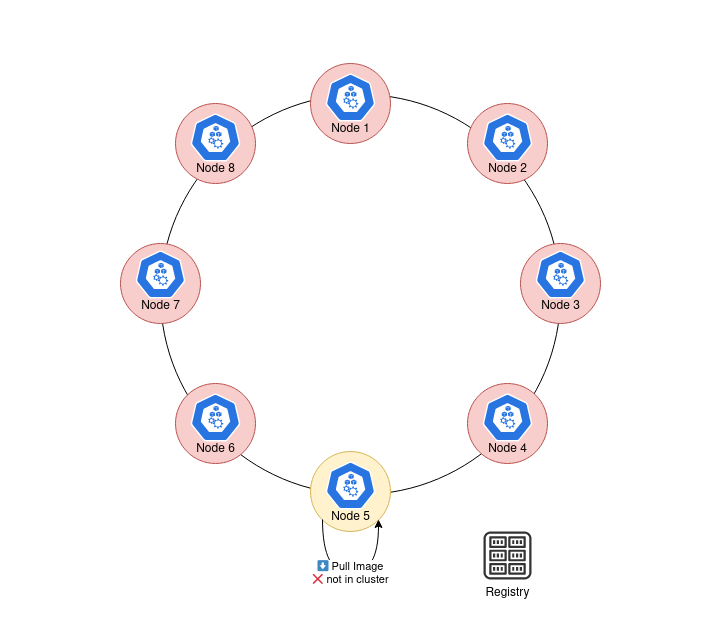

# Spegel : Un OCI registry cache stateless

Dans les clusters Kubernetes, chaque nœud pull les images depuis des registres distants - ce qui surcharge ces registres et peut déclencher des rate limits (notamment sur DockerHub). **Spegel** est un proxy de cache d'images local qui vise à résoudre ce problème en accélérant la distribution des images.

!!! warning "Containerd uniquement"
    Spegel ne prend en charge que **Containerd**, pas Docker.

## Principe de fonctionnement

Spegel est déployé sur chaque nœud en daemonset. Contrairement à un pull-through cache classique, il ne stocke rien en plus : il expose les layers déjà présents dans le content store de Containerd. La vraie valeur ajoutée est le **P2P** : les nœuds se partagent les images entre eux au lieu de retaper systématiquement sur le registre distant.

Chaque nœud monte un réseau P2P avec libp2p et une DHT Kademlia et annonce les digests qu'il possède localement. Quand un nœud tente de tirer une image :



1. La requête est redirigée vers Spegel via le mécanisme de *Registry Mirror* de Containerd.
2. Spegel cherche le layer dans la DHT. Si un autre nœud du cluster l'a déjà, il le récupère directement depuis ce peer, sans sortir du cluster.
3. Si personne ne l'a, fallback transparent vers le registre distant. Le layer devient ensuite disponible pour les autres nœuds.

Le partage est donc intra-cluster : le premier pull d'une image neuve tape toujours l'upstream, mais les nœuds suivants se servent entre eux. Il n'y a pas de pré-seeding.

## Compatibilité

Spegel requiert certains paramètres spécifiques de Containerd (`config_path` et `discard_unpacked_layers`). Depuis la v0.8, il exige aussi **Containerd 2.2 ou plus récent** (sur un Containerd plus vieux, on reste sur une version antérieure du chart), et à partir de Containerd 2.4 il vérifie les 2 paramètres au démarrage : s'ils ne vont pas, il sort en erreur.

Aucune distribution n'est incompatible d'après le tableau officiel, mais beaucoup demandent de la configuration en plus :

- AKS, DigitalOcean, Minikube, Kapsule : ça marche out of the box
- EKS : `discard_unpacked_layers` est activé par défaut sur AL2023, on le désactive via la config nodeadm (cf. plus bas)
- GKE : `discard_unpacked_layers` est aussi activé par défaut, ça passe par un startup script au niveau projet plus un registry host bidon pour forcer la nouvelle config de mirror
- Talos : patch machine config, `containerdRegistryConfigPath: /etc/cri/conf.d/hosts` dans les values, et le namespace `spegel` labellisé `pod-security.kubernetes.io/enforce=privileged`
- K3s/RKE2, k0s, Kind : configuration spécifique aussi

Le détail par distribution est sur le [site officiel](https://spegel.dev/docs/getting-started/#compatibility).

## Installation

Spegel s'installe avec son chart Helm, ou par Kustomize quand le déploiement passe par ArgoCD ou FluxCD :

=== "Helm chart"
    ```bash
    helm upgrade --create-namespace --namespace spegel --install spegel oci://ghcr.io/spegel-org/helm-charts/spegel
    ```

=== "Kustomize"
    ```yaml
    helmCharts:
      - name: spegel
        repo: oci://ghcr.io/spegel-org/helm-charts
        releaseName: spegel
        namespace: spegel
        valuesFile: values.yaml
    ```

Par défaut, le `values.yaml` ne nécessite quasiment aucune modification hormis l'activation du serviceMonitor si on dispose de la CRD.

## Configuration de Containerd

Spegel a besoin de 2 paramètres dans `/etc/containerd/config.toml` : activer `config_path` pour que Containerd lise les configs de mirror par registre (c'est ce qui permet de rediriger les pulls vers Spegel), et désactiver `discard_unpacked_layers` (par défaut à `true` sur certaines distros), sinon Containerd jette les layers compressés après unpack et Spegel n'a plus rien à partager.

Avec Containerd 2.x et une config `version = 3`, les 2 paramètres vivent sous le plugin `io.containerd.cri.v1.images` :

```toml
version = 3

[plugins."io.containerd.cri.v1.images".registry]
  config_path = "/etc/containerd/certs.d"
[plugins."io.containerd.cri.v1.images"]
  discard_unpacked_layers = false
```

Un fichier encore en `version = 2` (format Containerd 1.x, toujours accepté et migré par Containerd 2.x) garde l'ancien nom de plugin `io.containerd.grpc.v1.cri` :

```toml
version = 2

[plugins."io.containerd.grpc.v1.cri".registry]
  config_path = "/etc/containerd/certs.d"
[plugins."io.containerd.grpc.v1.cri".containerd]
  discard_unpacked_layers = false
```

Mélanger les 2 ne marche pas : une clé `grpc.v1.cri` dans un fichier `version = 3` est ignorée, avec juste un warning `Ignoring unknown key in TOML` dans les logs de Containerd. Sur un Containerd 2.x vanilla, les défauts conviennent déjà (`config_path = '/etc/containerd/certs.d:/etc/docker/certs.d'`, `discard_unpacked_layers = false`) : ce sont les distros qui les changent. On vérifie la config effective avec `containerd config dump`.

### Pour EKS

Sur les AMI AL2023, `discard_unpacked_layers` est activé par défaut. On le désactive dans la `NodeConfig` nodeadm passée en user data (partie MIME `application/node.eks.aws`), ce qui survit au remplacement des nœuds :

```yaml
apiVersion: node.eks.aws/v1alpha1
kind: NodeConfig
spec:
  containerd:
    config: |
      [plugins."io.containerd.cri.v1.images".registry]
        config_path = "/etc/containerd/certs.d"
      [plugins."io.containerd.cri.v1.images"]
        discard_unpacked_layers = false
```

Pour tester à la main sur un nœud existant, un `sed` suffit, mais il saute au prochain remplacement du nœud :

```bash
grep "discard_unpacked_layers" /etc/containerd/config.toml && \
sudo cp /etc/containerd/config.toml /etc/containerd/config.toml.bak && \
sudo sed -i 's/^\(\s*\)discard_unpacked_layers\s*=\s*true/\1discard_unpacked_layers = false/' /etc/containerd/config.toml && \
grep "discard_unpacked_layers" /etc/containerd/config.toml && \
sudo systemctl restart containerd
```

## Test de fonctionnement

Le fallback vers l'upstream est silencieux : si Spegel ne sert rien, les pulls passent quand même. Pour vérifier, on pull la même image sur 2 nœuds différents, le 2ème doit être servi par le premier. On repère d'abord 2 pods Spegel et leur nœud :

```bash
UPSTREAM_POD=$(kubectl -n spegel get pods -l app.kubernetes.io/name=spegel -o custom-columns=:metadata.name --no-headers | shuf -n 1)
UPSTREAM_NODE=$(kubectl -n spegel get pod "$UPSTREAM_POD" -o jsonpath='{.spec.nodeName}')
MIRROR_POD=$(kubectl -n spegel get pods -l app.kubernetes.io/name=spegel -o custom-columns=:metadata.name --no-headers | grep -v "^${UPSTREAM_POD}$" | shuf -n 1)
MIRROR_NODE=$(kubectl -n spegel get pod "$MIRROR_POD" -o jsonpath='{.spec.nodeName}')
```

Puis on lance un pod sur chaque nœud, le premier avant le second :

```bash
kubectl run upstream --image=ubuntu:25.04 --restart=Never --overrides="{\"spec\":{\"nodeName\":\"${UPSTREAM_NODE}\",\"containers\":[{\"name\":\"ubuntu\",\"image\":\"ubuntu:25.04\",\"imagePullPolicy\":\"Always\",\"command\":[\"true\"]}]}}"
kubectl run mirror --image=ubuntu:25.04 --restart=Never --overrides="{\"spec\":{\"nodeName\":\"${MIRROR_NODE}\",\"containers\":[{\"name\":\"ubuntu\",\"image\":\"ubuntu:25.04\",\"imagePullPolicy\":\"Always\",\"command\":[\"true\"]}]}}"
kubectl delete pod upstream mirror
```

Spegel expose une page de debug (activée par défaut, `spegel.debugWebEnabled`). On fait un port-forward vers le pod Spegel du 2ème nœud :

```bash
kubectl -n spegel port-forward "$MIRROR_POD" 9090
```

Sur <http://localhost:9090/debug/web>, la case `Last Mirror Success` doit afficher une durée. `Pending` veut dire que le pull n'est jamais passé par Spegel : la config Containerd n'est pas bonne.

## Voir aussi

- [Docker derrière un proxy](../../containers/docker/use_proxy.md) - l'autre façon de ne pas retélécharger la même image
- [ValidatingAdmissionPolicy](validating_admission_policy.md) - restreindre les registries autorisées à l'admission
- [GoReleaser](../../ci-cd/github/goreleaser.md) - le bout de chaîne qui pousse les images que Spegel va cacher
- [Kubernetes : Commandes Avancées](../cli/advanced_commands.md) - inspecter ce que containerd a réellement en local
