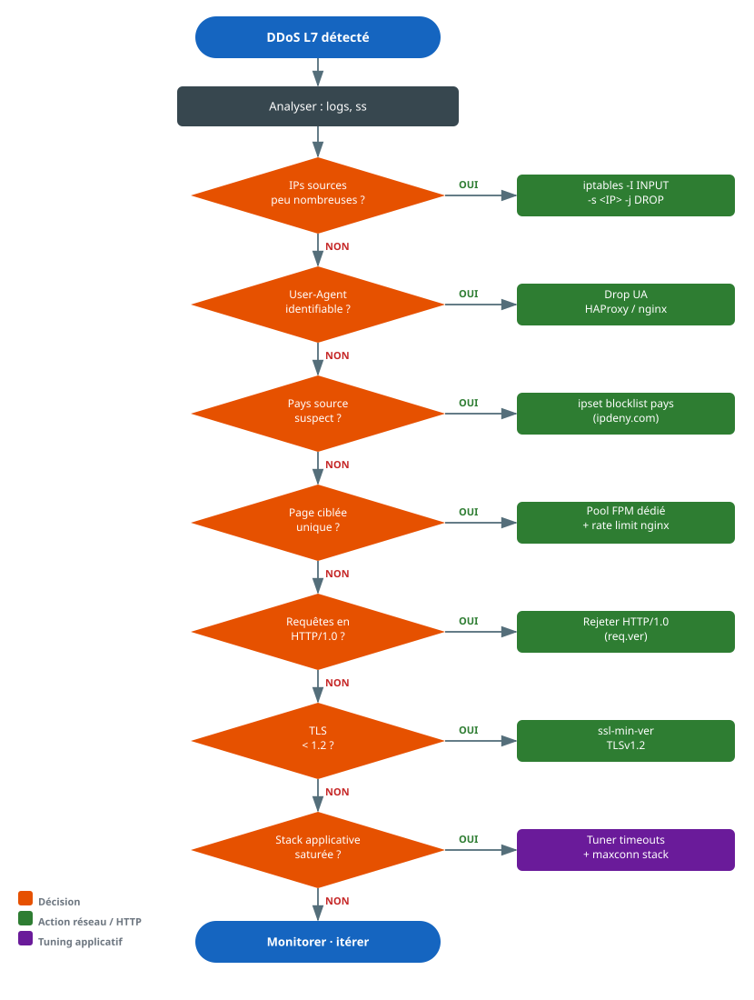

# Mitigation DDoS L7

Un DDoS Layer 7 cible la couche applicative (HTTP/HTTPS) plutôt que la
bande passante réseau. L'objectif est d'épuiser les ressources applicatives :
workers PHP-FPM, connexions HAProxy, `worker_connections` nginx.

On déroule l'arbre dans l'ordre, chaque OUI renvoie à sa section plus bas :



---

<div class="steps" markdown>

## Identifier l'attaque

Avant de bloquer quoi que ce soit, caractériser le trafic malveillant. Le `sed` retire le port en fin d'adresse, ce qui marche aussi en IPv6 (un `cut -d:` ne garderait que le premier groupe) :

```bash
# Top des IPs sources
ss -tn | awk 'NR>1 {print $5}' | sed 's/:[0-9]*$//' | sort | uniq -c | sort -rn | head -20

# Connexions par état : sans -a, ss masque SYN-RECV et TIME-WAIT, justement ceux qui gonflent pendant un flood
ss -tan | awk 'NR>1 {print $1}' | sort | uniq -c

# Top des IPs sur les 10 000 dernières requêtes (tail -f ne finit jamais, sort n'afficherait rien)
tail -n 10000 /var/log/nginx/access.log | awk '{print $1}' | sort | uniq -c | sort -rn | head -20

# Top des User-Agents (format combined : l'UA est le 6e champ entre guillemets)
awk -F'"' '{print $6}' /var/log/nginx/access.log | sort | uniq -c | sort -rn | head -20

# Top des URLs ciblées
awk '{print $7}' /var/log/nginx/access.log | sort | uniq -c | sort -rn | head -20
```

Pour les pays, on passe par une base GeoLite2 (paquets `mmdb-bin` et `geoipupdate`, compte MaxMind gratuit). On déduplique les IPs **avant** : un `mmdblookup` par ligne de log, sur un access.log d'attaque, ne finit pas. La base GeoIP legacy de `geoiplookup` n'est plus mise à jour. Le dossier de la base est le `DatabaseDirectory` de `/etc/GeoIP.conf`.

```bash
tail -n 100000 /var/log/nginx/access.log | awk '{print $1}' | sort | uniq -c | sort -rn | head -500 |
while read -r n ip; do
    cc=$(mmdblookup --file <geoip_db> --ip "$ip" country iso_code 2>/dev/null | awk -F'"' 'NF>1 {print $2}')
    echo "$n ${cc:-??}"
done | awk '{c[$2]+=$1} END {for (k in c) print c[k], k}' | sort -rn | head -10
```

---

## Blocage réseau rapide

### Bloquer une IP ou un range

```bash
# Bloquer une IP immédiatement
iptables -I INPUT -s 1.2.3.4 -j DROP

# Bloquer un range CIDR
iptables -I INPUT -s 1.2.3.0/24 -j DROP

# Vérifier
iptables -L INPUT -n --line-numbers | head -20
```

### Blocage par pays avec ipset

On charge la zone en une seule commande `ipset restore` plutôt qu'avec une boucle de `ipset add`, un process par range :

```bash
# Ranges du pays (ex: CN) via ipdeny.com
wget -q https://www.ipdeny.com/ipblocks/data/countries/cn.zone -O /tmp/cn.zone

# Créer le set et le remplir en une fois (-exist : relançable sans erreur)
{ echo "create blocklist hash:net -exist"; sed 's/^/add blocklist /; s/$/ -exist/' /tmp/cn.zone; } | ipset restore

# Appliquer le blocage
iptables -I INPUT -m set --match-set blocklist src -j DROP
```

Voir [ipset](../security/ipset.md) pour la gestion persistante des sets. Sur une distrib récente, `iptables` passe déjà par nftables : un set nftables natif fait la même chose sans ipset.

---

## Filtrage HAProxy

HAProxy est la première couche applicative : c'est là qu'on filtre le plus
efficacement avec le moins d'impact sur les workers backend.

### Rate limiting par IP

```haproxy
frontend http_front
    # Tracker les connexions par IP (table de 100k entrées, expiration 30s)
    stick-table type ip size 100k expire 30s store conn_cur,conn_rate(10s),http_req_rate(10s)
    tcp-request connection track-sc0 src

    # Bloquer si > 50 connexions simultanées par IP
    acl too_many_conn sc_conn_cur(0) gt 50
    tcp-request connection reject if too_many_conn

    # Bloquer si > 100 req/10s
    acl too_many_req sc_http_req_rate(0) gt 100
    http-request deny deny_status 429 if too_many_req
```

Derrière un CDN ou un load balancer, `src` est l'IP du proxy : tous les clients partagent le même compteur et on se bloque soi-même. On tracke alors l'IP client du header, ajoutée en dernier par le proxy de confiance, avec `http-request track-sc0 req.hdr_ip(X-Forwarded-For,-1)` à la place du `tcp-request connection track-sc0 src` (et la règle `conn_cur` saute, elle reste par IP de proxy).

### Filtrage User-Agent

`hdr_len(User-Agent) eq 0` ne matche qu'un header présent mais vide : un header absent ne donne aucun échantillon et passe. On teste l'absence avec `req.hdr_cnt` :

```haproxy
frontend http_front
    acl bad_ua hdr_sub(User-Agent) -i python-requests curl libwww-perl
    acl no_ua req.hdr_cnt(User-Agent) eq 0
    acl empty_ua hdr_len(User-Agent) eq 0
    http-request deny if bad_ua or no_ua or empty_ua
```

### Rejeter HTTP/1.0 et le vieux TLS

Forcer HTTP/2 n'est pas réaliste : `alpn h2,http/1.1` propose h2 mais accepte HTTP/1.1, et plein de clients légitimes (sondes, API, crawlers) parlent encore 1.1. HTTP/1.0 par contre n'est presque plus utilisé que par des scripts, on peut le refuser.

Pour TLS, pas d'ACL : le protocole n'est connu qu'après le handshake, donc pas en `tcp-request connection`. On le fixe sur le `bind` avec `ssl-min-ver`, qui vaut déjà `TLSv1.2` par défaut depuis HAProxy 2.2 : la ligne sert surtout à écraser un ancien `ssl-default-bind-options` plus permissif.

```haproxy
frontend https_front
    bind *:443 ssl crt /etc/ssl/certs/site.pem alpn h2,http/1.1 ssl-min-ver TLSv1.2

    http-request deny if { req.ver 1.0 }
```

### Tuning maxconn et timeouts

```haproxy
defaults
    maxconn 10000
    timeout connect 3s
    timeout client  10s    # réduire pour libérer vite les connexions pendantes
    timeout server  30s

frontend http_front
    maxconn 5000           # limite globale du frontend
```

---

## Filtrage nginx

### Rate limiting

`limit_req_status` ne change que le code de `limit_req`. `limit_conn` répond 503 par défaut, il a son propre `limit_conn_status` :

```nginx
# Dans http {}
limit_req_zone $binary_remote_addr zone=req_limit:10m rate=30r/m;
limit_conn_zone $binary_remote_addr zone=conn_limit:10m;

# Dans server {} ou location {}
location /login {
    limit_req zone=req_limit burst=5 nodelay;
    limit_req_status 429;
    limit_conn conn_limit 10;
    limit_conn_status 429;
}
```

Même piège que HAProxy derrière un CDN : `$binary_remote_addr` est l'IP du proxy tant que `set_real_ip_from` et `real_ip_header` ne sont pas configurés.

### Pool FPM dédié pour les pages sensibles

Si l'attaque cible `/login` ou `/api` : isoler avec un pool PHP-FPM distinct
pour ne pas saturer le pool principal.

```nginx
location /login {
    fastcgi_pass unix:/run/php/php-fpm-login.sock;
    include fastcgi_params;
}
```

Les commentaires d'un pool PHP-FPM commencent par `;`, sur leur propre ligne :

```ini title="/etc/php/8.x/fpm/pool.d/login.conf"
[login]
user = www-data
group = www-data
listen = /run/php/php-fpm-login.sock
listen.owner = www-data
listen.group = www-data
; limiter volontairement
pm = static
pm.max_children = 10
```

### Bloquer User-Agent et requêtes vides

Une variable absente vaut une chaîne vide pour nginx : `""` couvre à la fois un User-Agent vide et pas de User-Agent du tout.

```nginx
# Dans http {}
map $http_user_agent $bad_agent {
    default         0;
    ~*python        1;
    ~*libwww        1;
    ""              1;
}

server {
    if ($bad_agent) { return 444; }  # 444 = ferme la connexion sans réponse
}
```

### TLS récent

`ssl_protocols TLSv1.2 TLSv1.3` est déjà le défaut depuis nginx 1.27.3, la ligne compte sur une version plus ancienne. `ssl_ciphers` ne concerne que TLS 1.2, les suites TLS 1.3 ne se règlent pas là :

```nginx
ssl_protocols TLSv1.2 TLSv1.3;
ssl_ciphers ECDHE-ECDSA-AES128-GCM-SHA256:ECDHE-RSA-AES128-GCM-SHA256;
ssl_prefer_server_ciphers off;
```

---

## Tuning PHP-FPM

Quand `pm.max_children` est atteint, PHP-FPM ne rejette rien : les requêtes s'empilent dans le backlog du socket (`listen.backlog`) et nginx finit en timeout ou en 502. Baisser `max_children` protège le CPU et la RAM du serveur, pas la latence. C'est le `request_terminate_timeout` court qui libère les workers coincés :

```ini
pm = dynamic
pm.max_children = 50
pm.start_servers = 10
pm.min_spare_servers = 5
pm.max_spare_servers = 15
; recycler les workers régulièrement
pm.max_requests = 500

; timeout court pour libérer les workers bloqués
request_terminate_timeout = 10s
```

</div>
