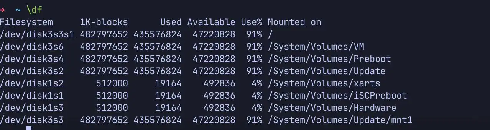
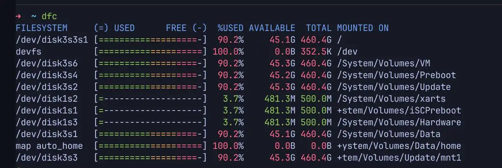

# DFC, la commande DF en plus

## Présentation

**dfc** est un petit utilitaire rendant la commande **df** dépassée. En
effet, dfc est beaucoup plus clair que la commande df et supporte
également les couleurs.

Comme des images sont plus représentatives, voilà les deux commandes :

**df :**



**dfc :**



Comme vous pouvez, le voir, le résultat est quasiment identique, mais
**dfc** est bien plus clair.

## Installation

dfc est dans les dépôts Debian depuis Wheezy (sauf Jessie, où il était absent). Depuis Buster, c'est la 3.1.1, la dernière version :

```bash
apt update && apt install -y dfc
```

Le *changelog* est disponible
[ici](https://github.com/Rolinh/dfc/blob/master/CHANGELOG.md)

Puis nous l'utilisons simplement via la commande dfc

### Compiler depuis les sources

Sur une distribution qui ne le package pas, on le compile à la main.

On commence par installer les pré-requis pour compiler **dfc** (`gettext` sert aux traductions, désactivables avec `-DNLS_ENABLED=false` au moment du `cmake`)

```bash
apt-get -y install build-essential cmake gettext git
```

On télécharge les sources

```bash
git clone https://github.com/Rolinh/dfc
```

On se rend dans le dossier de téléchargement de dfc

```bash
cd dfc
```

On créé un dossier nécéssaire à la compilation

```bash
mkdir build && cd build
```

Et enfin, on lance la compilation. Le binaire s'installe dans `/usr/local/bin`, d'où le `sudo` sur `make install`

```bash
cmake .. && make && sudo make install
```

## Bonus

Nous pouvons totalement se passer de **df** en le remplaçant par **dfc**
via un alias dans le .bashrc

```bash
echo "alias df=dfc" >> ~/.bashrc
```

---

## Voir aussi

- [Remplacer les commandes de base](replace_base_commands.md) - alternatives modernes à df et autres utilitaires Unix
