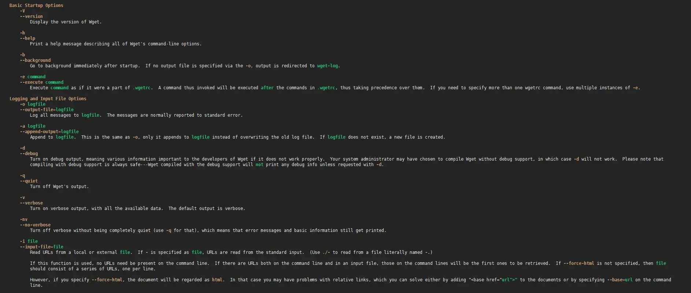

# Ajouter de la couleur à sa commande man

Voilà une astuce pour ajouter de la couleur à sa commande **man**

Concrètement: voilà le rendu finale de la manipulation :



Cela améliore grandement la lisibilité de la commande man je trouve et
la rend plus agréable à l'utiliser. Il se peut que les couleurs soient
plus agressives, j'utilise un thème un peu moins flashy pour reposer
les yeux :D

Pour obtenir ce résultat, il y a deux moyens, installer un programme qui se nomme **most**, ou bien en exportant quelques variables. Je vais détailler les 2 méthodes, mais personnellement, j'utilise la 2nd méthode : on garde `less` comme pager, avec les couleurs qu'on choisit, sans l'ajout d'un paquet. **most** est un autre pager, avec sa propre navigation et ses propres couleurs.

Pour la 1ère méthode, comme d'habitude, il suffit d'installer
simplement un paquet

```bash
apt-get install most
```

Puis exporter la commande dans votre `.bashrc`

```bash
echo "export MANPAGER=\"/usr/bin/most -s\"" >> ~/.bashrc
```

Il faut refaire la commande export pour **chaque utilisateur**

Pour la seconde méthode, il faut exporter plusieurs variables dans votre
**.bashrc** :

```bash
cat >> ~/.bashrc << 'EOF'
export LESS_TERMCAP_mb=$'\e[01;31m'
export LESS_TERMCAP_md=$'\e[01;31m'
export LESS_TERMCAP_me=$'\e[0m'
export LESS_TERMCAP_se=$'\e[0m'
export LESS_TERMCAP_so=$'\e[01;44;33m'
export LESS_TERMCAP_ue=$'\e[0m'
export LESS_TERMCAP_us=$'\e[01;32m'
export PAGER=less
EOF
```

Le `'EOF'` entre quotes empêche le shell d'interpréter le contenu au moment de l'écriture : les lignes arrivent telles quelles dans le `.bashrc`, et c'est bash qui décode les `$'\e[...'` à chaque ouverture de session.

Comme pour la commande précédente, **Il faut refaire les commandes
export pour chaque utilisateur**

Et enfin, pour pouvoir admirer votre magnifique man sans quitter et
ré-ouvrir votre client SSH, voici la commande à effectuer

```bash
source ~/.bashrc
```
