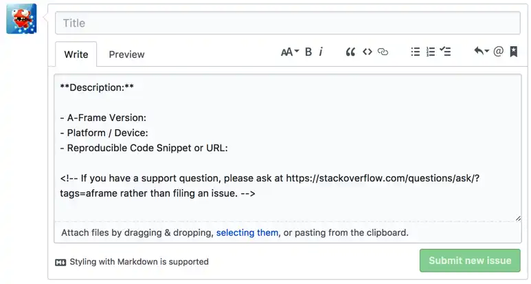

# Générer un template pour ses Pull Request et ses Issues

Si vous avez un repository à forte influence, vous savez comme il est
gênant de n'avoir qu'une partie des informations lors d'une issue, ou
alors un Pull Request qui ne détaille pas ses modifications.

Heureusement, GitHub a pensé à nous et il est possible de créer des
templates afin d'avoir une structure.

Voici un exemple de Pull Request et d'Issue pour le repo [aframe](https://github.com/aframevr/aframe/issues/new) :



Pour ce faire, c'est très simple.

## Créer ses templates

Tout se passe dans le dossier `.github` à la racine du projet. Les templates ne sont proposés qu'une fois mergés sur la branche par défaut.

### Pull Request

Un seul fichier suffit : `pull_request_template.md` (le nom n'est pas sensible à la casse), à la racine du repo, dans `docs/` ou dans `.github/`. Voici un exemple :

```markdown
**Description:**

**Changes proposed:**
-
-
-
```

Pour en avoir plusieurs, on les range dans un dossier `.github/PULL_REQUEST_TEMPLATE/` et on choisit le template avec le paramètre `template` dans l'URL de création, par exemple `.../compare/main...ma-branche?template=bugfix.md`. Il n'y a pas de sélecteur dans l'UI, c'est l'URL ou rien...

### Issues

Pour les issues, c'est un dossier : `.github/ISSUE_TEMPLATE/`, avec un fichier par template. GitHub affiche alors un sélecteur à l'ouverture d'une issue. Le fichier unique `ISSUE_TEMPLATE.md` fonctionne encore mais GitHub le considère comme legacy.

Un template Markdown porte un front matter avec `name` et `about`, par exemple `.github/ISSUE_TEMPLATE/bug_report.md` :

```markdown
---
name: Bug report
about: Report something that does not work
labels: bug
---

**Description:**

- A-Frame Version:
- Platform / Device:
- Reproducible Code Snippet or URL:

<!-- If you have a support question, please ask at https://stackoverflow.com/questions/ask/?tags=aframe rather than filing an issue. -->
```

Le mieux reste les issue forms : un fichier `.yml` dans le même dossier, qui donne un vrai formulaire avec des champs obligatoires. Fini les issues où la moitié du template est supprimée. Voici `.github/ISSUE_TEMPLATE/bug_report.yml` :

```yaml
name: Bug report
description: Report something that does not work
labels: ["bug"]
body:
  - type: input
    id: version
    attributes:
      label: A-Frame Version
    validations:
      required: true
  - type: input
    id: platform
    attributes:
      label: Platform / Device
  - type: textarea
    id: repro
    attributes:
      label: Reproducible Code Snippet or URL
    validations:
      required: true
```

Un `config.yml` dans ce dossier règle le sélecteur, par exemple pour interdire les issues vierges et renvoyer les questions ailleurs :

```yaml
blank_issues_enabled: false
contact_links:
  - name: Support question
    url: https://stackoverflow.com/questions/ask/?tags=aframe
    about: Ask support questions on Stack Overflow
```

### Pour toute une organisation

Pour ne pas copier les templates dans chaque repo, on crée un repo public nommé `.github` dans l'organisation (ou sur son compte) et on y met les mêmes fichiers. Ils servent de défaut aux repos qui n'ont pas les leurs : dès qu'un repo a ses propres templates d'issue dans `.github/ISSUE_TEMPLATE`, aucun template par défaut n'est utilisé.
