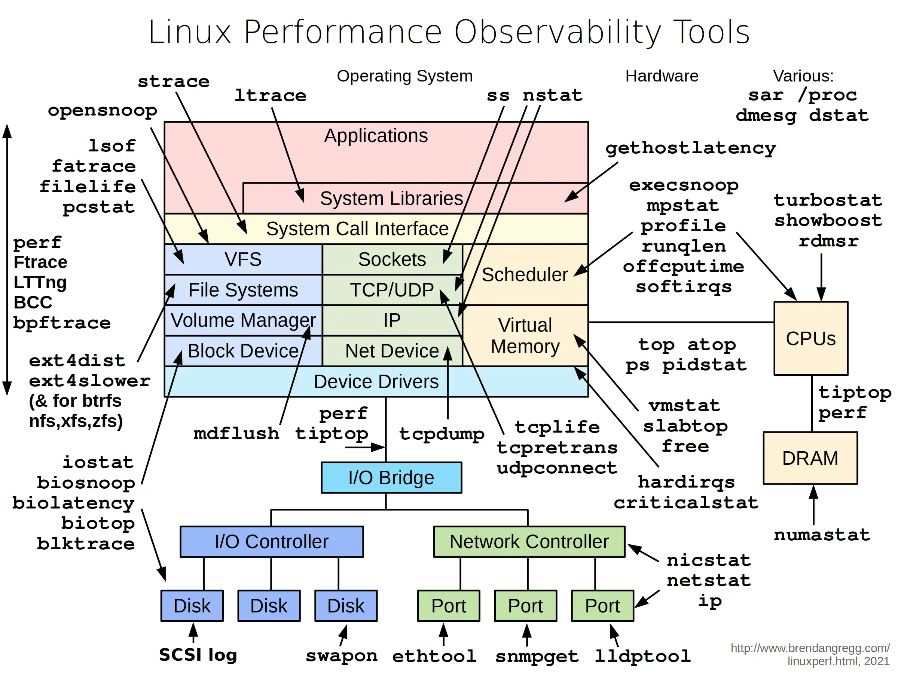

# Performances Linux

La carte ci-dessous recense les outils disponibles par couche du système.
Elle sert de point de départ pour identifier où regarder selon le symptôme.



---

## Méthodologie de triage

Avant de lancer des outils au hasard, localiser le goulot d'étranglement :

1. **CPU saturé ?** → `top`, `mpstat`, `perf top`
2. **Mémoire pleine / swap actif ?** → `free`, `vmstat`, `smem`
3. **I/O disque lent ?** → `iostat`, `iotop`, `dstat`
4. **Réseau saturé ou latent ?** → `ss`, `iftop`, `nethogs`
5. **Process spécifique suspect ?** → `strace`, `lsof`, `perf`

---

## CPU

### Charge et utilisation globale

```bash
# Snapshot unique en mode batch (pour le temps réel : top, q pour quitter)
top -b -n1 | head -20

# Par CPU (utile pour détecter un seul core saturé)
mpstat -P ALL 1

# Historique via sar (nécessite sysstat)
sar -u 1 10        # 10 mesures, 1 seconde d'intervalle
sar -u             # sans intervalle : relit l'historique du jour
sar -u -f /var/log/sysstat/sa$(date +%d)  # même chose sur Debian/Ubuntu (/var/log/sa/saDD sur RHEL)

# Load average interprétation (heuristique)
# 1 core : load > 1.0 = saturé
# 8 cores : load > 8.0 = saturé
# Le load compte aussi les process en état D (I/O bloquée, NFS) :
# un load élevé avec un CPU idle = I/O, à croiser avec vmstat (colonnes r et b)
uptime
```

### Profiling

```bash
# Top des fonctions consommant le plus de CPU
perf top

# Enregistrer 30s d'activité puis afficher
perf record -g sleep 30
perf report

# Profiling d'un process existant
perf record -g -p <PID> sleep 10
```

---

## Mémoire

```bash
# Vue globale (en Mo)
free -m

# Détail par process (nécessite smem)
smem -s rss -r | head -20

# Consommation réelle vs RSS (inclut shared)
smem -t -k

# Identifier les fuites potentielles (watch sur un process)
watch -n1 'cat /proc/<PID>/status | grep -E "VmRSS|VmSwap"'

# Pages swappées par process
for pid in /proc/[0-9]*/status; do
  awk '/VmSwap|Name/{printf $2 " "}END{print ""}' "$pid"
done | sort -k2 -n -r | head -10
```

### Pression mémoire

```bash
# Colonnes si/so (pages swappées in/out par seconde) > 0 en continu = swap actif
vmstat 1 5

# Page faults et swap (compteurs depuis le boot)
grep -E "pgmajfault|pgfault|pswpin|pswpout" /proc/vmstat

# Reclaim et compaction
grep -E "pgscan_|pgsteal_|allocstall|compact_stall" /proc/vmstat

# Temps passé bloqué faute de mémoire (PSI, si le noyau l'expose)
cat /proc/pressure/memory
```

---

## I/O disque

```bash
# Statistiques par device (1 mesure/sec)
iostat -xz 1

# Colonnes clés de iostat -x :
# %util   : taux d'occupation du disque, proche de 100% = saturé seulement
#           pour un disque qui sert les requêtes en série (HDD). Sur SSD,
#           NVMe ou RAID, ça ne dit rien : regarder r_await/w_await et aqu-sz
# r_await / w_await : temps moyen d'une lecture / écriture en ms (file d'attente comprise)
# aqu-sz  : longueur moyenne de la file d'attente
# r/s w/s : IOPS en lecture/écriture

# Process les plus actifs en I/O (nécessite root)
iotop -o -b -n 5

# Vue combinée CPU + I/O + réseau (dstat n'est plus maintenu,
# sur RHEL 9 la commande vient de pcp-system-tools, pcp-dstat)
dstat -cdngy 1

# Latence par opération : lectures par défaut, -W pour l'écriture, -Y pour du sync (O_SYNC)
ioping -c 10 /var/log
ioping -c 10 -W -Y /var/log
```

### Identifier les fichiers ouverts / actifs

```bash
# Fichiers ouverts par un process
lsof -p <PID>

# Quel process utilise un fichier
lsof /var/log/syslog

# Fichiers supprimés mais encore ouverts (espace non libéré)
lsof +L1
```

---

## Réseau

```bash
# Connexions actives avec état et process
ss -tulpn

# Bande passante par interface en temps réel
iftop -i eth0

# Bande passante par process
nethogs eth0

# Statistiques globales par protocole
ss -s

# Erreurs réseau par interface
ip -s link show eth0
cat /proc/net/dev

# Paquets droppés par la pile réseau (netstat n'est plus installé par défaut)
nstat -az | grep -i drop
```

### Latence & DNS

```bash
# Latence vers une IP (avec traceroute intégré)
trip 1.1.1.1

# RTT et perte de paquets
mtr --report --report-cycles 20 8.8.8.8

# Temps de résolution DNS
time dig @8.8.8.8 example.com
```

---

## Analyse par process

```bash
# Appels système en temps réel
strace -p <PID>

# Résumé des appels système (comptage + durée)
strace -c -p <PID>

# Appels système d'une commande
strace -e trace=network curl https://example.com

# Bibliothèques appelées
ltrace -p <PID>

# Threads et leur état
ps -L -o pid,lwp,stat,comm -p <PID>

# Priorité et nice value
ps -o pid,ni,pri,comm -p <PID>
```

---

## Vue système globale

```bash
# Dashboard complet CPU/mémoire/disque/réseau
glances

# Alternative avec graphes dans le terminal
btm

# Toutes les métriques sysstat en direct (5 mesures à 1 s),
# sar -A sans intervalle relit l'historique du jour
sar -A 1 5
```

---

## One-liners de diagnostic rapide

```bash
# Top 10 des process par CPU (moyenne depuis leur démarrage, pas l'instantané)
ps aux --sort=-%cpu | head -11

# Usage CPU instantané par process (sysstat)
pidstat 1 5

# Top 10 des process par mémoire RSS
ps aux --sort=-%mem | head -11

# Temps depuis le dernier boot
uptime -s

# Interruptions matérielles par CPU
watch -n1 cat /proc/interrupts

# Vérifier si un process est CPU-bound ou I/O-bound
cat /proc/<PID>/status | grep -E "voluntary|nonvoluntary"
# Indice, pas une preuve :
# voluntary_ctxt_switches élevé = le process cède le CPU (I/O, lock, sleep)
# nonvoluntary_ctxt_switches élevé = préempté, plutôt CPU-bound

# Limites du shell courant
ulimit -a

# Limites d'un process déjà lancé
cat /proc/<PID>/limits

# Descripteurs de fichiers utilisés
cat /proc/sys/fs/file-nr
```

---

## Signaux d'alerte

| Métrique | Seuil d'alerte | Commande |
|----------|---------------|----------|
| Load average | > nb de vCPU | `uptime` |
| CPU `%iowait` | > 20% | `iostat -x 1` |
| Swap actif (`si`/`so`) | > 0 en continu | `vmstat 1` |
| `%util` disque (HDD) | proche de 100% | `iostat -x 1` |
| `r_await`/`w_await` disque | > 50ms | `iostat -x 1` |
| Paquets droppés | > 0 | `ip -s link` |
| Descripteurs ouverts | > 80% du max | `cat /proc/sys/fs/file-nr` |
