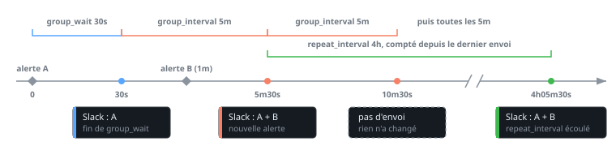

# Alertmanager sans spam : routing, inhibition et notifications Slack

Un incident sur un cluster qui déclenche 40 notifications Slack, dont la moitié ne sert à personne parce que la cause est déjà connue, c'est ce que donne un Alertmanager laissé à ses valeurs par défaut. Un `group_by` adapté, des règles d'inhibition, un `send_resolved` explicite, un bot token à la place des webhooks Slack et des templates qui portent un lien de dashboard ramènent ça à 1 message par problème.

Les noms de champs et les valeurs par défaut viennent du code d'[Alertmanager](https://github.com/prometheus/alertmanager) (v0.35.0 au moment de l'écriture). L'installation de la stack est décrite dans [simple_monitoring_stack.md](simple_monitoring_stack.md#alertmanager). Les alertes qui viennent de Loki sont dans [Générer des alertes depuis Loki](loki_alerting.md).

## Grouper par ce qui se traite ensemble

Sans `group_by`, Alertmanager range toutes les alertes dans un seul groupe, donc dans un seul message. Les valeurs par défaut de la route sont `group_wait: 30s`, `group_interval: 5m` et `repeat_interval: 4h` (`DefaultRouteOpts` dans `dispatch/route.go`).

On groupe sur les labels qui désignent **l'unité qu'on va traiter**, ici le cluster et le datacenter, plus le nom de l'alerte :

```yaml title="alertmanager.yml"
route:
  receiver: slack-default
  group_by: [alertname, cluster, dc]
  group_wait: 30s
  group_interval: 5m
  repeat_interval: 4h
```

Sur un même groupe, `group_wait` retarde le premier message et `group_interval` fixe le rythme des envois suivants, qui ne partent que si le groupe a changé. `repeat_interval` renvoie le même contenu quand rien n'a bougé depuis le dernier envoi :



Tout label ajouté à `group_by` multiplie les groupes, donc les messages. Un `pod` ou un `instance` dans la liste redonne 1 message par pod. Inversement, sans `cluster`, une même alerte sur 3 clusters finit dans un seul message et on ne sait plus lequel regarder.

`group_by: ['...']` groupe sur tous les labels (le code lit la valeur `...` pour activer `GroupByAll`) : chaque jeu de labels distinct forme son propre groupe, donc 1 notification par alerte tant que les alertes n'ont pas exactement les mêmes labels. À réserver à une route très ciblée comme les pages de nuit. Une route enfant qui ne définit pas `group_by` hérite de celui de son parent.

## Inhiber les alertes dont la cause est connue

Une inhibition mute les alertes cibles tant qu'une alerte source qui correspond est en `firing`. Le cas typique est une alerte de sauvegarde qui n'a aucun sens quand les métriques qu'elle lit ne sont plus à jour : si le fichier textfile d'un exporter est périmé, l'alerte « backup trop vieux » se déclenche sur une donnée fausse.

On pose donc l'alerte parent (`OldMetricsTextfile`, qui détecte un fichier textfile non rafraîchi) en source et l'alerte de backup en cible :

```yaml title="alertmanager.yml"
inhibit_rules:
  - name: backup-needs-fresh-metrics
    source_matchers:
      - alertname = "OldMetricsTextfile"
    target_matchers:
      - alertname = "BackupTooOld"
    equal: [cluster, instance]
```

`equal` liste les labels qui doivent avoir la même valeur sur les 2 alertes : sans lui, un `OldMetricsTextfile` sur n'importe quel serveur mute les `BackupTooOld` de toute la flotte. Le champ `name` est optionnel et existe depuis la v0.30.0 (#4628) : depuis la v0.34.0, le nom de la règle figure dans les événements `inhibition_muted_alert` de l'event recorder.

À l'usage :

- Utiliser `source_matchers` et `target_matchers`. Les variantes `source_match` et `target_match` sont marquées comme dépréciées dans le code.
- Une alerte résolue n'inhibe plus rien : le cache des sources ignore les alertes `resolved` (`inhibit/cache.go`).
- Une alerte qui correspond à la fois à la source et à la cible de la même règle ne s'inhibe pas elle-même (`excludeTwoSidedMatch` dans `inhibit/inhibit.go`).

!!! warning "Version"
    La v0.34.1 corrige plusieurs cas où des alertes inhibées étaient dé-mutées à tort (voir le [CHANGELOG](https://github.com/prometheus/alertmanager/blob/main/CHANGELOG.md)). Sur une version plus ancienne, une inhibition qui « saute » de temps en temps n'est pas forcément une erreur de config.

## Notifier la résolution

`send_resolved` décide si un message est aussi envoyé quand l'alerte passe en `resolved`. La valeur par défaut dépend de l'intégration, d'après les `Default*Config` du code :

- Slack : `false`
- webhook, PagerDuty et Opsgenie : `true`

Pour une intégration d'oncall branchée en webhook, la résolution doit arriver, sinon l'incident reste ouvert côté oncall jusqu'à ce que quelqu'un le ferme à la main. On l'écrit explicitement même quand c'est le défaut, pour qu'un changement de défaut amont ne modifie pas le comportement de la prod :

```yaml title="alertmanager.yml"
receivers:
  - name: oncall
    webhook_configs:
      - url_file: /etc/alertmanager/secrets/oncall-url
        send_resolved: true
  - name: slack-default
    slack_configs:
      - channel: "#alerts"
        send_resolved: false
```

Sur Slack on laisse `false` pour les canaux d'information : le message « resolved » double le volume sans rien apprendre. Pour un canal où l'on suit un incident, on le passe à `true`.

Le `resolve_timeout` global vaut 5m par défaut : c'est le délai après lequel une alerte qui n'a pas été mise à jour est déclarée résolue. Il ne s'applique qu'aux alertes reçues sans `EndsAt`, or Prometheus en pose toujours un : ce délai n'a aucun effet sur les alertes qui viennent de Prometheus.

## Passer des webhooks Slack à un bot token

Une URL de webhook entrante contient son propre secret. Écrite dans `alertmanager.yml`, elle finit dans un ConfigMap, dans git, dans les sorties de `kubectl get` et dans les logs de CI. Un bot token a le même défaut s'il est écrit en clair, mais Alertmanager sait le lire depuis un fichier, donc depuis un Secret monté.

Le support des Slack apps est arrivé dans la v0.30.0 (`Slack app support`, #4211). Les champs, côté receiver comme côté `global`, sont :

- `app_token` ou `app_token_file`, côté global `slack_app_token` et `slack_app_token_file`
- `app_url`, qui vaut par défaut `https://slack.com/api/chat.postMessage`
- `api_url` ou `api_url_file`, l'ancien mode webhook

Avant, avec un webhook :

```yaml title="alertmanager.yml (avant)"
receivers:
  - name: slack-default
    slack_configs:
      - api_url: https://hooks.slack.com/services/T000/B000/xxxxxxxx
        channel: "#alerts"
```

Après, avec le token lu depuis un fichier monté depuis un Secret :

```yaml title="alertmanager.yml (après)"
global:
  slack_app_token_file: /etc/alertmanager/secrets/slack-bot-token

receivers:
  - name: slack-default
    slack_configs:
      - channel: "#alerts"
        send_resolved: false
```

Alertmanager pose lui-même l'en-tête `Authorization: Bearer <token>` et envoie vers `app_url`. Quelques règles de validation, lues dans `config/config.go` et `notify/slack/config.go` :

- `api_url` et `app_token` sont exclusifs : les poser ensemble fait échouer le chargement de la config.
- `app_token` et `app_token_file` sont exclusifs entre eux, comme `api_url` et `api_url_file`.
- Un receiver qui définit son propre `api_url` n'hérite pas du token global.
- Définir `http_config.authorization` en plus d'un `app_token` est refusé (`http authorization can't be set when using Slack App tokens`).

Le même résultat s'obtient à la main, sans `app_token`, en pointant `api_url` sur `chat.postMessage` et en posant l'en-tête dans `http_config`. C'est utile si on veut un autre type d'authentification, mais `app_token_file` fait la même chose en 1 ligne :

```yaml title="alertmanager.yml (équivalent manuel)"
receivers:
  - name: slack-default
    slack_configs:
      - api_url: https://slack.com/api/chat.postMessage
        channel: "#alerts"
        http_config:
          authorization:
            type: Bearer
            credentials_file: /etc/alertmanager/secrets/slack-bot-token
```

Le passage au bot token ouvre aussi `update_message` et `post_updates_to_thread` (depuis la v0.35.0, #5540). Ces 2 options sont refusées avec un webhook : le code exige que `api_url` vaille `https://slack.com/api/chat.postMessage` et refuse `api_url_file`.

## Mettre un lien de dashboard dans le message

Le lien doit venir de la règle d'alerte, pas d'un template codé en dur par équipe. On pose une annotation `dashboard` sur la règle Prometheus :

```yaml title="rules.yml"
groups:
  - name: backup
    rules:
      - alert: BackupTooOld
        expr: time() - backup_last_success_timestamp_seconds > 86400
        for: 15m
        labels:
          severity: warning
        annotations:
          summary: "Backup trop vieux sur {{ $labels.instance }}"
          dashboard: "https://grafana.example.com/d/backup-overview?var-cluster={{ $labels.cluster }}"
```

Le template Slack lit ensuite cette annotation. `.CommonAnnotations` ne contient que les annotations identiques sur **toutes** les alertes du groupe : avec un `group_by` qui range plusieurs `instance` ensemble, le lien par instance disparaît. On boucle donc sur `.Alerts` pour le texte et on garde `.CommonAnnotations` pour le lien du titre :

```gotemplate title="/etc/alertmanager/templates/slack.tmpl"
{{ define "slack.custom.title" }}[{{ .Status | toUpper }}{{ if eq .Status "firing" }}:{{ .Alerts.Firing | len }}{{ end }}] {{ .GroupLabels.alertname }} ({{ .GroupLabels.cluster }}){{ end }}

{{ define "slack.custom.text" }}{{ range .Alerts }}{{ .Annotations.summary }}{{ if .Annotations.dashboard }} - <{{ .Annotations.dashboard }}|dashboard>{{ end }}
{{ end }}{{ end }}
```

Puis on branche les templates sur le receiver. Le titre pointe sur `.CommonAnnotations.dashboard` quand il existe et retombe sur l'URL d'Alertmanager sinon (`title_link` vaut `slack.default.titlelink` par défaut) :

```yaml title="alertmanager.yml"
templates:
  - /etc/alertmanager/templates/*.tmpl

receivers:
  - name: slack-default
    slack_configs:
      - channel: "#alerts"
        title: '{{ template "slack.custom.title" . }}'
        title_link: '{{ if .CommonAnnotations.dashboard }}{{ .CommonAnnotations.dashboard }}{{ else }}{{ .ExternalURL }}{{ end }}'
        text: '{{ template "slack.custom.text" . }}'
```

Le format `<url|texte>` est la syntaxe de lien de Slack (mrkdwn), pas celle d'Alertmanager.

## Nettoyer les labels côté Prometheus

L'option `alert_relabel_configs` ne vit pas dans Alertmanager mais **dans Prometheus**, sous `alerting:` (ou par entrée de `alertmanagers`). Le relabeling s'applique aux alertes juste avant leur envoi, après les `external_labels`, d'après la [documentation de configuration](https://prometheus.io/docs/prometheus/latest/configuration/configuration/#alert_relabel_configs).

Le cas d'usage cité par la doc est celui d'une paire de Prometheus en HA avec des `external_labels` différents : sans nettoyage, chaque replica envoie une alerte avec un label `prometheus_replica` distinct. Alertmanager ne les déduplique pas et les groupes contiennent des doublons.

```yaml title="prometheus.yml"
alerting:
  alert_relabel_configs:
    - action: labeldrop
      regex: prometheus_replica
  alertmanagers:
    - static_configs:
        - targets: ["alertmanager:9093"]
```

Le même mécanisme sert à ajouter un label `dc` ou `cluster` absent d'une règle, avec `action: replace`, pour que le `group_by` et les `equal` des inhibitions aient quelque chose à comparer.

## Valider avant de recharger

`amtool` vérifie la config et indique le receiver où une alerte de test finirait :

```bash
amtool check-config /etc/alertmanager/alertmanager.yml
amtool config routes test --config.file=/etc/alertmanager/alertmanager.yml alertname=BackupTooOld cluster=prod-eu
```

La première commande attrape les erreurs de champs (le conflit `api_url` et `app_token` par exemple), la seconde affiche le receiver choisi.
