# Netdata, Prometheus et Grafana : une stack de monitoring simple et puissante

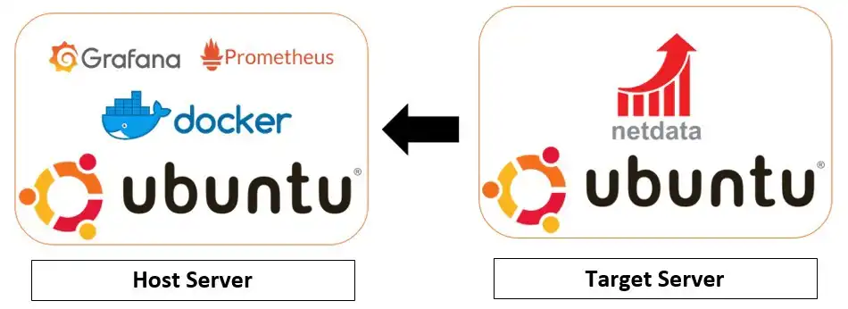

!!! info "Versions des logiciels"
    Cette documentation utilise des versions des logiciels qui peuvent ne pas être les dernières sur le marché. N'oubliez pas de vérifier avant d'appliquer.

Ces derniers temps, j'ai cherché quelques stacks de monitoring simples
à mettre en place mais également efficaces avec des métriques
pertinentes. Je suis passé par beaucoup de systèmes de monitoring
(Check_MK, Sensu, LibreNMS, Shinken...) sans avoir été satisfait. Soit
les métriques n'étaient pas pertinentes ; soit l'installation était
trop complexe... Bref, il y avait toujours quelque chose qui ne me
convenait pas, c'est là que j'ai découvert Netdata, puis peu de temps
après, Prometheus et Grafana.

## Lexique

Stack
:   Une stack d'applications est une suite ou un ensemble d'applications qui aident à réaliser une tâche précise.

Métrique
:   Mesure précise d'un composant (logiciel ou matériel), ex : Pourcentage de CPU utilisé à l'instant T...

Exporter
:   Outil qui va récolter les métriques d'un système (CPU utilisé, RAM utilisée...), les traiter et les exposer sur une URL HTTP.

Scrape
:   Requête périodique de Prometheus sur l'URL d'un exporter pour y récupérer les métriques. C'est Prometheus qui va chercher les données (pull), l'exporter ne pousse rien.

TSDB
:   Une Time Series Database (TSDB) est une base de données optimisée pour les données horodatées ou les séries chronologiques. Une « time serie » est seulement une suite de mesures ou évènements qui sont monitorées, downsampled et agrégées dans le temps.

Downsampling
:   Le downsampling (sous-échantillonnage) est une opération mathématique extrêmement simple permettant de créer un échantillon. Par exemple, si nous avons 60 échantillons de l'utilisation du CPU sur une minute, cela fait 1 par seconde et représente un poids non négligeable, nous pouvons donc faire un downsampling à 12 mesures par minute, nous aurons tout de même une mesure relativement précise avec un poids divisé par 5. Le downsampling rend donc la mesure moins précise mais beaucoup plus légère, nous utilisons donc le downsampling pour les anciennes données pour lesquelles une précision accrue n'est pas nécessaire.

## Détail des composants

### Netdata

Netdata est un système distribué de monitoring des performances de votre
hôte mais également des diverses applications qui y sont installées. Il
s'agit d'un agent de surveillance hautement optimisé que nous pouvons
installer sur tous vos systèmes et conteneurs.

Il fournit un aperçu en temps réel (grâce à sa granularité de 1s) de
tout ce qui se passe sur les systèmes sur lesquels il fonctionne (y
compris les serveurs web, les bases de données et les applications), au
travers de tableaux de bord interactifs accessibles via son interface
web.

Netdata est rapide et efficace, conçu pour fonctionner en permanence sur
tous les systèmes (serveurs physiques,virtuels et conteneurs), sans
perturber leur fonction principale.

Il s'agit d'un logiciel libre et open-source qui fonctionne
actuellement sous Linux, FreeBSD et qui est également accessible sous
container Docker.

### Prometheus

Prometheus est, dans notre stack, notre TSDB. C'est lui qui va
scraper l'exporter (Netdata) à intervalle régulier, stocker les
métriques récupérées et les agréger.

### Grafana

Depuis de nombreuses années, Grafana est l'outil par excellence de
visualisation de données. Grâce à un dashboard totalement
personnalisable et de nombreuses sources de données, Grafana s'est donc
naturellement imposé dans cette stack de monitoring. Il va s'occuper
d'afficher les données récoltées dans Prometheus à notre guise.

### Choix généraux

#### Netdata

Il existe beaucoup d'exporters (Node-Exporter + cAdvisor, Netdata,Telegraf)... pour tout logiciel (HAproxy,NGINX,PHP-FPM)

Cependant, j'ai fait le choix après avoir testé plusieurs exporters
d'utiliser Netdata. Ce logiciel intégre des milliers de métriques
matériels mais également de nombreuses logiciels (Plugins MySQL,
Nginx...) tout ça sans aucune configuration. De plus, Netdata dispose
nativement d'un système d'alerte pertinent avec de nombreuses
destinations : Slack, Email, Telegram...

Enfin, il s'agit d'un logiciel ne consommant que très peu de RAM et de
CPU. Ses métriques sont exportables en quelques clics vers de nombreuses
TSDB telles que InfluxDB, Prometheus... Les métriques exportées à
Prometheus sont extrêmement claires.

L'avantage comparativement à d'autres exporter est qu'il intègre
containers Docker et métriques de l'hôte. Par exemple, pour avoir ces
métriques avec un autre exporter, je dois installer Node-exporter +
cAdvisor.

#### Prometheus

J'ai choisi Prometheus en TSDB principalement car il fallait utiliser
OpenTSDB en backend en plus de InfluxDB si nous souhaitions utiliser ce
dernier avec Netdata. De plus, je trouve le langage de query de
Prometheus (PromQL) assez intuitif et puissant.

## Installation générale

### Installation & configuration de Netdata

2 méthodes pour installer Netdata, soit via image Docker, soit « à la
main ». Pour ma part, j'ai un serveur *from scratch* et les autres sous
Docker, j'ai donc utilisé les 2 méthodes.

#### Via Docker

Évidemment, il est nécessaire d'avoir une installation Docker à jour.
Pour cela, il suffit de suivre les [instructions
officielles](https://docs.docker.com/install). Une fois cela fait, 2
méthodes de lancement possible : via docker ou docker compose. Encore
une fois, j'utilise compose pour une question de cohérence. Tous mes
containers sont ordonnancés dans un seul fichier `compose.yaml`, donné
plus bas dans [Toute la stack en Docker Compose](#toute-la-stack-en-docker-compose).
Voici la version `docker run`, reprise de la doc officielle de Netdata :

??? note "Netdata : Running with docker"
    ```bash
    docker run -d --name=netdata \
      --pid=host \
      --network=host \
      -v netdataconfig:/etc/netdata \
      -v netdatalib:/var/lib/netdata \
      -v netdatacache:/var/cache/netdata \
      -v /:/host/root:ro,rslave \
      -v /etc/passwd:/host/etc/passwd:ro \
      -v /etc/group:/host/etc/group:ro \
      -v /etc/localtime:/etc/localtime:ro \
      -v /proc:/host/proc:ro \
      -v /sys:/host/sys:ro \
      -v /etc/os-release:/host/etc/os-release:ro \
      -v /var/log:/host/var/log:ro \
      -v /var/run/docker.sock:/var/run/docker.sock:ro \
      -v /run/dbus:/run/dbus:ro \
      --restart unless-stopped \
      --cap-add SYS_PTRACE \
      --cap-add SYS_ADMIN \
      --security-opt apparmor=unconfined \
      netdata/netdata:stable
    ```

Les 3 volumes nommés (`netdataconfig`, `netdatalib`, `netdatacache`)
ne sont pas décoratifs : sans eux, la config et l'historique des
métriques disparaissent à chaque recréation du container.

Il est possible de mettre Netdata derrière un reverse-proxy pour plus
de sécurité. Lorsque Netdata est lancé, il sera accessible sur le port
19999 de l'hôte (il tourne en `--network=host`) ou via votre
reverse-proxy configuré.

Nous verrons par la suite comment monitorer plus précisément nos
containers Docker.

#### From scratch

From scratch, il nous suffira de lancer le script d'installation de
netdata qui est très bien fait. La commande indiquée dans le GitHub
Netdata est la suivante :

```bash
wget -O /tmp/netdata-kickstart.sh https://get.netdata.cloud/kickstart.sh
sh /tmp/netdata-kickstart.sh
```

Les collectors (MySQL, Nginx...) sont livrés avec l'agent, il n'y a
plus de dépendances à installer à part. Le paramètre
**--non-interactive** (alias historique : `--dont-wait`) permet de
s'abstraire de toutes les questions posées à l'utilisateur.

### Installation de Prometheus

#### Docker

Via docker run (la version compose est dans [Toute la stack en Docker Compose](#toute-la-stack-en-docker-compose)) :

??? note "Prometheus : Running with docker"
    ```bash
    docker run -d --name prometheus \
       -p 9090:9090 \
       -v /etc/prometheus/prometheus.yml:/etc/prometheus/prometheus.yml:ro \
       -v prometheus-data:/prometheus \
       prom/prometheus:v3.15.0
    ```

L'image stocke ses données dans `/prometheus`. Sans le volume nommé
`prometheus-data`, Docker n'y met qu'un volume anonyme et tout
l'historique part avec un `docker rm`.

!!! Warning Docker
    Il faut créer manuellement le fichier
    prometheus.yml sans quoi par défaut Docker considère qu'il s'agit
    d'un dossier.

```bash
mkdir /etc/prometheus && touch /etc/prometheus/prometheus.yml
```

#### From scratch

Le binaire dans les dépôts système est généralement en retard de plusieurs versions. Il vaut
mieux l'installer manuellement pour garder la main sur les mises à jour.

Rendons-nous sur la [page officielle](https://prometheus.io/download/) pour trouver la dernière
version de Prometheus. A l'heure où j'écris, il s'agit de la **3.15.0**.

```bash
cd ~ ; wget https://github.com/prometheus/prometheus/releases/download/v3.15.0/prometheus-3.15.0.linux-amd64.tar.gz
```

On extrait les fichiers

```bash
tar xzvf prometheus-3.15.0.linux-amd64.tar.gz
```

On crée notre utilisateur Prometheus :

```bash
useradd --system --no-create-home --shell /usr/sbin/nologin prometheus
```

Puis on déplace les fichiers binaires et de configuration aux endroits
prévus. Depuis Prometheus 3.0, l'archive ne contient plus que les 2
binaires, `prometheus.yml`, `LICENSE` et `NOTICE` : les fichiers
`consoles/` et `console_libraries/` ont disparu.

```bash
mkdir -p /etc/prometheus /var/lib/prometheus
mv ~/prometheus-3.15.0.linux-amd64/prometheus.yml /etc/prometheus/
mv ~/prometheus-3.15.0.linux-amd64/{prometheus,promtool} /usr/bin/
chown -R prometheus:prometheus /etc/prometheus /var/lib/prometheus
```

Dans nos 2 fichiers exécutables, nous avons bien évidemment Prometheus
et un fichier nommé Promtool. Ce dernier nous permettra d'interroger
directement Prometheus, de valider la config et les règles, et
d'effectuer des opérations avancées.

Et enfin, l'unit systemd. Le [tutoriel](../../linux/systemd/create_unit.md)
détaille la syntaxe, voici celle qu'on utilise. `--storage.tsdb.path`
est indispensable : sa valeur par défaut, `data/`, est relative au
répertoire courant du process.

```ini title="/etc/systemd/system/prometheus.service"
[Unit]
Description=Prometheus
Wants=network-online.target
After=network-online.target

[Service]
User=prometheus
Group=prometheus
ExecStart=/usr/bin/prometheus \
  --config.file=/etc/prometheus/prometheus.yml \
  --storage.tsdb.path=/var/lib/prometheus
ExecReload=/bin/kill -HUP $MAINPID
Restart=on-failure
NoNewPrivileges=true
PrivateTmp=true
ProtectHome=true
ProtectSystem=strict
ReadWritePaths=/var/lib/prometheus

[Install]
WantedBy=multi-user.target
```

`ExecReload` permet de recharger la config avec un
`systemctl reload prometheus`, sans redémarrage. Une fois le fichier
créé, il faut l'activer :

```bash
systemctl daemon-reload && systemctl enable --now prometheus
```

#### Configuration de Prometheus

Toute la configuration Prometheus se fait via le fichier
`/etc/prometheus/prometheus.yml` en syntaxe YAML. Voici la configuration à
appliquer :

<!-- markdownlint-disable MD046 -->
??? abstract "/etc/prometheus/prometheus.yml"
    ```yaml title="prometheus.yml"
    # my global config
    global:
      scrape_interval:     5s # Scrape targets every 5 seconds. Default is every 1 minute.
      evaluation_interval: 5s # Evaluate rules every 5 seconds. Default is every 1 minute.
      # scrape_timeout is set to the global default (10s).

    # Load rules once and periodically evaluate them according to the global evaluation_interval.
    rule_files:
      # - "first_rules.yml"
      # - "second_rules.yml"


    scrape_configs:
      # The job name is added as a label `job=<job_name>` to any timeseries scraped from this config.

      - job_name: node SSL
        scheme: https
        metrics_path: /api/v1/allmetrics
        params:
          format: [prometheus]
          source: [average]
        honor_labels: true
        static_configs:
        - targets: [netdata:443]
        - targets: [netdata2:443]

      - job_name: node
        metrics_path: /api/v1/allmetrics
        params:
          format: [prometheus]
          source: [average]
        honor_labels: true
        static_configs:
        - targets: [netdata:19999]
    ```
<!-- markdownlint-enable MD046 -->

Afin de ne pas copier coller bêtement la configuration, voici une
explication succincte du fichier de configuration :

Premièrement, nous avons un groupe **global** qui comme son nom
l'indique applique les configurations pour tous les jobs. Dedans, nous
définissions un temps de scrape toutes les 5 secondes (une minute par
défaut) et un reload des règles d'alerting toutes les 5 secondes
également.

Deuxièmement, nous avons la directive `rule_files` qui s'occupe de
charger des fichiers YAML où nous pouvons définir des règles
d'alerting. Cependant, notre alerting de base est géré via netdata.
Nous verrons par la suite comment configurer alertmanager

Troisièmement, la partie la plus importante, nous avons au premier
niveau un `scrape_configs` qui indique la configuration qui sera
appliquée par Prometheus. `job_name` nous indique quel nom appliquer
au « groupe » au niveau de Prometheus.

Nous avons 2 jobs : Un concernant les noeuds netdata SSL appelé *Node
SSL* et un autre avec les node normaux appelés *Node*.

Le premier node contient la directive `scheme` qui nous permet de
spécifier que nous souhaitons utiliser une connexion sécurisée TLS pour
récupérer les données émises par Netdata. Le second ne contient pas ce
keyword car la connexion par défaut est en plain text (http).

Ensuite, nous avons 2 directives **extrêmement** importantes,
`metrics_path` et `params`. Elles vont de paire avec les targets. En
targets de static config, nous définissons chaque hôte dont Prometheus
doit récupérer les métriques. `metrics_path` indique donc sur quelle
URI Prometheus doit aller récupérer ses métriques et `params` les
paramètres de la query string. L'URI est propre à chaque exporter.
Ainsi, celle-ci est propre à Netdata et nous indique que nous
souhaitons des valeurs moyennes (`source=average`, la valeur par
défaut) au format Prometheus.

On ne met pas la query string directement dans `metrics_path` :
Prometheus l'encode et le `?` part en `%3F`. Toute la documentation
sur ce fichier de configuration est disponible
[ici](https://prometheus.io/docs/prometheus/latest/configuration/configuration/)

Concernant netdata, il est possible d'afficher directement les valeurs
bruts récupérées par prometheus à l'adresse suivante :
<https://netdata.user.domain.tld/api/v1/allmetrics?format=prometheus&source=average>

Deux helpers netdata sont également disponibles. `&types=yes` permettant
d'afficher le type de métrique renvoyé et `&help=yes` pouvant vous
apporter diverses précisions. Voici un exemple :

??? note "Example output of prometheus exporter"
    ```promql
    # COMMENT netdata_ipv4_tcperrors_packets_persec_average: dimension "RetransSegs", value is packets/s, gauge, dt 1586642036 to 1586642038 inclusive
    # COMMENT TYPE netdata_ipv4_tcperrors_packets_persec_average gauge
    netdata_ipv4_tcperrors_packets_persec_average{chart="ipv4.tcperrors",family="tcp",dimension="RetransSegs"} 0.0000000 1586642038000
    ```

Il est également possible de récuperer d'autres variables système tel
que le nombre de sockets TCP supportés... Il suffira d'ajouter
`variables: [yes]` aux `params`.

Selon le panel grafana que vous trouvez, vous pouvez trouver des unités
en MB au lieu d'en MiB. Ce comportement a changé en netdata 1.12, pour
retrouver les anciennes unités, rajouter `oldunits: [yes]` à vos
`params`. Attention, ça renomme toutes les métriques
(`netdata_system_ram_MB_average` au lieu de `..._MiB_average`) : les
règles d'alerte plus bas utilisent les noms actuels.

Pour vérifier que tout est conforme, rendez-vous dans l'interface de
Prometheus (Par défaut, port 9090), vous devriez tomber sur cette page :

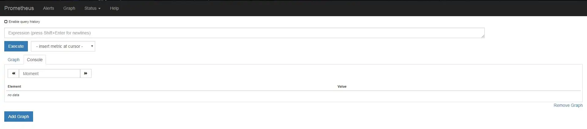

On se rend ensuite sur **Status** puis **Target health**

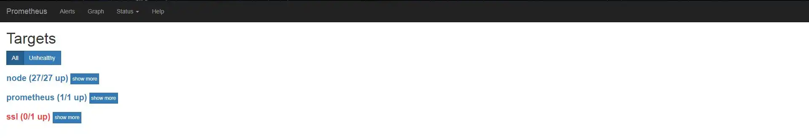

Si tout est bon, vous devriez apercevoir vos différentes targets avec
l'état UP.

#### Syntaxe Prometheus

Prometheus se base sur une syntaxe intuitive nommée PromQL. Nous pouvons
nous exercer à la syntaxe PromQL depuis le menu principal de Prometheus.

Il est possible de tester la syntaxe de PromQL depuis la page d'accueil
de Prometheus.

A côté du bouton **Execute** nous avons // - insert metric at cursor -
//. Ceci nous permet de voir toutes les métriques disponibles via
Prometheus.

Les métriques de Netdata sont également disponibles via l'URL de notre
Grafana suivi du chemin de la métrique.

Voici un exemple de relevé :

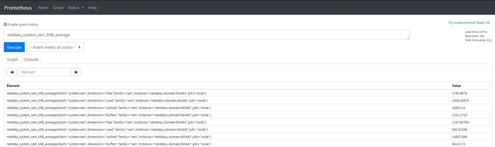

Comme vous pouvez le voir, nous obtenons de nombreuses informations
(Concrètement, on obtient en réponse tous les netdata que nous
monitorons).

Décortiquons une réponse type pour un serveur :

??? note "Example output of netdata exporter"
    ```bash
    netdata_system_ram_MiB_average{chart="system.ram",dimension="free",family="ram",instance="netdata.x.domain.tld:443",job="node"}
    netdata_system_ram_MiB_average{chart="system.ram",dimension="used",family="ram",instance="netdata.x.domain.tld:443",job="node"}
    netdata_system_ram_MiB_average{chart="system.ram",dimension="cached",family="ram",instance="netdata.x.domain.tld:443",job="node"}
    netdata_system_ram_MiB_average{chart="system.ram",dimension="buffers",family="ram",instance="netdata.x.domain.tld:443",job="node"}
    ```

Il existe un [site internet](https://samber.github.io/awesome-prometheus-alerts/rules) proposant quelques règles Prometheus. Attention, celles-ci ne sont pas forcément optimsiées ou fonctionnelles.

En premier lieu, nous observons que nous avons 4 métriques différentes
pour le même serveur. Ce qui est contenu dans les accolades est une
variable pour Prometheus. Par exemple, voici comment obtenir la RAM
utilisée pour le serveur ci-dessus :

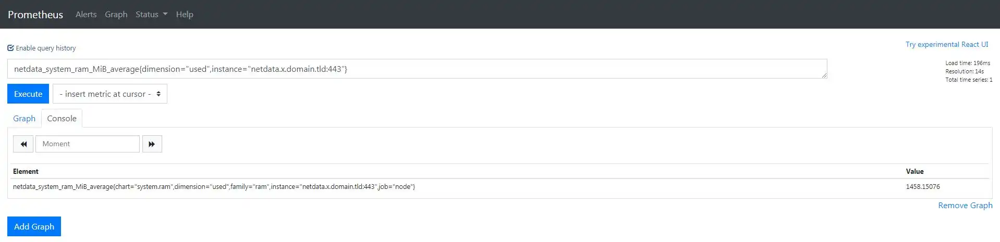

Comme nous pouvons le voir, nous nous sommes servis des variables de
Prometheus pour filtrer ce que nous voulons. Nous pouvons également nous
servir de ces variables pour obtenir des graphiques dynamiques sur
Grafana.

### Installation de Grafana

#### Docker

Via docker run (la version compose est dans [Toute la stack en Docker Compose](#toute-la-stack-en-docker-compose)) :

??? note "Grafana : Running with docker"
    ```bash
    docker run -d --name grafana \
       -p 3000:3000 \
       -v grafana-data:/var/lib/grafana \
       grafana/grafana:13.2.4
    ```

Même remarque que pour Prometheus : sans le volume `grafana-data`, les
dashboards et les utilisateurs créés dans l'UI sont perdus à la
recréation du container.

#### From scratch

Grafana n'est pas disponible dans les dépôts Debian, nous devons donc
ajouter ses propres dépôts avant de pouvoir l'installer (commandes de
la doc officielle) :

```bash
sudo mkdir -p /etc/apt/keyrings
sudo wget -O /etc/apt/keyrings/grafana.asc https://apt.grafana.com/gpg-full.key
sudo chmod 644 /etc/apt/keyrings/grafana.asc
echo "deb [signed-by=/etc/apt/keyrings/grafana.asc] https://apt.grafana.com stable main" \
  | sudo tee /etc/apt/sources.list.d/grafana.list
sudo apt update && sudo apt install -y grafana
```

Une fois installé, Grafana n'est pas démarré et n'est pas lancé au
démarrage de votre serveur. Pour cela voici les commandes :

```bash
systemctl daemon-reload
systemctl enable --now grafana-server.service
```

### Utiliser Prometheus en Datasource

Une fois toute la stack installée, nous devons configurer Grafana afin
qu'il utilise Prometheus comme source de données. Par défaut, Grafana
écoute sur le port **3000** et ses identifiants par défauts sont
**admin** / **admin**.

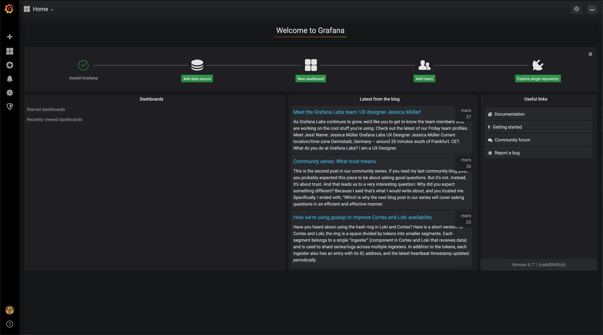

Il faut alors aller dans **Connections** > **Data sources** puis
cliquer sur *Add new data source* (les captures datent d'une ancienne
version de Grafana, le menu a bougé mais le formulaire reste le même) :

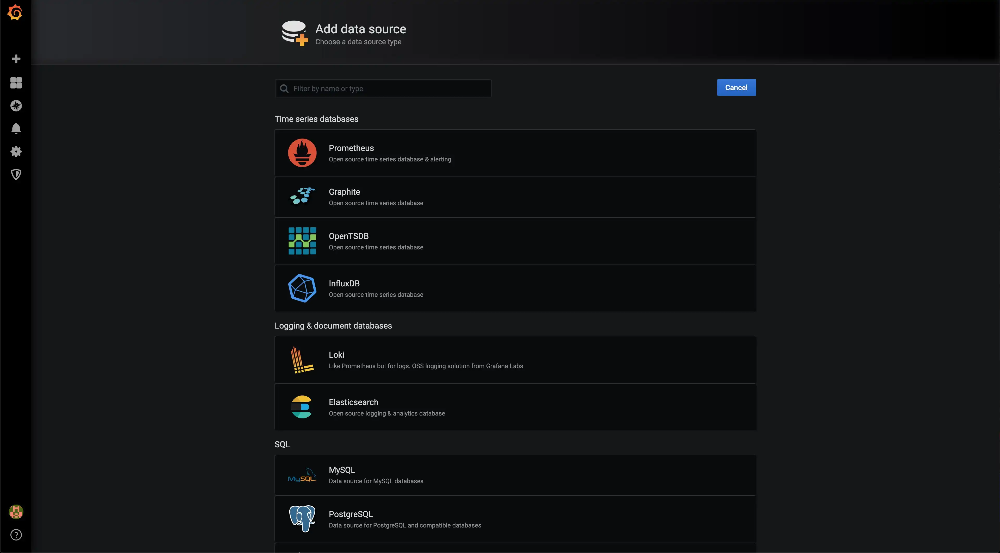

Dans le choix de la Data Source, nous choisissons bien évidemment
**Prometheus** :

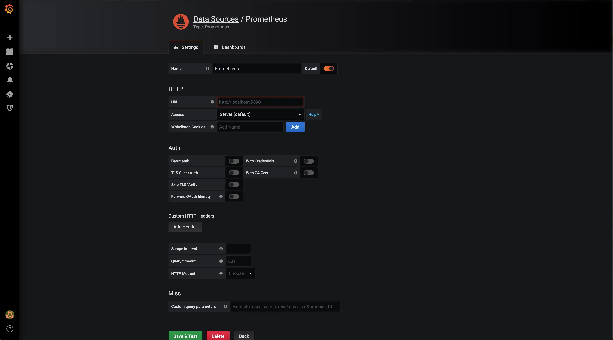

Ici, les choses se corsent un tout petit peu.

Tout d'abord, en URL, 3 cas sont possibles :

* Si vous avez installé Prometheus et Grafana sur le même serveur,
    alors vous pouvez pointer directement vers Prometheus :
    <http://localhost:9090>
* Si votre Prometheus n'est pas sur le serveur de Grafana, alors il
    vous faudra y accéder via son IP : [http://ip:port](http://ip:port)
* S'il est derrière un reverse-proxy (la solution optimale), alors il
    faudra y accéder de la manière suivante : <https://domain.tld>

Une fois ceci fait, **Save & Test**

Si tout est correct, voici le message que vous obtiendrez :


Cliquer dans l'UI ne se rejoue pas : si on réinstalle Grafana, il faut
tout refaire. La datasource se déclare aussi dans un fichier de
provisioning, lu au démarrage de Grafana :

```yaml title="/etc/grafana/provisioning/datasources/prometheus.yaml"
apiVersion: 1
datasources:
  - name: Prometheus
    type: prometheus
    access: proxy
    url: http://localhost:9090
    isDefault: true
```

Félicitations, une étape fastidieuse est passée, cependant, le plus dur
reste à faire, la création de votre premier panel !

### Création de son premier panel

Créer son panel Grafana peut s'avérer fastidieux. De nombreuses options
sont possibles. Pour vous faciliter sa prise en main, Grafana vous mets
à disposition une [instance test](https://play.grafana.org/).

Plutôt que de partir d'une page blanche, on peut importer un dashboard
existant et l'adapter.

#### 3 dashboards Netdata à importer

Les 3 dashboards ci-dessous lisent les métriques Netdata scrapées plus
haut. Ils filtrent tous par variables en haut de page (instance, CPU,
disque, filesystem, interface réseau, container Docker), un seul
dashboard sert donc pour tous les serveurs.

* **Simple Netdata** ([JSON](https://files.jdelgado.fr/r/7JCI5fpv#nprlBuA4F3Dnt9qbXbrFBjMtQNuoQNPixGDr8SCjvcc=)) : l'essentiel d'un serveur sur une page, uptime, CPU, load, I/O disque, RAM, swap, bande passante et processus
* **Docker Dashboard** ([JSON](https://files.jdelgado.fr/r/UEeLrP_8#9BJttU2EqJZa9aNXrrHzGTKi4UPooRnvu6VuzzsDQA0=)) : le nombre de containers et la RAM/CPU consommée par chacun, avec les jauges disque, RAM et swap de l'hôte
* **Netdata** ([JSON](https://files.jdelgado.fr/r/U4KCGryY#JDkX10832wvNJvRMOh/C3nPJ+dwDT/pD67XwbofHSuc=)) : la reprise de toutes les sections de l'UI Netdata, une row repliable par section (CPUs, mémoire, disques, TCP/UDP, sensors...)

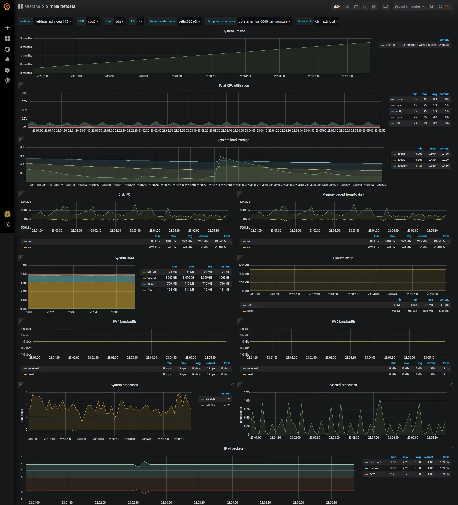

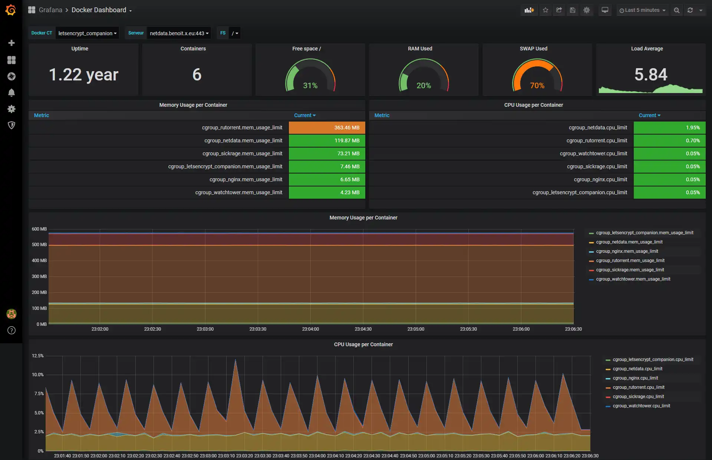

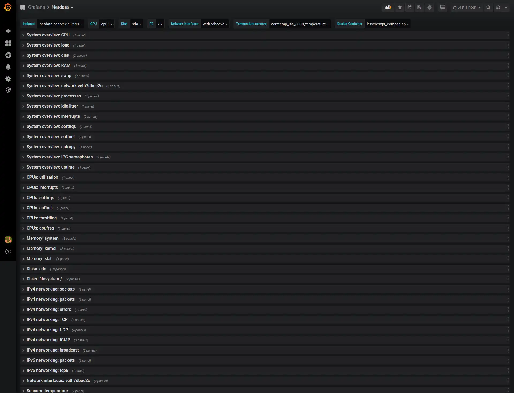

Pour les charger, on passe par **Dashboards** > **New** > **Import**,
on colle le JSON et on choisit la datasource Prometheus créée plus
haut. Ils ont été construits sur une ancienne version de Grafana, les
captures aussi : le rendu change un peu sur une version récente.

La communauté Grafana met aussi à disposition énormément de
[dashboards](https://grafana.com/grafana/dashboards/), importables de
la même façon par leur ID.

## Voir aussi

* [Générer des alertes depuis Loki](loki_alerting.md) - alerting avec LogQL via AlertManager
* [Ecrire une métrique custom pour node_exporter](custom_metrics_nodeexporter.md) - étendre les métriques collectées
* [Grafana Alloy](alloy.md) - collecteur universel logs/métriques/traces
* [Quelques tips pour la stack LGTM](tips_lgtm.md) - API calls et astuces

## Trucs & Astuces

### Grafana

L'utilisation de Grafana est assez simple. Cependant, certaines choses
sont assez mal conçues, il faut les découvrir par soi-même. Je mettrai
cette partie à jour au fur et à mesure de mes découvertes.

#### Lecture d'un timestamp

Pour lire une métrique de type Unix Timestamp, également appelé Epoch
(nombre de secondes écoulées depuis le 1er Janvier 1970), il faut
multiplier par 1000 la valeur et lui appliquer n'importe quel filtre de
type Date. En effet, comme me l'a expliqué
[Olivier](https://www.linkedin.com/feed/update/urn:li:activity:6654332320104882176/?commentUrn=urn%3Ali%3Acomment%3A%28activity%3A6654332320104882176%2C6654415986990555137%29)
sur LinkedIn, il s'agit d'une interface écrit en JavaScript. Le
timestamp renvoyé par prometheus est en seconde et celui de JS est
exprimé en millisecondes, c'est pour cela qu'il faut multiplier par
1000.

### Prometheus

Pour apporter une sécurité supplémentaire, il faut faire écouter
Prometheus sur localhost uniquement. Pour cela, dans votre unit systemd,
il faudra rajouter l'argument
`--web.listen-address="127.0.0.1:9090"` sans oublier de relancer le
service Prometheus ainsi que de faire le reverse-proxy adéquate.

Pour vérifier que notre modification a bien été prise en compte, il
suffit de faire un `ss -laptn sport eq 9090` et de constater que la
Local Address est bien 127.0.0.1.

Si votre instance Prometheus n'est pas sur le même serveur et que Grafana/Prometheus ne sont pas joignables via un réseau privé, alors il vous faudra un reverse-proxy avec authentification basic

Petit reverse proxy pour Prometheus, à adapter pour votre setup :

<!-- markdownlint-disable MD046 -->
??? abstract "nginx-prometheus.conf"
    ```nginx title="nginx-prometheus.conf"
    upstream prometheus {
        server localhost:9090;
    }

    server {
        listen        80;
        listen              [::]:80;

        server_name        prometheus.domain.tld;

        access_log        off;

        include        snippets/letsencrypt.conf;

        location / {
            return 301 https://prometheus.domain.tld$request_uri;
        }
    }

    server {
        server_name prometheus.domain.tld;

        auth_basic           "prometheus";
        auth_basic_user_file /etc/nginx/.htpasswd;

        listen 443 ssl;
        listen [::]:443 ssl;
        http2 on;

        ssl_certificate /root/.acme.sh/prometheus.domain.tld_ecc/fullchain.cer;
        ssl_certificate_key /root/.acme.sh/prometheus.domain.tld_ecc/prometheus.domain.tld.key;

        location / {
            proxy_set_header Host $http_host;
            proxy_pass http://prometheus;
        }
    }
    ```
<!-- markdownlint-enable MD046 -->

### Netdata

#### Général

Comme dit précédemment, Netdata permet nativement d'exporter de
nombreuses métriques. Cependant, pour certaines d'entre elles, dont
MySQL, il est nécessaire de faire une manipulation :

```sql
CREATE USER 'netdata'@'localhost';
GRANT USAGE, REPLICATION CLIENT, PROCESS ON *.* TO 'netdata'@'localhost';
FLUSH PRIVILEGES;
```

Sur MariaDB 10.5.9 et plus, `REPLICATION CLIENT` devient
`SLAVE MONITOR`.

#### Docker

##### Résolution des noms des containers

Pour résoudre les noms des containers dockers afin de ne pas avoir une
suite de chiffres et lettres incompréhensible, plusieurs méthodes
s'offrent à nous.

Tout d'abord, nous pouvons exposer l'API Docker via un autre container
afin de contrôler complètement son comportement :

??? abstract "compose.yaml"
    ```yaml title="compose.yaml"
    services:
      netdata:
        image: netdata/netdata
        # ... votre config ... #
        environment:
          - DOCKER_HOST=tcp://proxy:2375
      proxy:
        image: tecnativa/docker-socket-proxy
        volumes:
         - /var/run/docker.sock:/var/run/docker.sock:ro
        environment:
          - CONTAINERS=1
    ```

La variable d'environnement `CONTAINERS=1` nous permet d'indiquer à
Netdata qu'il n'a accès qu'à la partie de l'API concernant les
containers, ce qui peut être très utile en cas de compromission du
container. Le montage de `/var/run/docker.sock` dans le container
Netdata disparaît alors.

La seconde manière de faire est de monter directement
`/var/run/docker.sock` en lecture seule, comme dans la commande
officielle plus haut. Netdata détecte seul au démarrage le GID du
groupe docker de l'hôte (variable `PGID`), plus besoin de le chercher
dans `/etc/group` et de le passer à la main.

Enfin, troisième et dernière possibilité que je déconseille
**fortement** est de lancer Netdata en tant qu'utilisateur root via la
variable d'environnement `DOCKER_USR=root` sur notre container.

##### Monitoring d'un mountpoint personnalisé

Pour monitorer les I/O, espace disque... d'un point de montage, il
faut que le container Netdata le voie. Avec la commande officielle,
c'est déjà le cas : `/:/host/root:ro,rslave` monte toute
l'arborescence de l'hôte et `rslave` propage les montages faits après
le démarrage du container.

Si on a réduit les volumes au strict minimum, il faudra par contre
ajouter chaque point de montage à surveiller (par exemple `/home`) en
volume sur le container.

La base d'une stack de monitoring est désormais acquise.

## Pour aller plus loin

Il s'agit d'une stack très simple à mettre en place. Cependant,
celle-ci n'est pas parfaite, nous n'avons aucune indication concernant
nos sites web, l'état des certificats SSL ou encore aucun alerting.

## Rendre Prometheus dynamique

Actuellement, nous avons une configuration statique, ce qui implique
de toucher au `prometheus.yml` et de recharger Prometheus
(`systemctl reload prometheus`, qui envoie un SIGHUP) à chaque
ajout/suppression d'un host. Surtout pas de restart : le redémarrage
de prometheus peut durer plusieurs minutes avec la reprise des WAL...

A la place de static_configs, il est donc possible d'utiliser d'autres
directives, dont `file_sd_configs`. Votre configuration prometheus sera
donc dynamique via un simple fichier json que prometheus relira à chaque
modification, qu'il s'agisse d'une suppression ou d'un ajout.

Remplacer le bloc node de votre fichier prometheus.yml par le suivant :

??? abstract "/etc/prometheus/prometheus.yml"
    ```yaml title="prometheus.yml"
      - job_name: node
        scheme: https
        metrics_path: /api/v1/allmetrics
        params:
          format: [prometheus]
          source: [average]
        honor_labels: true
        file_sd_configs:
          - files:
            - "/etc/prometheus/netdata.json"
    ```

Un chemin relatif dans `files` est résolu par rapport au dossier du
`prometheus.yml`, pas au répertoire courant du process. Cependant, pour
un soucis de clarté, je préfère indiquer un chemin absolu.

Comme vous pouvez vous en douter, le fichier `netdata.json` contiendra
les différents nodes à monitorer. Si vous souhaitez ajouter/supprimer un
fichier ou un job, il faudra par contre recharger Prometheus
(`systemctl reload prometheus`). Voici le contenu dudit fichier :

??? abstract "/etc/prometheus/netdata.json"
    ```json title="netdata.json"
    [
      {
        "labels": {
          "env": "prod"
        },
        "targets": [
          "netdata.x.domain.tld:443",
          "netdata.y.domain.tld:443"
        ]
      }
    ]
    ```

Ce fichier est simplissime. Nous avons les labels ajoutés à toutes les
targets du bloc (ici `env`, on évite `job` qui écraserait le
`job_name`) puis nos différentes targets. **Attention** à penser aux
virgules entre les targets et à ne pas en mettre à votre dernière, sans
quoi votre JSON serait invalide.

Une fois ceci fait, nous rechargeons une ultime fois Prometheus
`systemctl reload prometheus`, puis nous pourrons modifier à chaud nos
targets sans aucune autre modification, plutôt pratique ! D'autres
manières sont également possibles pour importer dynamiquement vos
targets par exemple via consul. J'ai choisi ce mode-ci car il me
convient parfaitement. Xavier Pestel (xavki) nous propose une excellente
vidéo pour [l'inventaire
dynamique](https://www.youtube.com/watch?v=18ahxxrpxkg) via Consul.

## Monitorer vos certificats & websites

Le monitorer de ces éléments n'est pas proposé nativement par notre
exporter Netdata. Heureusement, Prometheus à pensé à tout et nous
propose blackbox_exporter, un exporter orienté autour des tests HTTP,
ICMP & co. Pour l'installer, nous devons procéder de la même manière
que Prometheus. Si vous disposez de Prometheus sur votre machine, il
n'y a aucun intérêt à créer un utilisateur supplémentaire, vous pourrez
lancer blackbox_exporter en tant que Prometheus et placer son fichier de
configuration dans le répertoire de Prometheus.

Il faut toujours se rendre sur la page Github afin de s'assurer que
nous disposons de la dernière version de notre logiciel :

```bash
cd ~ ; wget https://github.com/prometheus/blackbox_exporter/releases/download/v0.29.0/blackbox_exporter-0.29.0.linux-amd64.tar.gz
```

Et on extrait toujours les fichiers :

```bash
tar xzvf blackbox_exporter-0.29.0.linux-amd64.tar.gz
```

Et on les déplace dans le dossier adéquate. Attention à bien mettre le
bon username (prometheus ou celui que vous aurez décidés)

```bash
mkdir /etc/blackbox && chown -R prometheus:prometheus /etc/blackbox
mv ~/blackbox_exporter-0.29.0.linux-amd64/blackbox_exporter /usr/bin
mv ~/blackbox_exporter-0.29.0.linux-amd64/blackbox.yml /etc/blackbox
```

Si nous souhaitons utiliser le test ICMP de blackbox et que nous avons
lancé blackbox en tant que non-root, alors il lui faut le droit
d'ouvrir un socket raw. 2 solutions : ajouter une Capability à notre
unit

```bash
$ systemctl edit --full blackbox_exporter
[Service]
...
AmbientCapabilities=CAP_NET_RAW
...
```

ou la poser directement sur le binaire, qu'on vérifie ensuite avec
`getcap` :

```bash
$ setcap cap_net_raw+ep /usr/bin/blackbox_exporter
$ getcap /usr/bin/blackbox_exporter
/usr/bin/blackbox_exporter cap_net_raw=ep
```

La capability posée par `setcap` saute à chaque remplacement du
binaire, donc à chaque mise à jour : l'unit systemd est plus durable.
Sans l'une des 2, nous recevrons une erreur selon laquelle nous n'avons
pas la permission d'effectuer cette action :

```log
    ts=2020-04-06T01:59:18.302197375Z caller=main.go:119 module=icmp target=netdata.pierre.x.eu level=error msg="Error listening to socket" err="listen ip4:icmp 0.0.0.0: socket: operation not permitted"
```

Les tests écrits par défaut par les mainteneurs de Blackbox nous
conviendront pour faire de simples tests de chargement de page web ainsi
que d'ICMP, nous ne toucherons donc pas à ce fichier.

Maintenant que Blackbox est correctement installé, nous devons indiquer
à Prometheus d'aller récupérer les métriques de Blackbox :

??? abstract "Target for prometheus.yml"
    ```yaml title="prometheus.yml"
    - job_name: HTTP
      scheme: http
      params:
        module: [http_2xx]
      metrics_path: /probe
      file_sd_configs:
      - files:
        - http.json
      relabel_configs:
      - source_labels: [__address__]
        target_label: __param_target
      - source_labels: [__param_target]
        target_label: instance
      - target_label: __address__
        replacement: localhost:9115 # Blackbox exporter.
    ```

Ce job diffère un tout petit peu des anciens, tout d'abord, nous devons
spécifier un module correspondant au nom de notre module dans
`blackbox.yml`. Nous avons besoin de passer la destination de notre test
à Blackbox. Pour cela, nous utilisons le module relabel_configs de
Prometheus. Enfin, nous réécrivons la variable `__address__` avec la valeur de
notre exporter Blackbox, dans notre cas, `localhost:9115`. Voici le
contenu de notre fichier `http.json`

??? abstract "/etc/prometheus/http.json"
    ```json title="http.json"
    [
      {
        "labels": {
          "job": "blackbox"
        },
        "targets": [
          "https://netdata.jean.domain.tld:443",
          "https://netdata.peuplu.domain.tld:443"
        ]
      }
    ]
    ```

Une fois cette étape faite et Prometheus rechargé, nous avons accès à de
nouvelles métriques sur Prometheus (en fonction du module choisi, il
s'agit ici des métriques pour le module http_2xx) :

??? note "Output of blackbox_exporter / http_2xx"
    ```yaml
    probe_dns_lookup_time_seconds 0.001002382
    probe_duration_seconds 0.102398015
    probe_failed_due_to_regex 0
    probe_http_content_length 89715
    probe_http_duration_seconds{phase="connect"} 0.022205535
    probe_http_duration_seconds{phase="processing"} 0.022529847
    probe_http_duration_seconds{phase="resolve"} 0.006274033
    probe_http_duration_seconds{phase="tls"} 0.038470116
    probe_http_duration_seconds{phase="transfer"} 0.021751707
    probe_http_redirects 1
    probe_http_ssl 1
    probe_http_status_code 200
    probe_http_uncompressed_body_length 89715
    probe_http_version 1.1
    probe_ip_protocol 4
    probe_ssl_earliest_cert_expiry 1.59282791e+09
    probe_success 1
    probe_tls_version_info{version="TLS 1.3"} 1
    ```

Comme vous pouvez le voir, nous avons de nombreuses métriques,
particulièrement 3 plus utiles que les autres :

* `probe_success` nous indique si le test s'est effectué
    correctement
* `probe_http_status_code` nous renvoie le code de retour de la page
* `probe_ssl_earliest_cert_expiry` nous renvoie la date
    d'expiration (sous forme de timestamp)

Grace à ces nouvelles métriques, vous pouvez indiquer l'état de
services dans vos dashboards Grafana, la date d'expiration de vos
certificats... Un autre exporter s'occupant uniquement de la partie
SSL/TLS, mais fournissant plus de verbosité est disponible. Il se nomme
[node-cert-exporter](https://github.com/amimof/node-cert-exporter), je
lui préfère blackbox_exporter car il est plus polyvalent et supervise
une URL, non un chemin vers un certificat. Cependant, celui-ci peut être
intéressant dans le cas de supervision de certificats pour des systèmes
comme Kubernetes ou autre.

## Intégration d'un système d'alerting

### Alertmanager

Alertmanager est la brique d'alerting de notre stack, celle-ci se
greffe directement à prometheus. La procédure d'installation reste la
même que tous les autres produits créés par Prometheus. Pour générer des [alertes depuis Loki](loki_alerting.md), voir la documentation dédiée.

Rendons-nous sur la [page officielle](https://prometheus.io/download/)
pour trouver la dernière version d'alertmanager. A l'heure où
j'écris, il s'agit de la **0.34.1**.

```bash
cd ~ ; wget https://github.com/prometheus/alertmanager/releases/download/v0.34.1/alertmanager-0.34.1.linux-amd64.tar.gz
```

On extrait les fichiers

```bash
tar xzvf alertmanager-0.34.1.linux-amd64.tar.gz
```

cette archive contient, comme les autres, des exécutables et un fichier
de configuration, nous les déplaçons dans le répertoire adéquat. On
crée aussi le dossier où Alertmanager garde ses silences et l'état de
ses notifications :

```bash
mkdir -p /etc/alertmanager /var/lib/alertmanager
mv ~/alertmanager-0.34.1.linux-amd64/{amtool,alertmanager} /usr/bin/
mv ~/alertmanager-0.34.1.linux-amd64/alertmanager.yml /etc/alertmanager/
chown -R prometheus:prometheus /etc/alertmanager /var/lib/alertmanager
```

Pour l'unit, on reprend celle de Prometheus en changeant
`ExecStart` (`--storage.path` vaut `data/` par défaut, relatif au
répertoire courant comme pour Prometheus) :

```ini title="/etc/systemd/system/alertmanager.service"
ExecStart=/usr/bin/alertmanager \
  --config.file=/etc/alertmanager/alertmanager.yml \
  --storage.path=/var/lib/alertmanager
ReadWritePaths=/var/lib/alertmanager
```

Amtool est un outil permettant d'interagir directement avec l'API de
AlertManager et de valider la config avec
`amtool check-config /etc/alertmanager/alertmanager.yml`.

#### alertmanager.yml

Voici le contenu par défaut du fichier alertmanager.yml livré dans
l'archive :

<!-- markdownlint-disable MD046 -->
??? abstract "/etc/alertmanager/alertmanager.yml"
    ```yaml
    route:
      group_by: ['alertname']
      group_wait: 30s
      group_interval: 5m
      repeat_interval: 1h
      receiver: 'web.hook'
    receivers:
      - name: 'web.hook'
        webhook_configs:
          - url: 'http://127.0.0.1:5001/'
    inhibit_rules:
      - source_matchers: [severity="critical"]
        target_matchers: [severity="warning"]
        equal: [alertname, dev, instance]
    ```
<!-- markdownlint-enable MD046 -->

Nous voyons ici une directive `route` qui nous indique comment chaque
alerte sera traitée par alertmanager, nous pouvons imbriquer plusieurs
routes (`routes:`) si nous souhaitons des traitements spécifiques.
Chaque route envoie vers un receiver unique.

Tout d'abord, la directive `group_by`. Celle-ci prend un tableau de
labels en paramètre : les alertes qui ont les mêmes valeurs pour ces
labels sont regroupées dans une seule notification. Elle n'a pas de
valeur par défaut et sans `group_by` toutes les alertes de la route
tombent dans un seul groupe. Ici on groupe par `alertname` : une
notification par type d'alerte, quel que soit le nombre d'hôtes
touchés.

Ensuite, `group_wait` est ici défini à 30 secondes. Il s'agit du délai
avant d'envoyer la première notification d'un nouveau groupe, le temps
de récupérer les autres alertes du même groupe qui arrivent dans la
foulée et de les envoyer d'un coup.

`group_interval` est défini à 5 minutes : c'est le délai minimum avant
de notifier les nouvelles alertes arrivées dans un groupe qui a déjà
été notifié.

La variable `repeat_interval` est le délai avant de renvoyer une
notification pour des alertes toujours pas résolues, ici une heure.

Les valeurs ci-dessus sont aussi les valeurs par défaut quand on ne
précise rien, sauf `repeat_interval` qui vaut alors 4h. Enfin,
`inhibit_rules` coupe les alertes `warning` quand une alerte `critical`
de même `alertname`, `dev` et `instance` est déjà en cours.

De nombreux receivers sont possibles, adresse mail, slack, webhook,
Telegram... On remplace le receiver `web.hook` d'exemple par Telegram
[plus bas](#alertes-telegram). Pour plus d'informations, je vous invite
à aller voir [l'exemple
officiel](https://github.com/prometheus/alertmanager/blob/main/doc/examples/simple.yml)
d'alertmanager.

#### Modifications du fichier prometheus.yml

Faisons un petit point sur ce à quoi ressemble notre `prometheus.yml`
à ce stade-là. Nous voyons une partie concernant les règles (rule_files)
mais nous n'y avons pas touché. Nous allons donc charger notre première
règle. De plus, il faudra indiquer à Prometheus de renvoyer ses alertes
à alertmanager.

??? abstract "/etc/prometheus/prometheus.yml"
    ```yaml title="prometheus.yml"
    # ...
    rule_files:
      - "alert.rules.yml"
    # ...
    alerting:
      alertmanagers:
      - static_configs:
        - targets:
          - 127.0.0.1:9093
    # ...
    ```

Nous indiquons ici à Prometheus d'utiliser comme règles le contenu du
fichier `alert.rules.yml` mais également d'envoyer les alertes vers
la target de type alertmanager disponible sur 127.0.0.1:9093.

#### alert.rules.yml

??? abstract "/etc/prometheus/alert.rules.yml"
    ```yaml title="alert.rules.yml"
    groups:
    - name: alert.rules
      rules:
      - alert: EndpointDown
        expr: probe_success == 0
        for: 10s
        labels:
          severity: "critical"
        annotations:
          summary: "Endpoint {{ $labels.instance }} has an issue"
          description: "{{ $labels.instance }} of job {{ $labels.job }} has been down for more than 10 seconds."
    ```

La syntaxe est assez compréhensible. Tout d'abord, nous définissons un
nom au groupe de règles puis nous définissons la règle. Celle-ci va se
nommer `EndpointDown`. L'expression `probe_success == 0` (métrique
renvoyée par `blackbox_exporter`) est vraie quand l'URL monitorée ne
répond pas, et `for: 10s` ne déclenche l'alerte que si elle le reste
pendant 10 secondes. Les variables `{{ $labels.* }}` des annotations
sont remplies par Prometheus avec les labels de l'alerte.

Pour vérifier que notre règle est bien prise en place, nous ferons la
commande suivante :

```bash
$ promtool check rules /etc/prometheus/alert.rules.yml
Checking /etc/prometheus/alert.rules.yml
  SUCCESS: 1 rules found
```

Voici d'autres exemples de règles, écrites pour les métriques Netdata
exportées plus haut. Les noms et les labels (`family`, `dimension`)
bougent d'une version de Netdata à l'autre : on les vérifie sur l'URL
`/api/v1/allmetrics?format=prometheus` avant de charger les règles,
une règle sur une métrique qui n'existe pas ne renvoie rien et ne se
déclenche jamais, sans aucune erreur.

<!-- markdownlint-disable MD046 -->
??? abstract "/etc/prometheus/alert.rules.yml"
    ```yaml title="alert.rules.yml"
    groups:
    - name: netdata.rules
      rules:
      - alert: node_high_cpu_usage_70
        expr: 100 - avg by (instance) (netdata_system_cpu_percentage_average{dimension="idle"}) > 70
        for: 1m
        labels:
          severity: warning
        annotations:
          description: "{{ $labels.instance }} CPU usage is at {{ humanize $value }}%."
          summary: "CPU alert for {{ $labels.instance }}"

      - alert: node_low_memory_30
        expr: |
          sum by (instance) (netdata_system_ram_MiB_average{dimension=~"free|cached|buffers"})
            / sum by (instance) (netdata_system_ram_MiB_average) * 100 < 30
        for: 1m
        labels:
          severity: warning
        annotations:
          description: "{{ $labels.instance }} has {{ humanize $value }}% memory left."
          summary: "Memory alert for {{ $labels.instance }}"

      - alert: node_low_root_filesystem_space_20
        expr: |
          sum by (instance) (netdata_disk_space_GiB_average{family="/",dimension="avail"})
            / sum by (instance) (netdata_disk_space_GiB_average{family="/"}) * 100 < 20
        for: 1m
        labels:
          severity: warning
        annotations:
          description: "{{ $labels.instance }} root filesystem has {{ humanize $value }}% space left."
          summary: "Root filesystem alert for {{ $labels.instance }}"

      - alert: node_root_filesystem_fill_rate_6h
        expr: predict_linear(netdata_disk_space_GiB_average{family="/",dimension="avail"}[1h], 6 * 3600) < 0
        for: 1h
        labels:
          severity: critical
        annotations:
          description: "{{ $labels.instance }} root filesystem is going to fill up in 6h."
          summary: "Disk fill alert for {{ $labels.instance }}"
    ```
<!-- markdownlint-enable MD046 -->

Quelques points qui piègent sur ce genre de règles :

* on agrège `by (instance)` et pas `by (job)` : tous les Netdata partagent le même `job`, un `by (job)` ferait la moyenne de toute la flotte et une machine saturée passerait inaperçue
* `rate()` ne s'applique qu'à un counter : sur une jauge comme `..._percentage_average`, on lit la valeur directement
* le CPU utilisé se calcule à partir de `idle` (`100 - idle`), tester `idle > 70` alerterait sur les machines qui ne font rien

Enormement d'exemples sont disponibles [ici](https://samber.github.io/awesome-prometheus-alerts/rules)

Nos rules sont aussi publiées sur [rules.jdelgado.fr](https://rules.jdelgado.fr/), une trentaine de fichiers (MySQL, PostgreSQL, HAProxy, Kubernetes, certificats...), dont [celui de blackbox](https://rules.jdelgado.fr/#alerts/blackbox.rules.yml) qui va plus loin que l'`EndpointDown` ci-dessus. Elles sont écrites pour les exporters dédiés et pas pour Netdata : les noms de métriques ne sont pas les mêmes.

### Alertes Telegram

Alertmanager sait envoyer sur Telegram nativement avec
`telegram_configs`, plus besoin d'un bot tiers. Celui utilisé
auparavant ([alertmanager-bot](https://github.com/metalmatze/alertmanager-bot))
est archivé et n'a plus eu de release depuis 2021.

Il nous faudra un bot Telegram, qu'on crée en parlant à
[@BotFather](https://t.me/BotFather), qui nous donne son token. On
envoie ensuite un message au bot (ou on l'ajoute à un groupe) et on
relève le ChatID :

```bash
curl -s "https://api.telegram.org/bot<TOKEN>/getUpdates" | jq '.result[].message.chat.id'
```

On stocke le token dans un fichier lisible par le seul user
`prometheus` plutôt qu'en clair dans la config, puis on remplace le
receiver `web.hook` d'exemple :

```bash
install -m 600 -o prometheus -g prometheus /dev/null /etc/alertmanager/telegram_token
vi /etc/alertmanager/telegram_token
```

<!-- markdownlint-disable MD046 -->
??? abstract "/etc/alertmanager/alertmanager.yml"
    ```yaml
    route:
      group_by: ['alertname']
      group_wait: 30s
      group_interval: 5m
      repeat_interval: 1h
      receiver: telegram
    receivers:
      - name: telegram
        telegram_configs:
          - bot_token_file: /etc/alertmanager/telegram_token
            chat_id: 123456789
    ```
<!-- markdownlint-enable MD046 -->

Le message est mis en forme en HTML (`parse_mode` par défaut) avec le
template `telegram.default.message` livré par Alertmanager et les
résolutions sont envoyées aussi (`send_resolved` vaut `true` par
défaut). Pour un format maison, on surcharge le champ `message` avec
un template chargé via `templates:`. On valide puis on recharge :

```bash
amtool check-config /etc/alertmanager/alertmanager.yml
systemctl reload alertmanager
```

Pour que le reload marche, l'unit Alertmanager doit avoir le même
`ExecReload=/bin/kill -HUP $MAINPID` que celle de Prometheus.

## Toute la stack en Docker Compose

Plutôt que 5 `docker run`, toute la stack tient dans un seul
`compose.yaml`. Les configs vivent à côté, dans
`./prometheus/` (`prometheus.yml`, `alert.rules.yml`, les `.json` de
file_sd), `./alertmanager/` et `./grafana/provisioning/`. Les volumes
nommés gardent les données d'une recréation à l'autre et les ports
d'administration n'écoutent que sur `127.0.0.1`, à exposer via le
reverse-proxy.

<!-- markdownlint-disable MD046 -->
??? abstract "compose.yaml"
    ```yaml title="compose.yaml"
    services:
      netdata:
        image: netdata/netdata:stable
        container_name: netdata
        pid: host
        network_mode: host
        restart: unless-stopped
        cap_add:
          - SYS_PTRACE
          - SYS_ADMIN
        security_opt:
          - apparmor:unconfined
        volumes:
          - netdataconfig:/etc/netdata
          - netdatalib:/var/lib/netdata
          - netdatacache:/var/cache/netdata
          - /:/host/root:ro,rslave
          - /etc/passwd:/host/etc/passwd:ro
          - /etc/group:/host/etc/group:ro
          - /etc/localtime:/etc/localtime:ro
          - /proc:/host/proc:ro
          - /sys:/host/sys:ro
          - /etc/os-release:/host/etc/os-release:ro
          - /var/log:/host/var/log:ro
          - /var/run/docker.sock:/var/run/docker.sock:ro
          - /run/dbus:/run/dbus:ro

      prometheus:
        image: prom/prometheus:v3.15.0
        container_name: prometheus
        restart: unless-stopped
        ports:
          - 127.0.0.1:9090:9090
        extra_hosts:
          - host.docker.internal:host-gateway
        volumes:
          - ./prometheus:/etc/prometheus:ro
          - prometheus-data:/prometheus

      alertmanager:
        image: prom/alertmanager:v0.34.1
        container_name: alertmanager
        restart: unless-stopped
        ports:
          - 127.0.0.1:9093:9093
        volumes:
          - ./alertmanager:/etc/alertmanager:ro
          - alertmanager-data:/alertmanager

      blackbox:
        image: prom/blackbox-exporter:v0.29.0
        container_name: blackbox
        restart: unless-stopped
        ports:
          - 127.0.0.1:9115:9115

      grafana:
        image: grafana/grafana:13.2.4
        container_name: grafana
        restart: unless-stopped
        ports:
          - 3000:3000
        volumes:
          - ./grafana/provisioning:/etc/grafana/provisioning:ro
          - grafana-data:/var/lib/grafana

    volumes:
      netdataconfig:
      netdatalib:
      netdatacache:
      prometheus-data:
      alertmanager-data:
      grafana-data:
    ```
<!-- markdownlint-enable MD046 -->

Et pour la lancer : `docker compose up -d`

Dans les containers, `127.0.0.1` désigne le container lui-même : les
adresses des configs vues plus haut changent. Netdata tourne sur le
réseau de l'hôte (`network_mode: host`), Prometheus le joint donc via
`host.docker.internal:19999`. Les autres services se joignent par leur
nom :

* `alerting.alertmanagers` dans `prometheus.yml` : `alertmanager:9093`
* le `replacement` du job blackbox : `blackbox:9115`
* l'`url` de la datasource Grafana : `http://prometheus:9090`

Le reload se fait avec `docker compose kill -s HUP prometheus` (idem
pour `alertmanager`).

## Stockage et exporters

### Stockage très longue durée

Par défaut, Prometheus garde 15 jours de données. Il sait garder ce
qu'on lui demande, mais les flags `--storage.tsdb.retention.time` et
`--storage.tsdb.retention.size` sont dépréciés en 3.15 au profit du
`prometheus.yml`, qui a l'avantage de se recharger sans restart :

```yaml title="prometheus.yml"
storage:
  tsdb:
    retention:
      time: 90d
      size: 50GB
```

Ce qu'il ne sait pas faire, c'est répliquer ce disque, downsampler les
vieilles données et répondre à une requête qui couvre plusieurs
Prometheus à la fois. 2 options ici : VictoriaMetrics ou Thanos.

Les deux parlent PromQL, donc pas de nouveau langage à apprendre et
aucun des deux n'est monolithique : chaque fonction est un binaire
distinct, ce qui permet de scale les composants indépendamment sur
Kubernetes.

Thanos est celui que j'utilise en production et le sujet est assez
large pour avoir son propre article : [Thanos at scale](thanos.md)
détaille le mode Receive, les paliers de downsampling et ce que tout ça
coûte réellement.

### Exporters

Voici une liste d'exporter pour divers équipements/logiciels.
Cependant, je n'ai pas testé ces derniers :

| Matériel/Logiciel | Lien |
| --- | --- |
| JunOS | [junos_exporter](https://github.com/czerwonk/junos_exporter) |
| Cisco | [cisco_exporter](https://github.com/lwlcom/cisco_exporter) (archivé) |
| MikroTik | [mikrotik-exporter](https://github.com/nshttpd/mikrotik-exporter) |
| Windows | [windows_exporter](https://github.com/prometheus-community/windows_exporter) |
| VMware | [vmware_exporter](https://github.com/pryorda/vmware_exporter) |
| Proxmox | [prometheus-pve-exporter](https://github.com/prometheus-pve/prometheus-pve-exporter) |

Une [liste officielle](https://github.com/prometheus/prometheus/wiki/Default-port-allocations) de tous les exporters Prometheus est disponible, vous permettant de choisir l'exporter qu'il vous faut.
