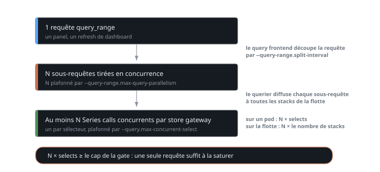

# La concurrence de lecture Thanos : amplification, gates et diagnostic

Une gate de store gateway protège un pod à la fois. Le nombre qu'on y met n'a de sens qu'en regard de ce qui arrive sur ce pod. Ce flux n'est pas le nombre de requêtes utilisateur mais ce nombre multiplié par le découpage du query frontend, par le nombre de sélecteurs de la requête, puis par le fan-out du querier vers les stacks.

Le symptôme de départ est une gate collée à son plafond alors que le trafic entrant ne bouge pas d'un pouce sur 24h. Cet article va de ce symptôme jusqu'à l'invariant qui empêche qu'il revienne. Le reste de la plateforme est décrit dans [Thanos at scale](thanos.md), qui couvre le sharding temporel et les limites de lecture.

## Une requête utilisateur n'est pas une requête

Le query frontend découpe chaque `query_range` en tranches de `--query-range.split-interval` et en envoie jusqu'à `--query-range.max-query-parallelism` **en concurrence**. Chaque sous-requête atteint un querier, qui la diffuse aux store endpoints dont la timerange et les external labels matchent. En pratique, elle part vers toutes les stacks de la flotte.



Le point qui compte est la distinction entre les 2 nombres du bas. Sur la flotte, une requête produit le parallélisme multiplié par le nombre de stacks. Sur **un** pod donné, elle en produit au moins autant que le parallélisme. C'est ce second nombre, celui qu'on oublie, qui se compare au cap de la gate.

!!! warning "Le découpage n'est pas le seul multiplicateur"
    Une sous-requête ne produit pas un seul Series call par store gateway. Elle en produit un par sélecteur de vecteur, envoyés en concurrence et plafonnés par `--query.max-concurrent-select` sur le querier. Le compte réel sur un pod est le produit du parallélisme et de ce nombre de sélecteurs. En pratique les requêtes portent peu de sélecteurs ([mesure plus bas](#ce-que-la-flotte-mesure-vraiment)) et ce cap ne mord que sur le pire cas.

Le sharding par timerange concentre encore la charge. Comme [chaque shard couvre une plage](thanos.md#un-shard-par-timerange), un dashboard sur 7 jours ne tape pas les shards au hasard. Il tombe sur le même shard de toutes les stacks à la fois, soit sur 2 pods par stack et pas un de plus.

Mesuré sur une vingtaine de stacks, l'amplification tourne autour de 2,5 Series calls par requête HTTP entrante en régime normal et monte à 84 en pic. Le dénominateur compte aussi les requêtes instantanées, qui ne se découpent jamais et que le query frontend [ne cache pas](thanos-cache.md). Elles diluent le chiffre de base et le vrai facteur sur les seules `query_range` est plus élevé.

!!! warning "`--labels.max-query-parallelism` amplifie pareil, mais ailleurs"
    Il porte sur les endpoints de labels, ceux qui résolvent les variables de template. Ils sont sollicités à chaque chargement de dashboard avant même le premier panel. Un parallélisme élevé y coûte donc plus souvent que sur les `query_range`. En aval, ce chemin **ne traverse pas la series gate**. Dans la store gateway, `queryGate.Start()` n'est appelé que par `Series()`, jamais par `LabelNames()` ni `LabelValues()`. Un parallélisme de labels élevé ne remplit donc pas la gate dont parle cet article. Il consomme de la mémoire et du CPU par une autre porte.

## Décomposer une saturation en débit et en durée

Le nombre d'appels en vol suit la loi de Little, `in_flight = λ × T`, où λ est le débit d'arrivée sur le pod et T la durée moyenne d'un appel. Une gate saturée ne dit pas lequel des 2 termes a bougé, alors que les leviers ne sont pas les mêmes.

Les 2 termes se lisent séparément. Le débit d'arrivée par pod se prend sur le compteur de la gate.

```promql
sum by (namespace, pod) (rate(thanos_bucket_store_series_gate_queries_total[5m]))
```

La durée moyenne d'un Series call se prend sur l'histogramme gRPC du serveur. Elle inclut l'attente à la gate, puisque `queryGate.Start()` est le premier appel de `Series()`. Sous saturation, T gonfle aussi parce que les appels font la queue.

```promql
  sum by (namespace, pod) (rate(grpc_server_handling_seconds_sum{grpc_method="Series"}[5m]))
/ sum by (namespace, pod) (rate(grpc_server_handling_seconds_count{grpc_method="Series"}[5m]))
```

Le résultat surprend. Entre le régime normal et le pic, le débit fait x4,5 alors que la durée fait x190, de 0,7 ms à 132 ms de moyenne. C'est la durée qui domine largement. Un graphe de QPS seul, celui qu'on regarde en premier, ne dit à peu près rien de la saturation.

La moyenne ne suffit pas non plus et la queue fait le reste du travail, avec des appels du dernier millième qui se comptent en secondes. Quelques appels de plusieurs secondes suffisent à remplir une gate. C'est le même piège que sur la latence utilisateur, où [p99 ne voit structurellement pas une population lente à 0,1 %](thanos.md#mettre-des-limites-en-lecture-et-en-ingestion).

Il y a donc 2 familles de leviers, une par terme. Pour borner λ, ce sont les multiplicateurs en amont. Pour borner T, ce sont les limites par requête sur la store gateway, `--store.limits.request-series` et `--store.limits.request-samples`, qui valent 0 par défaut, c'est-à-dire aucune limite.

!!! warning "Mesurer la taille d'un appel avant de poser une limite par requête"
    Ces limites ne servent que si un appel individuel est réellement gros. Il faut le vérifier sur `thanos_bucket_store_series_data_touched_bucket{data_type="series"}` plutôt que de recopier une valeur. Le filtre `data_type` n'est pas optionnel. La métrique porte aussi `postings` et `chunks`, d'un ordre de grandeur au-dessus. Sans ce filtre, le chiffre ne veut rien dire. Sur une flotte de production, 98 % des appels touchent 200 séries ou moins, 200 étant justement le premier bord de bucket. Le plus gros appel de la fenêtre en touche 200 000, soit 10 fois moins que la valeur de 2 000 000 qu'on voit passer. Posée là, la limite ne se déclenche jamais. La pression venait du nombre d'appels concurrents, pas de la taille d'un appel.

## Ordonner les limites de concurrence

4 limites se suivent sur le chemin de lecture et elles ne sont pas interchangeables. La première multiplie, la deuxième écrête un multiplicateur qui vient de la requête elle-même et les 2 dernières sont des plafonds de concurrence.

| Flag | Composant | Rôle |
|---|---|---|
| `--query-range.max-query-parallelism` | query frontend | sous-requêtes concurrentes par requête, 14 par défaut |
| `--query.max-concurrent-select` | querier | plafond des selects concurrents dans une requête, 4 par défaut |
| `--query.max-concurrent` | querier | requêtes PromQL simultanées par pod, 20 par défaut |
| `--store.grpc.series-max-concurrency` | store gateway | Series calls simultanés par pod, 20 par défaut |

!!! note "Les valeurs de la prod"
    Les calculs qui suivent partent des valeurs par défaut et de mesures faites quand les queriers étaient à 64. La prod tourne aujourd'hui avec des queriers régionaux à 128 pour `--query.max-concurrent` comme pour `--query.max-concurrent-select`, un querier global à 64 sur les 2 flags et une gate de store gateway à 50 (`--store.grpc.series-max-concurrency`). Avec un parallélisme de 14, 14 fois le nombre de sélecteurs dépasse 50 dès 4 sélecteurs et la gate reste atteignable par une seule requête large.

Le sens de `--query.max-concurrent-select` est l'inverse de ce qu'on croit. Il ne multiplie rien, il borne. Le vrai multiplicateur est le nombre de sélecteurs de vecteur de la requête et le flag ne fait que l'écrêter, `min(nb de sélecteurs, 4)`. Le compte par pod est donc `max-query-parallelism` fois ce minimum.

L'invariant qu'on voudrait est que ce produit reste sous le plus petit des 2 plafonds. **Les valeurs par défaut ne le respectent pas**, puisque 14 fois 4 fait 56 pour une gate à 20. Rien ne casse tant que le trafic est faible, parce que la gate met en file d'attente au lieu de refuser. Une requête à 4 sélecteurs suffit pourtant à demander presque 3 fois la place disponible. La marge n'existe pas, elle est empruntée au fait que personne ne requête en même temps. La règle ne mord en pratique que sur les requêtes larges, puisque la plupart portent bien moins de 4 sélecteurs (mesure plus bas).

Corriger un seul multiplicateur ne suffit pas toujours. Une flotte ramenée de 256 à 14 sur le découpage a vu son amplification de pointe tomber de 74 à 21 sans que la series gate décolle de son plafond. Le cap des selects, resté à 64, n'y était pour rien puisque les requêtes portaient peu de sélecteurs. La saturation venait de plusieurs requêtes concurrentes sur le même shard ([mesure plus bas](#ce-que-la-flotte-mesure-vraiment)). La tentation de monter le parallélisme reste réelle, puisqu'il rend effectivement plus rapide une requête large prise isolément.

2 seuils se franchissent alors, dans cet ordre.

Quand le parallélisme atteint le cap de la gate, **une seule requête suffit à saturer la gate de toutes les stacks à la fois**. Ce n'est plus une accumulation statistique de plusieurs lecteurs mais une identité de configuration. La requête est dimensionnée pour remplir la gate au bord.

Quand le parallélisme approche `--query.max-concurrent`, le problème change de nature et devient un problème d'isolation. Le calcul se fait sur le pool entier de queriers et pas sur un pod. 3 queriers à 64 donnent 192 places, qu'un parallélisme de 50 remplit avec 4 requêtes larges concurrentes. Mesuré au pas de 1 minute sur un burst, les 3 queriers étaient épinglés à 64 en même temps, somme exacte de 192, pendant que le débit entrant restait plat entre 6 et 13 requêtes par seconde et que les sous-requêtes montaient à 171 par seconde. Personne ne relie ça à un flag de découpage et on le vit comme « le Grafana est lent ».

### Ce que la flotte mesure vraiment

On a mesuré 7 jours côté store gateway et côté querier. La gate de la store gateway (cap 50) est au plafond 0,44 % des minutes, soit 44 minutes par semaine, surtout sur le shard le plus ancien des plus grosses stacks. L'attente à la gate y est de 102 ms en moyenne, 1,6 s au p99 et 26 s au p999. La file existe mais elle est étroite. La saturation vient de plusieurs requêtes concurrentes sur le shard d'historique, pas d'une seule requête large.

Les requêtes portent en moyenne 1,5 sélecteur de vecteur (3 au maximum sur une moyenne à 5 minutes). Le vrai multiplicateur est donc 14 × 1,5 = 21, sous la gate à 50, alors que 14 × 4 = 56 n'est que le pire cas théorique. Abaisser `--query.max-concurrent-select` à 3 n'écrêterait presque rien avec 1,5 sélecteur. Les leviers sont le shard d'historique (plus de replicas ou un découpage plus fin) et la concurrence entre requêtes, pas le cap des selects.

!!! warning "Un pic de 468 pour un cap de 64 n'est pas une saturation"
    Le flag `--query.max-concurrent-select` s'applique **par requête**, alors que la gauge `thanos_query_concurrent_selects_gate_selects_in_flight` additionne toutes les requêtes. Un pic de 468 pour un cap de 64 est donc normal, avec une attente moyenne à cette gate de l'ordre de la microseconde. Le signal de saturation côté querier est la gate PromQL, pas celle des selects.

Le querier global joint aussi les queriers régionaux par la StoreAPI, qui ne passe pas par leurs gates PromQL. Le flag `--query.max-concurrent` d'un querier régional ne borne donc rien pour le trafic du global et leurs caps à 128 n'ont jamais dépassé 1 requête en vol sur la semaine. Seule la gate PromQL du querier global (64) touche son plafond, quelques minutes par semaine.

!!! tip "Poser l'invariant dans le manifest, pas dans une tête"
    Les 4 flags vivent dans des blocs de config différents, souvent dans des fichiers différents. Rien ne signale qu'ils sont liés. Un commentaire sur chaque multiplicateur, qui nomme le plafond aval et dit pourquoi il doit rester en dessous, reste le garde-fou le plus durable contre le prochain qui voudra accélérer une requête lente.

## Lire au bon pas d'échantillonnage

Une gate saturée par un découpage ne monte pas en pente. Elle saute de 0 au plafond à l'intérieur d'un seul scrape et retombe. Au pas de 30 minutes d'un dashboard ouvert sur 7 jours, ce créneau n'existe pas. Le panel affiche 0 et on conclut que tout va bien.

Le correctif est côté requête, en enveloppant l'expression dans un `max_over_time` avec un pas de sous-requête explicite.

```promql
max_over_time(
  (
      max by (pod) (thanos_query_concurrent_gate_queries_in_flight)
    / on (pod)
      max by (pod) (thanos_query_concurrent_gate_queries_max)
  )[$__interval:1m]
)
```

La range de la sous-requête doit couvrir le pas d'affichage, d'où le `$__interval` de Grafana plutôt qu'une valeur en dur. Un `[5m:1m]` sur un panel évalué toutes les 30 minutes ne regarde que les 5 minutes précédant chaque point. 25 minutes sur 30 restent aveugles et le pic n'est capté que s'il tombe dans le bon sixième. Ce piège fait croire que le correctif marche alors qu'il déplace juste le trou.

Le contraste est net. Sur la même fenêtre et au même pas de 30 minutes, l'expression brute retourne 0 quand l'enveloppée retourne 1, c'est-à-dire gate pleine. Chaque pic est en contrepartie étalé sur la largeur d'un pas d'affichage. C'est un bon échange pour un panel dont le seul rôle est de répondre « est-ce qu'on a touché le plafond ».

Cette forme demande 2 précautions. Le pas de la sous-requête se pose explicitement. Un `[5m:]` reprend l'`evaluation_interval` du serveur (1 minute par défaut) et le résultat change d'un Prometheus à l'autre sans prévenir. Le ratio se prend aussi contre la métrique `_max` exportée plutôt que contre un nombre en dur. Sinon le panel continue de comparer à l'ancienne valeur après un changement de config, sans aucun symptôme visible.

Le même biais frappe ailleurs. Un `increase(<compteur>[2h])` lu en instantané n'est qu'un échantillon arbitraire et sous-estime lourdement tout ce qui est en burst. Pour un chiffre de dimensionnement, il faut un percentile de la fenêtre glissante sur plusieurs jours, avec un pas de sous-requête explicite.

!!! warning "Un `max_over_time` sur 24h ramène aussi les pods qui n'existent plus"
    La même enveloppe qui rend le créneau visible fait remonter toutes les séries de la fenêtre, y compris celles des ReplicaSets remplacés depuis. On croit compter 24 queriers dont 7 saturent, alors qu'il y en a 3 et qu'ils saturent tous les 3. Il faut compter le parc avec `count(group by (pod) (up{...} == 1))` avant de raisonner sur des pods, jamais avec le `max_over_time` qui sert à lire les pics. Si `up` ne remonte rien pour ces cibles, comme sur notre datasource globale, on compte depuis la métrique `_max` de la gate, `count(group by (pod) (thanos_bucket_store_series_gate_queries_max))`, toujours en instantané.

## La gate sature, elle ne bloque pas

Une gate qu'on voit pleine ne se corrige presque jamais en la montant.

La gate fait attendre, elle ne refuse pas. L'histogramme d'attente le prouve, en lisant ses séries `thanos_bucket_store_series_gate_queries_duration_seconds_bucket`, `_sum` et `_count`. Son aide dit exactement *how many seconds it took for queries to wait at the gate*. Sur 7 jours de la flotte, le temps s'accumulait là sans qu'aucune requête ne soit perdue. La saturation n'était donc pas la contrainte active, la mémoire l'était.

!!! warning "`queries_dropped_total` ne voit pas la gate"
    C'est le compteur qu'on regarde en premier et il ne prouve rien ici. Le compteur `thanos_bucket_store_queries_dropped_total` n'est incrémenté que par les limiters, son label `reason` valant `series`, `chunks` ou `bytes`. Il est câblé sur `--store.limits.request-series`, `--store.limits.request-samples` et `--store.grpc.downloaded-bytes-limit`, qui valent tous 0 par défaut. Le compteur reste structurellement à 0 tant qu'on n'a pas posé ces limites. Le lire comme une preuve que la gate n'a rien refusé est un raisonnement circulaire.

La gate peut quand même faire échouer une requête. La fonction `promgate.Start(ctx)` rend `ctx.Err()` si le contexte expire pendant l'attente. Une gate saturée assez longtemps fait donc échouer la requête par `--query.timeout` ou `--store.response-timeout`. La saturation ne se manifeste pas en drops mais en timeouts.

La distribution finit de trancher. Au pas de 1 minute sur 7 jours, en prenant le maximum sur toute la flotte (le pod le plus chargé, où qu'il soit), 98 % des minutes passent sous 14 Series calls concurrents. Le p99 est collé au cap, soit une centaine de minutes par semaine. Un cap relevé n'apporte rien 98 % du temps et retire la borne exactement pendant les 2 % qui font mal.

C'est la bonne façon de lire une saturation rare. La question n'est pas de savoir si la limite est trop basse mais ce qui produit les 2 %. Dans notre cas, c'était plusieurs requêtes concurrentes sur le shard le plus ancien des plus grosses stacks. Le slow log du query frontend permet de trouver les clients responsables, avec la requête, le dashboard et le panel qui l'a émise.

## Voir aussi

- [Thanos at scale : archi, perf et FinOps](thanos.md) - l'architecture, le sharding par timerange et les limites de lecture et d'ingestion
- [Les caches Thanos](thanos-cache.md) - ce que le query frontend cache et ce qu'il ne cache pas
