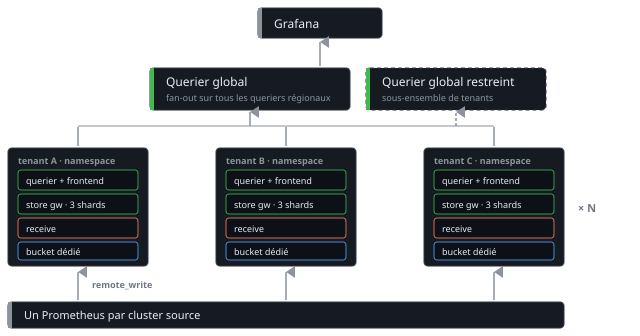
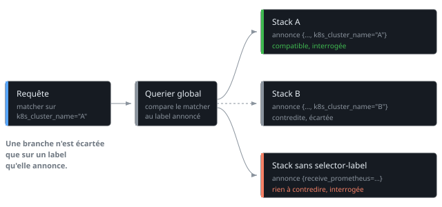
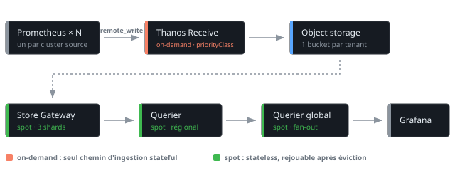
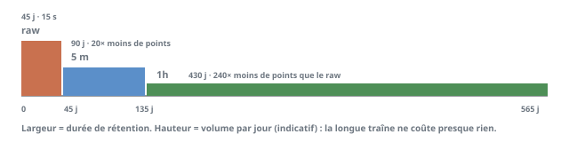
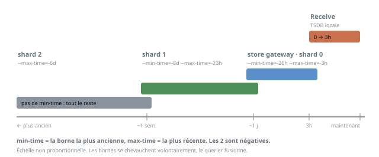
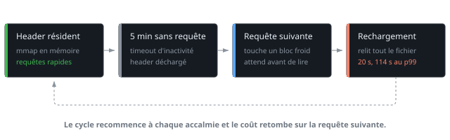

# Thanos at scale : archi, perf et FinOps

!!! warning "Écrit pour Thanos 0.42"
    Les flags et leurs valeurs par défaut bougent d'une version à l'autre et certains sont
    dépréciés en silence, comme `--store.grpc.series-sample-limit` remplacé par
    `--store.limits.request-samples`. Vérifier contre la doc de sa propre version avant de
    copier quoi que ce soit et ne rien lire ici comme un optimum : ce sont les arbitrages
    qu'on a faits avec nos contraintes, pas une configuration de référence.

Un Prometheus garde ses métriques aussi longtemps qu'on le lui demande. On pose
`--storage.tsdb.retention.time` ou `--storage.tsdb.retention.size` si on préfère plafonner
en volume et c'est réglé. On croit souvent que Thanos sert à allonger la rétention : ce
n'est pas là que Prometheus coince.

La TSDB vit sur un seul disque sans réplication et elle grossit
linéairement parce que Prometheus ne downsample pas. Enfin, elle ne répond que pour
elle-même, alors que certains déploiements multi-cluster gagnent à croiser leurs sources
simplement, dans une seule requête.

Thanos répond à ces trois limites : il pousse les blocs vers un object store, les
downsample, et une seule requête interroge tous les clusters. La doc explique très bien les mécanismes, mais
personne n'écrit la facture, ni le fait que chaque décision est un arbitrage où on gagne
sur le coût pour payer ailleurs. Cet article raconte les nôtres, y compris celles qu'on a dû annuler.

## Thanos, Mimir ou VictoriaMetrics

Premier malentendu à lever : on associe souvent Thanos au mode sidecar, donc à du pull, par opposition à Mimir qui serait du push. C'est faux dès qu'on utilise Thanos Receive : les Prometheus font un `remote_write`, exactement comme vers Mimir. Le chemin d'ingestion est le même, la config Alloy aussi (voir [Grafana Alloy](alloy.md), il suffit de changer l'URL).

Le mode Receive apporte en plus quelque chose que le sidecar ne peut pas donner : **le filtrage à la source**. Le sidecar uploade les blocks de la TSDB telle qu'elle est, donc tout ce qui est scrapé finit dans le bucket. Le seul filtre disponible est `metric_relabel_configs`, au scrape, qui supprime la métrique localement aussi.

Grâce à `remote_write`, on dispose de `write_relabel_configs`, qui ne touche que ce qui part. On choisit donc ce qui va en long terme : les métriques produit dont on suit la tendance sur des mois partent, les métriques techniques qui les accompagnent restent en local.

```yaml
remote_write:
  - url: http://thanos-receive:19291/api/v1/receive
    write_relabel_configs:
      # tout ce qui est utile en debug local mais pas sur 14 mois
      - source_labels: [__name__]
        regex: 'go_.*|process_.*|promhttp_.*'
        action: drop
      # les histogrammes de latence par endpoint, ingérables en cardinalité
      - source_labels: [__name__, handler]
        regex: 'http_request_duration_seconds_bucket;/api/v1/.*'
        action: drop
```

Une métrique qui ne part pas ne coûte rien côté Thanos, ni en stockage, ni en compaction, ni en cardinalité. C'est le moyen le plus simple de faire baisser la facture. En local, Prometheus garde tout pour le debug à chaud, seul le long terme est filtré.

Le vrai critère de choix est ailleurs : une stack isolée par tenant ou un cluster mutualisé ?

- Mimir et VictoriaMetrics poussent vers un backend unique et multi-tenant, avec des limites par tenant
- Thanos Receive permet le multi-tenant, mais rien n'oblige à l'utiliser ainsi

On a pris le chemin inverse du manuel : un jeu complet de composants par cluster source. Chaque cluster a son bucket, son namespace, son receive, ses store gateways, son querier. Ça multiplie les composants et c'est assumé.

Ce qu'on y gagne :

- un tenant en surcharge ne ralentit que sa stack, et le querier global
- le dimensionnement se fait par tenant, un petit cluster ne paye pas pour le gros

Ce qu'on y perd : une vingtaine de compactors, de queriers et de store gateways à opérer. C'est tout le sujet de la suite.

## L'architecture high-level

Une stack complète par tenant et au-dessus un querier global qui fait le fan-out sur tous les queriers régionaux.



Ce querier global a son propre query frontend et son propre cache de résultats. Rien n'oblige à n'en avoir qu'un. On peut poser un second querier global sur un sous-ensemble de tenants, pour donner à une équipe une vue limitée à son périmètre sans lui ouvrir la flotte entière.

```yaml
query:
  extraFlags:
    - --query.auto-downsampling
    - --grpc-compression=snappy
queryFrontend:
  extraFlags:
    - --query-range.split-interval=12h
    - --labels.max-query-parallelism=14
    - --query-range.max-query-parallelism=14
    - --query-frontend.compress-responses
    - --cache-compression-type=snappy
    - --query-frontend.log-queries-longer-than=10s
```

Le parallélisme du query frontend global est à 14, comme sur les stacks régionales. On l'avait monté à 256, mais à ce niveau une seule requête large sature la gate de la store gateway sur toutes les stacks à la fois (voir [la concurrence des queries](thanos-query-concurrency.md)).

Le plus important n'est pas dans les flags. La liste des stores interrogés est dynamique. Elle suit les clusters déclarés, comme les stacks elles-mêmes. Une liste statique dérive toujours. On finit avec une entrée qui pointe vers un Thanos mort ou un tenant que personne n'interroge.

Le piège d'une liste dynamique, c'est son ordre. Le générateur `clusters` d'un ApplicationSet ArgoCD ne garantit pas l'ordre de ses éléments, donc la liste rendue dans `--endpoint.sd-config` change d'ordre d'un rendu à l'autre. Pour Kubernetes, c'est un nouveau pod template : le Deployment repart en rollout sans aucun changement réel (11 fois en 3 jours chez nous). Il faut trier la liste au moment du rendu avec `sortAlpha`.

Le flag `--query-frontend.log-queries-longer-than=10s` est à activer dès le premier jour. C'est ce qui permet de savoir quel dashboard fait souffrir la stack, plutôt que de le deviner.

Une requête lente dans ce log ne veut pas dire que le dashboard est mal écrit, la lenteur vient souvent d'une seule stack. Le querier global attend **toutes** les stacks avant de répondre et la latence perçue est celle de la plus lente. Une stack qui répond en 150 ms au p99 mais en 4 s dans sa queue suffit à produire des requêtes utilisateur à 25 s, dès lors que le fan-out en interroge une vingtaine : la probabilité de tomber sur au moins un traînard devient forte.

On a longtemps cherché des requêtes trop lourdes. En réalité, les plus lentes étaient des requêtes simples qui attendaient la stack la plus lente. Un sélecteur sur 9 séries qui met 26 secondes ne calcule presque rien : **il attend**. Le levier n'est alors ni le cache ni le sizing : c'est de réduire le fan-out, en s'assurant que les external labels annoncés par chaque stack permettent au querier global d'élaguer ceux qui ne peuvent pas matcher, ou de borner la queue avec le couple `--store.response-timeout` et `--query.partial-response`.

!!! warning "Partial response et alerting ne font pas bon ménage"
    Si les principaux appelants sont des règles d'alerte - et c'est souvent le cas, elles
    tournent en continu là où un dashboard n'est ouvert que par intermittence - une réponse
    incomplète peut sous-rapporter silencieusement et ne pas déclencher. Borner la latence au
    prix d'une alerte qui rate n'est pas un bon échange.

Il y a aussi un effet de bord qu'on ne voit pas venir. En principe, **une réponse partielle n'est pas cachée** et le cache disparaît **précisément** quand il servirait le plus. Chaque rafraîchissement repart alors de zéro sur une infrastructure déjà en souffrance. C'est un **amplificateur**, pas un amortisseur.

En pratique, la règle a des trous. On a déjà vu un résultat partiel rester en cache pendant 30 jours, avec des datacenters absents d'un dashboard alors que l'API répondait complet. Ajouter `+ 0` à la fin de la requête change sa clé de cache et suffit à le confirmer.

Le flag ne fixe qu'un défaut et les clients peuvent le surcharger par requête avec le paramètre `partial_response`. Le compromis consiste à désactiver le partial response par défaut pour protéger les règles d'alerte et le cache. Seule la datasource Grafana des humains le garde activé. Pour eux, une réponse partielle avec un warning vaut mieux qu'un spinner de 25 secondes.

## Annoncer le label sur lequel on filtre

Le querier global n'écarte une stack que si la requête contredit un label que cette stack
annonce dans son info endpoint, ses external labels. Les labels présents dans ses séries ne
comptent pas. Tout repose sur cette différence et on a mis longtemps à la voir.

Nos queriers de tenant annonçaient leurs labels de receive, qui identifient bien la stack
mais que personne n'écrit jamais dans une requête. Les dashboards, eux, filtrent sur le nom
du cluster. Aucun matcher ne pouvait donc contredire quoi que ce soit, aucune stack
n'était écartée et chaque requête partait sur la vingtaine de stacks.



Les métriques existantes le montraient déjà, sans rien instrumenter de plus. Toutes les
stacks servaient les mêmes QPS sur `Series`, à 0,4 % près. Un tenant qui pèse quelques
dizaines de milliers de séries encaissait autant d'appels que le plus gros de la flotte.

Il faut ensuite choisir quel label annoncer. Il doit remplir 2 conditions.

- Les requêtes doivent réellement le porter. Sinon aucun matcher ne le contredit jamais et l'annonce ne sert à rien.
- Chaque stack ne doit porter qu'une seule valeur de ce label. Une stack qui reçoit `dc="euw1"` et `dc="euw4"` mais n'annonce que `euw1` est écartée des requêtes sur `euw4`, et ses données disparaissent sans erreur.

En général, un seul label remplit les 2. Il dépend de la manière dont les clients écrivent leurs requêtes et du découpage des stacks. Il n'y a pas de nom universel. Chez nous, 2 labels cochent les 2 cases. Le premier est le label de cluster que les Prometheus posent en external label et sur lequel toutes les variables de dashboard sont câblées, `k8s_cluster_name`. Le second est `dc`, annoncé aussi par stack en opt-in, avec la même règle d'une seule valeur par stack. Ce sont des conventions internes, à lire comme des exemples. Ce qui compte est qu'un label coche les 2 cases, pas son nom.

Le flag se pose ensuite sur le querier de chaque tenant, avec le label retenu :

```yaml
extraFlags:
  - --selector-label=k8s_cluster_name="<le cluster de ce tenant>"
  - --selector-label=dc="<le dc de ce tenant>"   # seulement si la stack n'a qu'un dc
```

Il se vérifie dans l'info endpoint et pas dans la conf, le label doit apparaître dans les
`external_labels` que le querier global expose sur `thanos_store_nodes_grpc_connections`.

Dans le code, `ProxyStore.LabelSet()` passe par `ExtendSortedLabels`, donc le flag **étend** les label
sets remontés des stores en aval au lieu de les remplacer : tout ce qui filtrait déjà sur
les autres labels continue de marcher.

Pour compter les stores connectés, la même métrique a une série par endpoint, donc un `max()` vaut 1 quelle que soit la taille de la flotte. Il faut compter par pod de querier puis garder le pire, `min(count by (pod) (thanos_store_nodes_grpc_connections > 0))`.

!!! warning "Une stack qui ingère 2 clusters ne peut pas être annotée"
    La seconde condition n'est pas théorique : 4 de nos stacks reçoivent 2 clusters chacun,
    parce que des clusters sans bucket dédié poussent dans le receiver régional.
    `--selector-label` ne portant qu'une valeur par clé et `ProxyStore.Series()` s'auto-filtrant
    dessus, une valeur unique n'y ralentit pas la requête, elle renvoie **vide** pour le second
    cluster. C'est une perte de données silencieuse en lecture, donc le flag se pose en opt-in
    par stack et jamais en défaut de template.

Le gain réel a été de 28 % d'appels en moins sur les stacks annotées, pas les 96 % qu'on
visait. L'écart vaut pour toute flotte multi-tenant.

Une stack qu'on n'a pas pu annoter reste interrogée par 100 % des requêtes, donc même une
requête parfaitement scopée sur un cluster touche encore tous ceux-là. Surtout, la
plupart des requêtes ne portent aucun filtre de cluster : en passant en revue les 1300
dashboards de notre Grafana, sur les 417 qui interrogent le store global, 71 ont une
variable de cluster et 346 n'en ont aucune. Une variable laissée sur « All » ne compte pas
davantage, elle se rend en regex qui matche tout.

Ce n'est pas de la négligence. Un développeur qui regarde son API ne sait pas, et n'a pas à
savoir, sur quel cluster tourne son pod. Sa requête filtre sur un job ou un namespace et
aucun label annoncé ne permet d'écarter une stack.

L'annonce de labels réduit le fan-out pour les requêtes qui portent le bon label, typiquement
les dashboards d'infra. Les autres demandent d'autres leviers, comme une variable de cluster
dans le dashboard ou un querier global limité au périmètre d'une équipe.

Tant que le querier global n'écarte aucune stack, chaque requête part vers toutes et une
petite stack en reçoit autant qu'une grosse. Sa charge suit le
trafic des dashboards, pas son volume de données. Sur 24h, toutes les stacks montent et
descendent ensemble, de 17,7 à 45,1 QPS selon l'heure, à quelques pourcents près.
Dimensionner une stack sur sa seule volumétrie laisse de côté toute cette charge de requêtes.

## Le chemin d'une métrique



La couleur porte l'essentiel : tout ce qui est stateless et rejouable tourne sur spot, seul le chemin d'ingestion reste on-demand.

## Éviter le trafic inter-zone

Chaque flèche du schéma précédent est du trafic facturé. Receive qui uploade ses blocks, la store gateway qui les retélécharge à chaque miss de cache, les séries qui remontent en gRPC vers le querier, puis le fan-out du querier global sur tous les régionaux. À une vingtaine de tenants le volume est conséquent et personne ne le regarde parce qu'il n'apparaît pas sur la ligne compute.

Sur GCP, un transfert entre 2 zones d'une même région est facturé, alors qu'il est gratuit à l'intérieur d'une zone. Chez nous, tous les composants d'une stack tournent dans une seule zone. Les répartir entre zones apporte de la haute dispo mais rend chaque échange entre eux facturé. Si on fait ce choix, il faut d'abord mesurer ce que coûte le trafic inter-zone.

Le bucket suit la même logique mais à la maille région, un bucket GCS étant régional et pas zonal. Depuis une VM de la même région la sortie ne coûte rien, alors qu'un bucket dans une autre région ou en multi-région se paye à chaque lecture et la store gateway lit beaucoup.

!!! warning "Le prix : plus de redondance de zone"
    Une stack dans une seule zone tombe avec sa zone. C'est le même arbitrage que le RF=1 sur receive (voir « Réplication : le choix assumé ») :
    on accepte de perdre un tenant le temps d'une panne zonale plutôt que de payer du trafic
    inter-zone en permanence. Sur des métriques la perte est bornée et l'historique reste
    dans le bucket, ce qui rend le compromis tenable là où il ne le serait pas sur une base
    transactionnelle.

C'est aussi ce qui rend le cache partagé et `--grpc-compression=snappy` rentables au-delà de la latence : ils réduisent des octets qui sont facturés. Attention à ce flag, il porte un *Deprecated after v0.43.0* dans son aide, la compression se configurant désormais par endpoint dans la service discovery fichier.

La version de Thanos compte autant que la config. Le batching gRPC arrivé en 0.41 groupe jusqu'à 64 séries par message `SeriesResponse` au lieu d'une, ce qui amortit l'overhead par message. Les auteurs annoncent des économies réseau importantes et des queriers qui consomment un peu moins de CPU. Le 64 est la taille de lot par défaut (`DefaultResponseBatchSize`), pas un facteur de gain, et le flag `query.series-response-batch-size` qui permettait de la régler a disparu quand le batching est passé actif par défaut. Aucun tuning de config ne donne ça.

## Spot pour tout ce qui se rejoue

Un pod de querier évicté n'est pas important, la requête sera réessayée sur un autre pod. Une store gateway évictée retélécharge ses index-headers. Un compactor évicté reprendra son travail au run suivant. Tous ces composants sont sur un node pool spot dédié.

Receive, non. C'est le seul composant qui tient de la donnée pas encore uploadée. Il reste sur un pool on-demand, avec un `priorityClassName` dédié pour ne pas se faire évicter par la pression d'un autre workload.

```yaml
# Composants rejouables
tolerations:
  - key: kubernetes.io/arch
    value: arm64
    effect: NoSchedule
nodeSelector:
  cloud.google.com/compute-class: thanos-spot

---
# Receive : chemin d'ingestion stateful
nodeSelector:
  cloud.google.com/compute-class: thanos
priorityClassName: thanos-receive-critical
```

Le prix à payer se voit à la reprise. Après une éviction, une store gateway n'est prête qu'une fois ses index-headers retéléchargés. **Plus ses index sont gros, plus la reprise est longue.** Il faut caler les alertes dessus, sinon on se réveille la nuit pour rien. On recommande une alerte sur l'écart de replicas du StatefulSet, avec un `for` qui couvre la reprise :

```yaml
- alert: ThanosStoreIsDown
  # up == 0 ne sonne pas : un pod évicté qui reste Pending sort des targets
  expr: kube_statefulset_replicas{statefulset=~".*thanos-store.*"} - kube_statefulset_status_replicas_ready{statefulset=~".*thanos-store.*"} > 0
  for: 30m      # et pas 5m : la reprise après éviction spot est lente
```

!!! warning "`partial-response` seul ne coupe aucune stack lente"
    `--store.response-timeout` vaut **`0ms` par défaut, ce qui désactive le timeout**. Tant
    qu'on n'y touche pas, une store gateway lente mais vivante est attendue jusqu'à
    `--query.timeout`, et la réponse partielle ne sauve que le cas d'un store réellement
    injoignable. La doc est explicite : *if you prefer availability over accuracy you can set
    tighter timeout to underlying StoreAPI than overall query timeout*. C'est le couple des
    2 flags qui borne la latence, pas `partial-response` tout seul.

Une question qu'on oublie souvent de se poser : pendant cette reprise, que voit l'utilisateur ? Ça dépend de `--query.partial-response`, activé par défaut. La query renvoie ce qu'elle a pu récupérer, assorti d'un warning, plutôt qu'une erreur. Un dashboard affiche donc un graphe avec un trou dedans et le trou ne se voit pas forcément.

C'est le bon comportement pour du dashboard temps réel, beaucoup moins pour une règle d'alerting ou un rapport de capacité. Le paramètre se surcharge par requête et une réponse partielle n'est en principe pas mise en cache.

Le tout tourne sur des instances ARM, ce qui se cumule avec le spot sur le ratio prix/performance. La tolération `arch=arm64` est posée sur tous les composants.

## Receive : le composant le plus cher

Receive garde la head de sa TSDB en mémoire, donc sa consommation ne suit pas le débit d'ingestion mais le **nombre de séries actives**. Doubler la fréquence de scrape ne change presque rien, ajouter un label à forte cardinalité fait exploser la facture et comme c'est le seul composant en on-demand chaque Gio y coûte plus cher qu'ailleurs.

On ne plafonne pas cette RAM, on agit sur ce qui la fait grossir.

Le levier le moins cher reste de réduire le nombre de séries. Le `write_relabel_configs` vu plus haut agit avant l'ingestion donc il ne coûte rien et le `head_series_limit` par tenant plafonne ensuite ce qu'un cluster peut pousser.

Vient ensuite le sharding du hashring. `hashmod` répartit déjà les séries sur tous les receivers, ce que Ketama apporte c'est la stabilité quand le pool bouge : la doc le présente comme *a consistent hashing scheme which enables stable scaling of Receivers without the drawbacks of the hashmod algorithm*. Avec `hashmod`, ajouter un pod redistribue une grande partie des séries et provoque un pic mémoire sur tout le monde. C'est le nombre de pods qui fait baisser la RAM par pod, Ketama est ce qui permet de changer ce nombre sans douleur.

Le plus structurant est de séparer le routing de l'ingestion. Quand `--receive.local-endpoint` n'est pas défini, un Receive tourne en mode routeur pur et transmet les écritures sans rien stocker localement. On peut alors poser beaucoup de routeurs légers devant peu d'ingesters et ne payer de la RAM que sur ces derniers.

!!! warning "Ce qu'on n'active pas sans raison"
    Les caches de postings étendus (`--tsdb.head.expanded-postings-cache-size` et son
    équivalent block) sont expérimentaux et désactivés par défaut : les activer se paye
    directement en mémoire. Les exemplars aussi, `--tsdb.max-exemplars` valant 0, ce qui
    veut dire au passage que les exemplars envoyés en `remote_write` sont droppés en silence.

!!! warning "Le redémarrage est le moment dangereux"
    Au redémarrage, Receive rejoue son WAL en mémoire avant d'accepter du trafic. Si le pod
    OOM avant la fin, le WAL a grossi entre-temps et le replay suivant est plus lourd encore,
    ce qui transforme un simple restart en indisponibilité longue. Le signal à surveiller est
    le nombre de segments WAL et pas `up` : une croissance continue veut dire que la
    compaction ne suit plus.

Enfin, comme Receive est un binaire Go, il mérite un `GOMEMLIMIT` calé sur sa limite de pod. Sans ça le GC laisse la heap grossir jusqu'à l'OOM kill au lieu de s'emballer pour rester sous le seuil. Voir [GOMAXPROCS et GOMEMLIMIT dans Kubernetes](../../kubernetes/deployment/gomaxprocs_gomemlimit_kubernetes.md).

## Rétention et downsampling



3 paliers sur le compactor :

```yaml
compactor:
  retentionResolutionRaw: 45d
  retentionResolution5m: 90d
  retentionResolution1h: 430d
```

On garde 430 jours plutôt que 365. Comparer un pic saisonnier à celui de l'année d'avant demande un peu de marge, et 2 mois de plus ne coûtent presque rien à cette résolution.

C'est là que le downsampling devient intéressant : la longue traîne est quasi gratuite. Passer de 15 secondes à 1 heure, c'est 240 fois moins de points, mais chaque point downsamplé garde 5 agrégats (count, sum, min, max, counter), donc un facteur réel autour de 48 avant compression. Les 430 jours en résolution horaire pèsent une fraction des 45 jours en résolution native. Garder un an ne coûte pas 12 fois 2 mois.

Avec `--query.auto-downsampling`, le querier prend comme résolution source maximale le pas divisé par 5, donc il faut un pas d'au moins 25 minutes pour lire le 5m et de 5h pour lire le 1h. Un dashboard de 24h à un pas de 240s lit le raw. Le downsampling n'aide que les timeranges assez longs pour que Grafana élargisse le pas.

!!! warning "Ne jamais gérer les blocks avec une lifecycle policy du bucket"
    Le compactor est le seul composant qui connaît les dépendances entre un block raw et ses
    versions downsamplées, donc lui seul peut décider quoi supprimer. Une politique de cycle
    de vie côté object storage supprime ou archive à l'aveugle.

[Le retour d'expérience d'Anuj Ramola](https://medium.com/@anujramola/thinking-your-storage-class-is-helping-you-save-cost-for-thanos-s3-buckets-think-again-9ae18ccc382a) est instructif. Son équipe a basculé 6 mois de blocks vers Glacier Deep Archive pour économiser une cinquantaine de dollars mensuels de stockage. Le compactor a voulu compacter des blocks devenus illisibles sans restauration préalable, a échoué et a retenté toutes les 5 minutes en boucle. Les requêtes objet sont passées de 1,1 million à 40 millions par jour, soit 13 dollars à 480 dollars sur la seule ligne API et l'économie de stockage a été payée 10 fois.

Dans le même ordre d'idées, les paliers du compactor doivent rester alignés sur ce que les store gateways servent réellement, sinon on paye pour des blocks que personne n'interroge ou on cherche de la donnée que la rétention a déjà supprimée.

Côté flags de compaction :

```yaml
extraFlags:
  - --deduplication.func=penalty
  - --deduplication.replica-label=prom_replica
  - --compact.enable-vertical-compaction
  - --block-files-concurrency=2
  - --compact.blocks-fetch-concurrency=1
  - --downsample.concurrency=1
  - --no-debug.halt-on-error
```

Un mot sur `--no-debug.halt-on-error` : le compactor sort en erreur au lieu de continuer en silence. On préfère un job rouge à un bucket qui se dégrade sans que personne ne le voie.

Ce garde-fou a une limite qu'il faut connaître. Le downsampling peut se terminer sur un warning du type `empty chunks happened, skip series` sans jamais passer en erreur, donc sans halte et la rétention supprimera ensuite les blocks raw alors qu'aucun remplaçant downsamplé n'a été produit. Le halt ne couvre que les vraies erreurs, pas les succès assortis d'un warning, ce qui oblige à surveiller les logs du compactor et pas seulement ses codes de sortie.

Les 3 flags de concurrence sont à 1 ou 2 volontairement. Ils valent 1 par défaut et la doc recommande d'allouer un cœur CPU par unité de `--compact.concurrency`. Les monter transforme un job court en job cher.

!!! warning "2 flags à ne pas activer à l'aveugle"
    `--deduplication.func=penalty` sert à dédupliquer des replicas Prometheus qui ne sont
    pas bit à bit identiques, mais l'algorithme casse encore occasionnellement les `rate` et
    `irate`. Quant à `--compact.enable-vertical-compaction`, il fusionne des flux de blocks :
    si 2 producteurs différents publient avec les **mêmes external labels**, leurs séries
    se mélangent et deviennent inexploitables. C'est pour ça que chaque tenant a son propre
    jeu d'external labels et c'est non négociable.

## Compacter sans payer le disque 24h/24

C'est l'optimisation la plus rentable de la stack et celle qui a le plus d'effets de bord.

Un compactor déployé en Deployment tourne 24h/24 avec son PVC attaché en permanence, alors qu'il ne travaille réellement que quelques minutes toutes les quelques heures. Sur une vingtaine de stacks, ça fait une vingtaine de disques facturés en continu pour un usage marginal.

On l'a donc passé en CronJob avec un volume éphémère :

```yaml
compactor:
  enabled: false        # on ne veut pas le Deployment du chart

# CronJob maison
schedule: "0 */6 * * *"
concurrencyPolicy: Forbid
successfulJobsHistoryLimit: 1
failedJobsHistoryLimit: 1
ttlSecondsAfterFinished: 600
persistence:
  ephemeral: true
  storageClass: hyperdisk-standard
```

Le `concurrencyPolicy: Forbid` n'est pas cosmétique. **2 compactors simultanés sur le même bucket corrompent les blocks.** C'est une garantie que le Deployment assurait tout seul et qu'il faut réclamer explicitement en CronJob.

Le volume éphémère est ce qui matérialise l'économie. Le disque est créé avec le Pod et réclamé à la fin du job. Plus de PVC en `Bound` entre 2 runs.

!!! warning "L'effet de bord : l'alerting ment"
    La règle standard `ThanosCompactIsDown` repose sur un `absent()` ou un `up == 0`. Entre 2 runs, il n'y a plus ni Pod, ni Service, ni cible de scrape. La règle passe donc en alerte **en permanence**, 23 heures sur 24.

Il faut la neutraliser et la remplacer par des règles qui interrogent l'état du CronJob via `kube-state-metrics` :

```yaml
# La règle générique ne peut pas matcher
- alert: ThanosCompactIsDown
  expr: vector(0) == 1

# Aucun run réussi depuis 12h, alors que le schedule est à 6h
- alert: ThanosCompactCronJobStale
  expr: |
    time() - kube_cronjob_status_last_successful_time{cronjob=~".*thanos-compact.*"} > 12 * 3600
  for: 30m

# Un job en échec
- alert: ThanosCompactCronJobFailed
  expr: kube_job_status_failed{job_name=~"thanos-compactor.*"} > 0
  for: 5m
```

La fenêtre de 12 heures tolère un cycle manqué. `ThanosCompactCronJobFailed` reste du best-effort. Le `ttlSecondsAfterFinished` à 600 fait disparaître le Job 10 minutes après son échec, donc la fenêtre de détection est courte.

Ces 2 règles disent si le job tourne, pas s'il fait son travail. Un compactor peut réussir tous ses runs et laisser le backlog s'accumuler parce que la concurrency ne suit pas le volume produit. Le bucket grossit alors en continu sans que rien ne s'allume.

Depuis la v0.24 le compactor expose 4 gauges faites pour ça, `thanos_compact_todo_compactions`, `thanos_compact_todo_compaction_blocks`, `thanos_compact_todo_downsample_blocks` et `thanos_compact_todo_deletion_blocks`. Elles ne servent pourtant à rien ici.

!!! danger "Les gauges de backlog n'existent pas en CronJob"
    Les 3 calculateurs de progression qui les alimentent sont enfermés dans un
    `if conf.wait` de `cmd/thanos/compact.go`, et l'aide de `--compact.progress-interval`
    le dit noir sur blanc : *when `--wait` has been enabled*. Un compactor en CronJob
    tourne sans `--wait`, donc il n'enregistre jamais ces gauges. Une alerte posée dessus
    ne se déclenche pas, ce qui est pire qu'une alerte absente. Même piège avec
    `--wait-interval`, qui ne sert à rien sans `--wait` : en CronJob, chaque run fait une
    seule passe puis sort, donc le poser est inoffensif mais n'a aucun effet.

On ne récupère pas ces gauges sans revenir au Deployment, donc sans rendre le disque à la facturation. Le compromis qu'on recommande est de lire le backlog du côté des store gateways, qui tournent en continu et resynchronisent les métadonnées de blocks à chaque `--sync-block-duration`.

```yaml
# Le nombre de blocks du bucket ne redescend plus sur 24h
- alert: ThanosCompactBacklog
  expr: |
    min(thanos_blocks_meta_synced{state="loaded", job=~".*thanos-store.*"})
      - min(thanos_blocks_meta_synced{state="loaded", job=~".*thanos-store.*"} offset 24h)
      > 0
  for: 24h
```

C'est un proxy, pas le compte exact des compactions en attente : un bucket dont le nombre de blocks ne redescend jamais est un bucket que le compactor ne rattrape pas.

Les échecs de compaction ne se détectent pas avec `thanos_compact_group_compactions_failures_total`, et une règle `ThanosCompactGroupFailures` posée dessus ne se déclenche jamais en CronJob. Cette métrique est exportée par le compactor lui-même, qu'on ne scrape que pendant un run : il n'y a ni Service ni cible entre 2 passes, donc la série n'existe presque jamais côté Prometheus. Un run qui échoue sort en erreur (`--no-debug.halt-on-error`), et c'est le Job en échec que `ThanosCompactCronJobFailed` et `ThanosCompactCronJobStale` voient via `kube-state-metrics`.

## Un shard par timerange

Une store gateway qui sert tout le bucket doit être dimensionnée pour la requête la plus violente qu'on lui posera jamais, par exemple un dashboard avec un timerange de 6 mois qui va charger énormément de donnée en RAM sur tous les replicas, pendant que le dashboard temps réel attend derrière.

Les 2 profils d'accès n'ont pourtant rien à voir :

- les données récentes sont interrogées en permanence, sur un petit volume et doivent répondre vite
- les données anciennes sont interrogées rarement, mais chaque requête scanne énormément et supporte d'être lente

On recommande donc de découper la store gateway en 3 shards par timerange, avec 2 replicas chacun. Le plus récent couvre le dernier jour : un `--max-time` dans le futur (par exemple `3h`) veut dire pas de borne haute, donc il va de maintenant moins 1 jour jusqu'à maintenant et ne « démarre » pas à 3 heures. Les dernières heures sont aussi servies par Receive depuis sa TSDB.



Les 2 flags sont négatifs et se lisent à l'envers de ce qu'on croit. `--min-time` est la borne la plus ancienne, donc le nombre le plus grand en valeur absolue. `--max-time` est la plus récente.

```yaml
# shard 0 : le dernier jour, le chaud, sollicité en continu
- --min-time=-26h
  --max-time=-3h

# shard 1 : de 1 jour à 1 semaine
- --min-time=-8d
  --max-time=-23h

# shard 2 : tout ce qui est plus vieux qu'une semaine
- --max-time=-6d
```

Le découpage sert 2 choses.

Le dimensionnement suit le profil d'accès. Chaque shard est taillé pour son usage, donc sur les gros tenants le shard historique monte à plusieurs dizaines de Gio de RAM sans qu'on les donne aux 2 autres, alors que le shard chaud reste modeste. Sans découpage on paye le pire cas partout.

Le blast radius se réduit aussi, puisqu'une requête de 6 mois ne tape que le shard historique. Elle peut le saturer sans mettre par terre celui qui sert le dernier jour.

!!! warning "Faire chevaucher les plages, volontairement"
    Les bornes ci-dessus se recouvrent d'une heure ou d'un jour et ce n'est pas une erreur.
    La doc Thanos recommande explicitement le chevauchement : le querier sait fusionner et
    ça évite un trou si un shard est indisponible. À l'inverse, des bornes jointives au
    millimètre garantissent une fenêtre aveugle dès qu'un replica manque.

Un block dont la plage franchit une borne est chargé par les 2 shards, qui gardent chacun son index-header et le lisent chacun quand une requête couvre la zone, ce qui double la RAM et les lectures pour ce block.

Le filtrage se fait au niveau du chunk et pas de l'échantillon, donc un shard peut renvoyer des points hors de sa plage annoncée. La découverte des blocks est aussi asynchrone, à l'intervalle de `--sync-block-duration` (15 minutes par défaut), ce qui s'ajoute au délai d'upload. Ce délai ne fait pas perdre de donnée : Receive garde 12h de TSDB en local et les blocks sources d'une compaction restent servis 24h avant d'être supprimés. Le flag ne pilote que les appels `iter` du bucket, le reste suit les TTL du caching bucket (voir [Les caches Thanos](thanos-cache.md#le-gain-cote-facture)).

Ce découpage temporel n'est pas le seul possible. Quand c'est le bucket d'un seul tenant qui devient trop gros, le sharding par labels externes via `--selector.relabel-config` répond mieux et les 2 se combinent.

## Payer de la capacité disque pour acheter du débit

La store gateway tournait au départ sur `emptyDir`, donc sur le disque de boot du nœud. Sur les gabarits qu'on avait choisis, le téléchargement des index-headers au démarrage saturait ce disque : les instances sont IO bound et un store qui doit rapatrier ses index-headers y passe un temps déraisonnable. C'est ce même téléchargement qui rallonge la reprise après une éviction.

On a donc donné à la store gateway un PVC dédié, dimensionné pour le débit et non pour la place.

Sur Hyperdisk Balanced, la performance est découplée de la capacité, et c'est le piège quand on arrive du Persistent Disk. Les IOPS et le débit se provisionnent explicitement, les 3000 premières IOPS et 140 Mio/s sont offerts, **le reste est facturé**. La capacité ne fait que relever le plafond de ce qu'on a le droit de provisionner, `MIN(500 x Gio, 160000)`, ce qui impose au minimum 6 Gio pour avoir droit aux 3000 IOPS de base.

Grossir le disque sans toucher au reste ne donne donc presque rien : sans `provisioned-iops-on-create`, le défaut suit `6x + 3000`, et passer de 6 à 20 Gio fait passer de 3036 à 3120 IOPS, soit 3 % de mieux. Ce sont les IOPS provisionnées dans la StorageClass qui coûtent et qui font le travail, pas la capacité.

Le volume est à 20 Gio par défaut, ce qui suffit à débloquer le plafond d'IOPS, et on le relève stack par stack là où les index-headers le demandent : 30 ou 40 Gio sur 2 stacks, 80 Gio sur la plus grosse. Le dimensionnement suit le volume d'index-headers du shard le plus chargé (celui des blocks de plus d'une semaine), qui grossit à chaque compaction, et une valeur unique s'applique à tous les shards d'une stack. Les `volumeClaimTemplates` d'un StatefulSet sont immutables et un Hyperdisk ne sait que grossir, donc on dimensionne toujours vers le haut et on ne revient jamais en arrière.

!!! note "C'est un contournement, pas une optimisation"
    Tout ce calcul existe parce qu'on a choisi des instances économiques qui sont IO bound.
    Avec des gabarits plus généreux en débit disque ou du local SSD, le problème ne se
    poserait pas et la store gateway n'aurait pas besoin de PVC du tout. On a déplacé le
    coût du compute vers le stockage, ce qui reste gagnant sur la facture, mais il faut
    savoir que la solution propre est ailleurs.

## Mutualiser les caches

Thanos a 3 caches et, par défaut, chacun vit dans la mémoire de son process. Sur la flotte,
ça fait une centaine de caches séparés qui repartent à froid à chaque redémarrage. Une
éviction spot coûte donc deux fois, le pod à relancer puis toutes les données à relire
depuis le bucket.

Les caches sont un sujet à part entière et ont [leur propre page](thanos-cache.md). Elle couvre le backend
partagé, les limites du caching bucket entre tenants, le dimensionnement et le gain sur la
facture.

## Mettre des limites en lecture et en ingestion

Logger les requêtes lentes ne suffit pas, il faut pouvoir les arrêter. Avec RF=1 et des store gateways sur spot, un seul dashboard qui balaie plusieurs mois de raw peut saturer une store qui mettra ensuite longtemps à revenir.

Côté lecture, les garde-fous sont sur la store gateway. Les valeurs ci-dessous sont celles qu'on recommande :

```yaml
extraFlags:
  - --store.limits.request-series=2000000
  - --store.limits.request-samples=100000000
  - --store.grpc.downloaded-bytes-limit=10GB
  - --store.grpc.series-max-concurrency=50
```

Les 2 premiers remplacent `--store.grpc.touched-series-limit` et `--store.grpc.series-sample-limit`, qui sont dépréciés. Les 3 limites valent 0 par défaut, c'est-à-dire aucune limite. `--store.grpc.series-max-concurrency` est l'exception : on recommande 50 alors que le défaut est de 20. À 100, des store gateways se sont fait OOMKill, donc 50 est une borne mémoire (le pic de RSS suit le nombre de `Series` en vol) et pas un bouton de débit : le remonter ne rend rien plus rapide, ça ne fait que rapprocher l'OOMKill.

!!! warning "Une requête coupée n'est jamais servie"
    Une limite atteinte ne ralentit pas la requête, elle la rejette. Le dashboard qui la
    déclenche échoue donc à chaque rafraîchissement, tant que personne ne réduit son
    timerange ou sa cardinalité. Sans partial response, le panel affiche une erreur. Avec,
    il affiche un résultat incomplet assorti d'un warning que personne ne remarque. Avant
    de poser ces limites, repérer les dashboards qui les dépassent dans le log des requêtes
    lentes et prévenir leurs propriétaires.

Côté ingestion c'est plus intéressant financièrement, parce que Receive est on-demand donc le plus cher au vCPU et que rien ne le protège d'un tenant qui explose en cardinalité.

```yaml
# --receive.limits-config-file
write:
  global:
    # sans meta-monitoring, head_series_limit reste inerte
    meta_monitoring_url: "http://prometheus.monitoring:9090"
  default:
    request:
      size_bytes_limit: 0
      series_limit: 1000
      samples_limit: 10000
    head_series_limit: 1000000
  tenants:
    gros-tenant:
      head_series_limit: 5000000
```

!!! warning "head_series_limit n'est pas une barrière étanche"
    Il a besoin d'une meta-monitoring, c'est-à-dire d'un endpoint compatible Prometheus
    Query API que Receive interroge toutes les 15 secondes pour connaître le nombre de
    séries actives par tenant. Si cet endpoint est injoignable, Receive **arrête de limiter**
    et se contente de logger. La donnée étant par nature en retard, on dépasse toujours un
    peu la limite et la fonctionnalité est marquée expérimentale.

Les 2 familles de limites ne rendent pas le même code et la nuance décide de qui perd de la donnée. Les limites de requête (`series_limit`, `samples_limit`, `size_bytes_limit`) rendent un **413**, que Prometheus ne rejoue pas : ce qui est refusé est perdu, et une limite trop basse fait des trous dans les métriques du tenant. Le `head_series_limit`, lui, rend un **429** (`tenant is above active series limit`), que Prometheus rejoue selon son `retry_on_http_429`. Poser une limite de séries actives ralentit donc un tenant, poser une limite de requête l'ampute.

Sur 14 jours de mesure, aucune explosion de cardinalité : la plus grosse stack oscille chaque jour de 0,86M à 3,7M de séries (pic à 4,6M) et son plus gros saut sur 1h est d'environ +1M. Une limite à pic × 1,5 ne se déclenche donc jamais, et la limite mémoire du pod tient environ 2 fois le pic. Avec un seul replica et sans HA sur Receive, un 429 bloque toutes les écritures du tenant tant qu'il reste au-dessus de la limite, alors qu'un OOM ne coûte qu'un restart et un replay du WAL. Le levier est donc la limite mémoire, dimensionnée sur le pic de séries. Le `head_series_limit` garde sa valeur dans un Receive partagé entre plusieurs tenants, ou avec de la réplication.

## GOMAXPROCS : le parallélisme qu'on n'a pas choisi

Le moteur PromQL de Thanos découpe chaque sélecteur de vecteur en plusieurs goroutines de
décodage, ce qui apparaît dans le plan d'exécution sous la forme `0 mod N`, `1 mod N`. N
n'est exposé par aucun flag Thanos, il sort du runtime :

```go
decodingConcurrency := opts.DecodingConcurrency
if opts.DecodingConcurrency < 1 {
    decodingConcurrency = max(runtime.GOMAXPROCS(0)/2, 1)
}
```

Depuis Go 1.25 le runtime lit la limite CPU du cgroup pour fixer GOMAXPROCS. Le seul
composant de la stack qui porte une limite CPU est donc le seul dont le parallélisme de
requête est plafonné et chez nous c'était le querier global, celui qui fusionne les réponses
de toutes les stacks. Il décodait sur 4 shards alors que le querier de chaque stack en
utilisait 8. Personne
n'a pris cette décision, elle est tombée d'un commit qui montait les requests et limits
mémoire et qui a emmené le CPU avec lui.

L'autre moitié est pire : les composants sans limite CPU prennent le nombre de cœurs du
nœud. Le parallélisme des requêtes est alors dicté par le gabarit que l'autoscaler a choisi
ce matin-là, il change sans commit et sans que rien ne le signale.

Avant de corriger quoi que ce soit, la case `Analyze` de l'UI Thanos affiche le temps passé
dans chaque nœud du plan d'exécution. Sur la requête qui nous intriguait, 1,88 s au total
dont 1,38 s dans la lecture des séries et les 4 shards rendaient la même durée à la
milliseconde près : ils finissaient ensemble parce qu'ils attendaient tous la même chose,
les stores. Le décodage n'était pas le goulot, le CPU des pods plafonnait à 0,3 cœur sur une
limite de 8 et doubler le nombre de shards n'aurait rien acheté.

Poser GOMAXPROCS explicitement reste utile pour que le comportement cesse de dépendre du
nœud, mais tant que les requêtes attendent le réseau c'est de l'hygiène et pas une
optimisation. Autant le savoir avant d'ouvrir le ticket.

!!! note "Right-sizer le CPU d'un composant memory-bound ne rend rien"
    Le querier global demandait 4 cœurs pour un pic mesuré à 0,31, ce qui ressemble à une
    économie facile. Sur un gabarit highmem à environ 7,8 Gio par vCPU, ses 45 Go de RAM
    immobilisent déjà l'équivalent de 5,3 vCPU : descendre la request CPU ne libère aucun
    nœud et ne change même pas la densité de pods. C'est la dimension contraignante qui
    décide et ici c'est la mémoire.

## Nos tests et nos échecs

Le PVC de la store gateway réglait le problème de disque saturé, mais pas la lenteur du téléchargement lui-même. L'étape suivante paraissait donc évidente : activer la stratégie de lazy download, pour ne charger que ce dont on a besoin. Moins de disque, moins de trafic, un démarrage plus rapide.

On l'a **retirée**. Sur des dashboards historiques larges, ceux qui balaient plusieurs mois d'un coup, le p99 est monté jusqu'à environ **224 secondes**. L'économie de disque ne valait pas des dashboards inutilisables.

On avait gardé le lazy load des index-headers en mémoire, avant de le retirer lui aussi une fois les disques changés (voir [le prix du rechargement en lazy load](#le-prix-du-rechargement-en-lazy-load) plus bas).

Toutes les optimisations de coût ne passent pas. Celle-là s'est payée en latence et on a rollback.

!!! warning "Le p99 est aveugle aux pathologies rares"
    Nos requêtes pathologiques représentaient 0,12 % du trafic. Un p99 se calcule sur les 99 %
    les plus rapides : il ne peut **structurellement pas** les voir. On lisait 0,15 s au p99 là
    où le p999 donnait 4 s et le p9999 5,3 s, soit un facteur 30 caché juste sous le seuil.

Ça marche dans les 2 sens. Sur un gate de concurrence, le p99 et le p999 donnaient tous les 2 10 à 17 ms, ce qui n'apprend rien : c'est le p9999 à 95 ms qui a permis d'écarter la mise en file avec certitude, pics de saturation compris.

Dès qu'une pathologie touche nettement moins de 1 % des requêtes, mesurer au p999 ou au p9999, ou ne pas mesurer du tout. On a tiré 2 conclusions fausses avant de s'en apercevoir.

## Le prix du rechargement en lazy load

Le flag `--store.enable-index-header-lazy-reader` ne charge l'index-header d'un block qu'à la première requête qui le touche, et le décharge après un délai d'inactivité. Il promet 2 choses : une store gateway qui démarre sans attendre d'avoir lu tous ses headers, et une mémoire qui ne porte que les blocks réellement interrogés.

On l'avait activé pour la première, comme contrepartie du spot. Une store gateway évictée doit relire ses index-headers avant de pouvoir répondre. Sur des instances économiques qui sont IO bound, ça se compte en dizaines de minutes, les mêmes que celles de la reprise après éviction plus haut. Le téléchargement, lui, reste eager. Ce qu'on n'avait jamais fait, c'est mesurer ce que le lazy load déplace.

Le flag décharge un index-header après un délai d'inactivité qui vaut 5 minutes par défaut.
Sur une plateforme où les dashboards ne sont ouverts que par intermittence, les headers ne
sont donc presque jamais résidents : sur le shard qui porte les blocks les plus vieux, la
résidence tourne entre 0 et 9 % sur toute la flotte et le shard chaud décharge entre 18 et
32 fois par heure et par pod. Le premier utilisateur qui ouvre un dashboard paie un
rechargement complet avant qu'une seule série ne soit lue, ce qui est exactement le
symptôme « la première requête est interminable » qu'on nous remontait sans savoir quoi en
faire.



Le coût de ce rechargement n'a rien à voir avec le flag, il est fixé par la taille du
fichier d'index-header, elle-même fixée par la cardinalité du tenant. Le plus lourd de nos
tenants porte 2,1 Go par header contre 0,12 Go pour le plus léger, un facteur 17, et le
classement des durées de chargement suit exactement : 20 secondes de moyenne et 114 s au p99
d'un côté, moins de 0,5 s de l'autre.

Ce n'est ni du CPU ni du disque saturé, on a vérifié les 2 avant de conclure : pendant un
chargement de 28 secondes le conteneur consommait 0,04 cœur et les disques tournaient à
moins de la moitié de leur temps d'occupation. C'est un gros fichier qu'on relit, rien de
plus.

### Allonger le délai d'inactivité

Tout ça, c'est le comportement avec le délai par défaut. Le flag `--store.index-header-lazy-reader-idle-timeout` (5 minutes) est caché : il n'apparaît pas dans `--help`, mais il existe bel et bien. Le monter à 10h, soit une journée de travail, garde les index-headers ouverts entre 2 chargements de dashboard : le premier de la matinée paie le rechargement, les suivants lisent un header déjà résident. Sur notre plus gros tenant, le temps de chargement a baissé de 84 %, soit environ 6 fois plus rapide.

```yaml
extraFlags:
  - --store.enable-index-header-lazy-reader
  - --store.index-header-lazy-reader-idle-timeout=10h
```

Ça n'a réglé qu'une partie du problème. Une nuit dure plus de 10h, donc le premier dashboard du matin rechargeait encore tout. La résidence plafonnait d'ailleurs autour de 50 % sur la flotte : la moitié des blocks restait plus de 10h sans être lue.

### Tout charger au démarrage

L'étape suivante a été de couper le lazy load sur une stack de test. Sur le shard qui porte les blocks les plus vieux, la part des requêtes au-delà de 9 secondes est passée de 1 à 4,5 % selon les jours à 0. Le pic quotidien de heap, lui, est resté à 3,4 Gio là où il montait jusqu'à 20 Gio auparavant. La seconde promesse du flag ne pesait donc presque rien : un header chargé est surtout un fichier mappé en mémoire, du page cache que le noyau sait reprendre, pas du heap qu'il faudrait provisionner pour tout le corpus.

Le prix se paie au démarrage, puisque la store gateway ne passe Ready qu'après avoir lu tous ses headers. Sur la stack de test, le shard des blocks les plus vieux porte 24 index-headers pour 39 Gio et met 3 min 30 à 4 min à démarrer, soit 160 à 190 Mio/s, à peu près le débit du disque. Les 2 autres shards, avec 1,5 Gio et 0,2 Gio, démarrent tous les 2 en une trentaine de secondes : à cette taille, on ne mesure plus que le démarrage du process. Ce chiffre ne tient que parce que les headers sont sur un PVC Hyperdisk provisionné à 3000 IOPS et 200 Mio/s (voir « Payer de la capacité disque pour acheter du débit » plus haut), et le temps de boot suit ce débit : doubler le volume de headers double l'attente. Sur le disque de boot d'une instance IO bound, le même chargement se comptait en dizaines de minutes. Sans disque à IOPS provisionnées, il vaut donc toujours mieux garder le lazy load : 30 secondes sur un dashboard valent mieux qu'une store gateway absente une demi-heure.

Le chart bitnami rend une seule liste `extraFlags` pour tous les shards d'une stack, donc impossible de couper le flag sur le seul shard qui souffre : le test a basculé les 3 shards de la stack. La généralisation redémarre de même toutes les store gateways de la flotte. Les stacks archivées, qu'on n'interroge presque plus, gardent le lazy load.

Le flag ne supprime pas le coût du chargement, il le déplace du démarrage vers la première requête, où le délai d'inactivité décide combien de fois on le paie. Avec des disques rapides, le payer une fois par redémarrage coûte moins cher que de le payer chaque matin.

### Les métriques que personne n'affiche

Aucun dashboard livré ne porte ces compteurs, alors qu'ils sont exposés par défaut. Tant
qu'on ne les trace pas, le symptôme reste invisible et il faut passer les logs de la store
gateway en debug pour voir passer les `lazy loaded index-header`.

| métrique | ce qu'elle dit |
|---|---|
| `thanos_bucket_store_indexheader_lazy_load_total` | chargements |
| `thanos_bucket_store_indexheader_lazy_unload_total` | évictions après le délai d'inactivité |
| `thanos_bucket_store_indexheader_lazy_load_duration_seconds` | le prix d'un chargement |
| `thanos_bucket_store_indexheader_lazy_load_failed_total` | un header perdu, donc des résultats incomplets en silence |

Le panel qui manquait le plus est la résidence, `(load - unload) / blocks_loaded`, qui dit
d'un coup d'œil quelle part du corpus est encore chargée. À 0, la prochaine requête paiera
plein tarif.

!!! warning "Ne pas passer histogram_quantile sur cet histogramme"
    Ses bornes de buckets sautent 5, 15, 30, 60, 90, 120 puis 300 secondes, donc tout
    quantile qui tombe au-delà de 5 s est interpolé dans un bucket large de dizaines de
    secondes et sort une courbe lisse qui est un artefact. On lit la moyenne par
    `sum / count`, qui est exacte, et on compte les franchissements de bucket pour la queue.

## Réplication : le choix assumé

Thanos Receive sait faire du hashring et de la réplication. Le chart sait le déployer, en opt-in par stack, avec le `receive-controller` et la ConfigMap de hashring.

Il n'est activé nulle part : ni le `receive-controller` ni le hashring ne sont déployés aujourd'hui, sur aucune stack. **Le facteur de réplication réel est de 1.**

La résilience ne repose donc pas sur la duplication de l'ingestion, mais sur 2 autres choses : la rétention locale de la TSDB (12 heures de head) et l'upload continu vers l'object storage. Si un receive tombe, on perd la fenêtre non uploadée de ce tenant, pas l'historique.

C'est un arbitrage coût contre disponibilité, pas un oubli. Un facteur de réplication supérieur à 1 multiplie la mémoire, puisque chaque replica maintient sa propre copie des séries en RAM et on parle du composant qui est justement en on-demand. L'opt-in reste disponible pour basculer un tenant précis si son SLA le justifie.

Le raisonnement se retourne d'ailleurs. Avec RF=2 et 2 replicas, une éviction devient survivable et Receive pourrait descendre sur spot comme le reste et on récupérerait l'économie sur le composant le plus cher. Ce qu'on paierait à la place, c'est une archi nettement plus complexe, avec le hashring à maintenir, le receive-controller qui le recalcule à chaque changement de topologie et les rééquilibrages qui vont avec. On a préféré payer de l'on-demand plutôt que de la complexité.

!!! warning "Le quorum d'écriture en RF=2 a changé en v0.37"
    Receive accepte une écriture quand un quorum de replicas l'a reçue. La formule générale est `RF/2 + 1`, soit 2 replicas sur 2 en RF=2. Avant la v0.37, un seul replica évicté bloquait donc toutes les écritures et il fallait RF=3 sur 3 replicas pour survivre à la perte d'un pod. La [PR #7669](https://github.com/thanos-io/thanos/pull/7669) a fait du RF=2 un cas particulier avec un quorum de 1, pour garder les garanties d'un setup sidecar à 2 Prometheus. En contrepartie, une écriture acceptée pendant l'éviction n'existe qu'en un exemplaire jusqu'au retour du second replica.

!!! note "À ne pas confondre avec la déduplication"
    Le `--deduplication.replica-label=prom_replica` vu plus haut n'a rien à voir. Il traite
    les paires de Prometheus en HA qui écrivent les mêmes séries en double vers Receive.
    La réplication interne de Receive, elle, est bien désactivée.

## Garder une vingtaine de stacks maintenables

Une stack par cluster, ça veut dire dupliquer la configuration autant de fois. La réponse tient en 2 mécanismes.

Un ApplicationSet ArgoCD génère les stacks avec son générateur `clusters`, qui parcourt les clusters déclarés dans ArgoCD et ne retient que ceux qui portent un label donné. Ajouter un cluster à la flotte ne demande aucune merge request sur Thanos : on pose le label sur le cluster, la stack apparaît.

Les values Helm sont empilées en couches, de la plus générique à la plus spécifique :

```text
values/common/                          defaults partagés par toutes les stacks
values/thanos-common/                   defaults de l'archétype « stack régionale »
values/thanos-stack/                    flags et hostnames, communs à tous les environnements
values/thanos-<type>/                   surcharge par type de bucket
<env>/values/...                        les mêmes couches, propres à un environnement
<env>/values/thanos-<tenant>-<type>/    surcharge dédiée à un tenant
```

Tout repose sur `ignoreMissingValueFiles: true`, qui rend chaque étage optionnel. On déclare toutes les couches partout et seules celles qui existent s'appliquent.

L'ApplicationSet ne porte que l'identité de la stack. Les flags, les hostnames et le sizing vivent dans un chart wrapper du repo, qui embarque le chart Thanos en dépendance. Un bloc `values:` inline en goTemplate ne se rend que dans ArgoCD, si bien que ni `helm template` ni la revue d'une MR ne le voient. Le sortir de l'ApplicationSet rend chaque stack reproductible en local.

Un opt-in par stack se branche sur le même mécanisme. La couche `thanos-receive-ha` est nommée `thanos-receive-ha-off` quand l'option est désactivée, et `ignoreMissingValueFiles` ignore ce dossier qui n'existe pas.

Les versions récentes d'ArgoCD acceptent le glob dans `valueFiles`. Une couche découpée en 12 fichiers par composant tient alors en 1 ligne au lieu de 12 :

```yaml
helm:
  ignoreMissingValueFiles: true
  valueFiles:
    - $argocd/apps/thanos/values/common/*.yml
    - $argocd/apps/thanos/values/thanos-common/*.yml
```

!!! warning "Le glob s'expanse alphabétiquement"
    Sans conséquence à l'intérieur d'une couche quand les fichiers sont découpés par
    composant et ne se recouvrent pas, mais on garde **un wildcard par couche** et les
    couches restent ordonnées : c'est entre elles que la précédence compte, pas dedans.

## Voir aussi

- [Les caches Thanos](thanos-cache.md) - mutualiser les 3 caches sur un backend partagé, et ce que ça change sur la facture
- [Grafana Alloy](alloy.md) - la collecte en amont, le `remote_write` pointe vers Receive au lieu de Mimir
- [GKE Spot Nodes](../../cloud/gcloud/spot_nodes.md) - la même ligne de partage entre workloads évictables et critiques
- [Netdata, Prometheus et Grafana](simple_monitoring_stack.md) - la stack de départ, avant que la rétention devienne un problème
