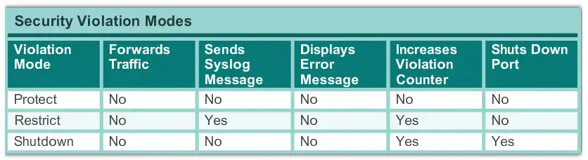

# Switch Cisco : Accroître la sécurité

Étant donné que le switch ou le routeur est au cœur d'un réseau, il est très important de ne pas négliger sa sécurité. Voici comment la renforcer.

## Désactivation des interfaces inutilisées

N'importe qui ayant un accès physique à l'équipement peut s'y brancher si on ne désactive pas les interfaces inutilisées

```cisco
Comm1(config)#interface range fastEthernet 0/12-23
Comm1(config-if-range)#shutdown
```

## ACL

Il est préférable de définir uniquement certaines IP ayant accès au routeur en SSH, pour cela, nous utilisons les ACL

Admettons que notre adresse IP soit *192.168.1.20*

```cisco
Router(config)# access-list 25 permit host 192.168.1.20
Router(config)# access-list 25 deny any log
Router(config)# line vty 0 15
Router(config-line)# access-class 25 in
Router(config-line)# transport input ssh
```

L'ACL s'applique à **toutes** les lignes VTY : une session entrante prend la première ligne libre (0, puis 1...), restreindre une seule ligne laisse les autres ouvertes à tous. Selon le modèle il y a 5 lignes (`0 4`) ou 16 (`0 15`), `show line` les liste.

`access-class` filtre telnet comme SSH. `transport input ssh` coupe telnet au passage, qui fait transiter les mots de passe en clair.

Le `log` de la dernière ligne journalise les tentatives non autorisées.

## Tentatives Maximale

Pour éviter le bruteforce, nous pouvons définir une politique de tentative d'accès sur une plage de temps donnée :

```cisco
Router(config)# login block-for 120 attempts 3 within 60
Router(config)# login quiet-mode access-class 25
```

La première ligne bloque les connexions pendant 2 minutes (**120** secondes) après **3** échecs en 1 minute (**60** secondes). Ce blocage vaut pour tout le monde, admin légitime compris : sans `login quiet-mode access-class`, n'importe qui peut nous verrouiller dehors en ratant 3 mots de passe. La seconde ligne laisse passer les IP de l'ACL 25 pendant le blocage.

## Taille de mots de passe minimum

Afin d'éviter le bruteforce et de casser un mot de passe à cause d'une complexité trop faible, nous pouvons imposer un nombre de caractères minimum. 8 est un plancher, on vise plutôt 12 ou plus :

```cisco
Router(config)# security passwords min-length 12
```

La règle ne s'applique qu'aux mots de passe définis après la commande, les existants ne sont pas revérifiés.

## Timeout

En cas d'oubli de déconnexion, une session peut rester ouverte indéfiniment, c'est pour cela que nous définissons une durée de timeout :

```cisco
Router(config)# line vty 0 15
Router(config-line)# exec-timeout 5 0
```

Au bout de **5 minutes** d'inactivité sur une ligne **VTY**, la session est déconnectée. La valeur par défaut d'IOS est déjà de 10 minutes : la commande sert à descendre en dessous, et surtout à vérifier qu'aucun `exec-timeout 0 0` (jamais de timeout) ne traîne dans la config.

## DHCP Snooping

Le DHCP Snooping protège contre une attaque MITM où un serveur DHCP pirate se fait passer pour le serveur légitime, afin de fournir de mauvaises informations (mauvaise passerelle, mauvais DNS...).

On l'active globalement, puis sur les VLAN à protéger. La commande globale seule ne fait rien : le snooping n'est actif que sur les VLAN listés.

```cisco
switch(config)#ip dhcp snooping
switch(config)#ip dhcp snooping vlan 10,20
```

À partir de ce moment, tous les ports de ces VLAN sont considérés comme « untrust » et donc aucun ne peut fournir du DHCP. Il nous faut donc placer le port qui mène au vrai serveur DHCP (ou à l'uplink) comme « trust »

```cisco
switch(config)#interface fa0/1
switch(config-if)#ip dhcp snooping trust
```

On peut également limiter le nombre de paquets DHCP par seconde sur les ports untrust (limit rate)

```cisco
switch(config-if)#ip dhcp snooping limit rate 100
```

## Port security

Le port security n'est actif sur aucun port par défaut. On l'active par port, en mode access, avec `switchport port-security` seul : sans cette commande, `maximum`, `violation`, `sticky` et les adresses MAC statiques sont acceptés mais n'ont aucun effet.

```cisco
Comm1(config)#interface fastEthernet 0/18
Comm1(config-if)#switchport mode access
Comm1(config-if)#switchport port-security
```

### Limitation d'adresse MAC

On peut limiter le nombre d'adresses MAC utilisables par port. Le défaut est déjà de 1 adresse, on ne le précise que pour en autoriser plus (un téléphone IP avec un PC derrière, par exemple)

```cisco
Comm1(config-if)#switchport port-security maximum 2
```

### Sécurité en cas de violation

Il existe différents modes de violation de droits



Par défaut, les ports sont en shutdown : à la première violation, le port passe en err-disabled et il faut le réactiver à la main (`shutdown` puis `no shutdown`). C'est déjà le mode le plus strict.

On ne passe en restrict (le trafic des MAC inconnues est jeté et journalisé, le port reste up) que là où couper le port gêne plus que l'intrusion

```cisco
Comm1(config)#interface fastEthernet 0/18
Comm1(config-if)#switchport port-security violation restrict
```

### Affectation d'adresse MAC statique

Afin d'améliorer au maximum la sécurité, nous pouvons attribuer de manière statique, ou bien en mode « apprentissage » une adresse MAC sur un port défini.

Cela empêche un appareil inconnu de se connecter à un port, même si celui-ci est activé

#### En mode apprentissage

En mode apprentissage (sticky), le switch met en allowlist les premières adresses MAC qui se connectent au port, jusqu'au `maximum`

```cisco
Comm1(config)#interface fastEthernet 0/18
Comm1(config-if)#switchport port-security mac-address sticky
```

Les adresses apprises sont écrites dans la running-config seulement : sans `copy running-config startup-config`, elles sont perdues au reboot.

#### En mode statique

En mode statique, seule l'adresse MAC enregistrée peut se connecter au port

```cisco
Comm1(config)#interface fastEthernet 0/18
Comm1(config-if)#switchport port-security mac-address 0002.16E8.C285
```

## Désactiver les services inutiles

Un service actif représente toujours une potentielle faille, ainsi qu'une charge CPU inutile.

Si nous ne nous en servons pas, il est toujours de bonne pratique de les désactiver. L'interface web existe en HTTP et en HTTPS, on coupe les deux :

```cisco
Comm1(config)# no ip http server
Comm1(config)# no ip http secure-server
```
