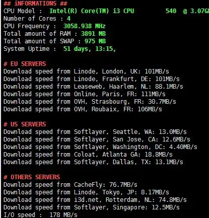
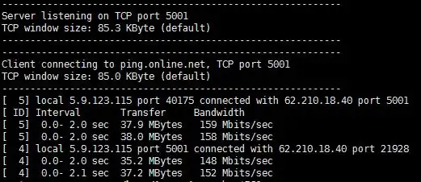

# Tester la bande passante effective de son serveur avec des proofs files

## Préambule

Ce wiki va nous aider à déterminer la bande passante réelle de son
serveur. Evidemment, plusieurs critères rentrent en jeu, tel que la
location physique de son serveur, sa bandwidth théorie/garantie, son
peering...

Par exemple, si l'on a un serveur Gbps chez Online et que l'on
effectue un test sur un serveur appartenant à Online, le test ne
reflétera pas le débit réel, étant donner qu'on dispose généralement
d'une bande passante importante.

Si le réseau internet est surchargé au moment ou vous effectuez le test,
il est possible que le résultat soit en dessous de la réalité.

## Qu'est ce qu'un proof file ?

Un *proof file* est un fichier stocké sur un serveur disposant d'une
importante bande passante (Généralement du Gbps vroi 10Gbps) afin
d'effectuer des tests de vitesse avec différents hébergeur. Il existe
des fichier de différente taille selon les différents hébergeurs (1Go,
2.5Go...) Cela permet de refléter le débit réel d'un réseau avec un
autre réseau et donc de tester son peering

## Liste des proofs files disponibles

| Provider | Lien |
| --- | --- |
| I3D | [Ici](https://customer.i3d.net/mirror/) |
| Tele2 | [Ici](http://speedtest.tele2.net/) |
| Vultr (Francfort) | [Ici](https://fra-de-ping.vultr.com/) |
| Free | [Ici](http://test-debit.free.fr/) |
| Linode | [Ici](https://www.linode.com/speedtest) |
| OVH | [Ici](https://proof.ovh.net/) |
| Online (AMS) | [Ici](http://ping-ams1.online.net/) |
| Online | [Ici](http://ping.online.net/) |
| Test Debit | [Ici](https://testdebit.info/) |
| X4B | [Ici](http://lg.x4b.net/) |
| Serverius | [Ici](http://speedtest.serverius.net/) |
| Hetzner (Falkenstein) | [Ici](https://fsn1-speed.hetzner.com/) |
| Belwue | [Ici](http://speedtest.belwue.net/) |
| LG | [Ici](http://lg.core-backbone.com) |

Durant les cours intéréssants, j'ai finis par développer (Ou plutôt
fork) un script permettant de lancer des DLs à partir d'une multitude
de location, le script est disponible sur Dropbox.

Voici le rendu du script :



## iPerf, kezako ?

iperf est un logiciel nécessitant un serveur et un client compatible IPv4 et IPv6, se basant sur les protocoles UDP et TCP (plus SCTP avec iperf3, sous Linux et FreeBSD uniquement), disponible sur Windows, Linux et même Android et iOS. 2 versions cohabitent : iperf2 (`iperf`) et iperf3 (`iperf3`), qui ne sont pas compatibles entre elles. Un client iperf2 ne parle pas à un serveur iperf3.

Il s'agit de la solution la plus pure pour tester la vitesse d'un
réseau car une multitude d'options sont disponibles : taille du paquet,
connections simultanées, port....

Par défaut, iperf2 utilise le port 5001 en TCP, iperf3 le port 5201.

2 options sont toutefois indispensables à l'utilisation de iperf :

* `-s` pour exécuter iperf en mode `serveur`
* `-c` pour exécuter iperf en mode `client`

Voici l'exemple typique de la commande à lancer côté client. *ping.online.net* ne répond plus qu'en iperf3, sur les ports 5200 à 5209 (le 5001 d'iperf2 est fermé) :

```bash
# Client vers serveur, 4 flux en parallèle
iperf3 -c ping.online.net -p 5200 -i 2 -t 10 -P 4
# Sens inverse : le serveur envoie, on reçoit
iperf3 -c ping.online.net -p 5200 -i 2 -t 10 -R
```

Dans cette commande, nous lançons iperf3 en mode client (`-c`) sur l'hôte *ping.online.net*, pendant 10 secondes (`-t 10`, une durée en secondes, pas un nombre d'essais), avec un rapport de débit intermédiaire toutes les 2 secondes (`-i 2`). `-P 4` ouvre 4 flux en parallèle et `-R` inverse le sens du test. Un serveur public ne sert qu'un test à la fois : sur `the server is busy running a test`, on essaie le port suivant.

Pour plus d'informations, je vous invite à aller consulter [la
documentation officielle](https://iperf.fr/iperf-doc.php) du logiciel.

Il semble également exister une [liste officieuse](https://iperf3serverlist.net/) comprenant de nombreux autres serveurs

La capture ci-dessous date de l'époque iperf2, avec `iperf -c ping.online.net -i 2 -t 2 -r`. `-r` teste les 2 sens l'un après l'autre (`-d` les teste en même temps) :



Nous pouvons clairement apercevoir plusieurs parties sur le screen.

Tout d'abord, le mode de transfert choisi (TCP), le port d'écoute du
serveur (soit 5001, le port par défaut), ainsi que la *TCP Window
Size* (85KB)

Suivi des informations côté client, qui sont logiquement les mêmes que
celle serveur, soit TCP, port 5001 et une Window Size +/- identique
(Ici, 0.3KB de différence, soit un gain négligable)

Et enfin, nous observons enfin les données qui nous sont utiles. Tout
d'abord, sous l'identifiant « 5 », il s'agit des données qui sont
envoyées par le serveur et enfin, sous le champ 4, les données qui
sont réellement reçus par le serveur « hôte ».

Nous pouvons apercevoir un écart de 10 Mbps entre les 2 sens. Ce n'est pas une preuve de perte de paquets : les 2 sens sont mesurés l'un après l'autre, pendant 2 secondes seulement, et peuvent suivre des routes différentes (routage asymétrique, congestion d'un côté, fenêtre TCP). Pour mesurer la perte, on passe en UDP avec iperf3 (`iperf3 -c <serveur> -u -b 500M`, colonne `Lost/Total`) ou on regarde la colonne `Retr` (retransmissions TCP) d'un test iperf3 classique.

A savoir qu'il existe une petite liste officielle de serveurs publics
disponible sur [le site officiel](https://iperf.fr/iperf-servers.php) de
l'éditeur du logiciel, à laquelle je rajouterai *iperf.ovh.net* que je
viens de découvrir en farfouillant sur Internet ou encore
*iperf.worldstream.nl*.
