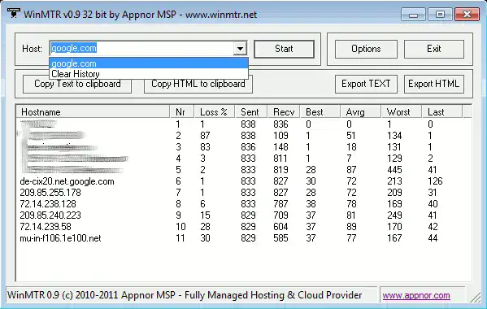

# Les weathermaps

## Vérifier l'état du réseau avec la Weathermap

Cet article aura pour but d'aider à vérifier l'état/encombrement du
réseau via les différentes Weathermap disponibles

## Qu'est ce qu'une Weathermap ?

Une Weathermap (Traduction littérale : Carte du temps) est une carte qui
permet de vérifier l'état du réseau d'un hébergeur, afin de savoir si
nous allons disposer de bonnes conditions de navigation. Bon nombre de weathermaps sont privées, car elles montrent le réseau Internet d'une entreprise, mais il en existe quelques unes publiques (évidemment, certains équipements peuvent être cachés).

## Liste des Weathermap disponibles

| Service        | Lien                                                               |
| -------------- | :----------------------------------------------------------------: |
| OVH            | [Ici](http://weathermap.ovh.net/)                                  |
| France-IX      | [Ici](https://tools.franceix.net/weathermap/par) (compte membre)   |
| Hivane Network | [Ici](https://www.hivane.net/info/weathermap.html)                 |
| France-IX      | [Ici](https://tools.franceix.net/stats/aggregated) (compte membre) |

## Connaitre son réseau

Pour savoir par quels routeurs passe sa connexion, il suffit de faire un
**traceroute** avec l'outil **mtr** sous Linux ou bien
**[WinMTR](https://winmtr.net/)** sous Windows. Voici des informations
qui nous intéressent :

Ce screen provient du logiciel **WinMTR**.

On peut voir ici que nous passons par un réseau HOPUS pour joindre le
réseau d'Online, puis que nous passons par le routeur s45-s103-1 pour
accéder à notre serveur.

## Diagnostiquer

A notre niveau, nous ne pouvons pas vraiment diagnostiquer ce qui se
passe chez notre ISP. Cependant, grace à un outil appelé Looking Glass,
on peut cependant faire des diagnostics plus poussés.

**[Liste complète](https://www.bgplookingglass.com/)**

**[Traceroute depuis différents pays + RS...](http://www.traceroute.org/)**

| Opérateur(s)               | Lien                                                          |
| -------------------------- | :-----------------------------------------------------------: |
| ClearFly                   | [ici](https://lg.clearfly.net/cgi-bin/bgplg/)                 |
| Cogent                     | [ici](https://www.cogentco.com/en/looking-glass)              |
| Colt                       | [Ici](https://portal.colt.net/lg/private/lookingGlassExec.do) |
| Core Backbone              | [ici](https://lg.core-backbone.com/)                          |
| Deutsche Telekom           | [ici](https://lg.telekom.com/)                                |
| Feral                      | [ici](https://network.feral.io/looking-glass)                 |
| HE                         | [ici](https://lg.he.net/)                                     |
| HKIX                       | [ici](https://www.hkix.net/hkix/hkixlg.htm)                   |
| Hivane                     | [ici](https://lg.hivane.net/)                                 |
| Hopus                      | [Ici](https://lg.hopus.net/)                                  |
| IndoCyber                  | [ici](https://bgplg.indocyber.net.id/)                        |
| LES                        | [ici](http://lg.les.net/cgi-bin/bgplg)                        |
| Level3 (Lumen)             | [Ici](https://lookingglass.level3.net/)                       |
| Lux Network                | [ici](https://lg.luxnetwork.eu/)                              |
| Milkywan                   | [ici](https://lg.milkywan.fr/)                                |
| NLNOG                      | [ici](https://lg.ring.nlnog.net/)                             |
| NTT                        | [ici](https://www.gin.ntt.net/looking-glass-landing/)         |
| OpenTransit/Orange         | [Ici](https://looking-glass.opentransit.net/)                 |
| Retn                       | [ici](https://lg.retn.net/)                                   |
| SFMIX                      | [ici](https://lg.sfmix.org/)                                  |
| Serverius                  | [ici](https://lg.serverius.net/)                              |
| Solnet                     | [ici](https://lg.solnet.ch/)                                  |
| Tata                       | [Ici](https://lg.as6453.net/lg/)                              |
| TelekomRS                  | [ici](https://lg.telekom.rs/)                                 |
| Telia                      | [ici](https://lg.telia.net/)                                  |
| Zayo                       | [Ici](http://lg.as8218.eu/)                                   |

Il est également possible de se renseigner via les route-servers
(Disponible via telnet)

| Opérateur(s) | Lien                       |
| ------------ | -------------------------- |
| HE           | telnet route-server.he.net |
