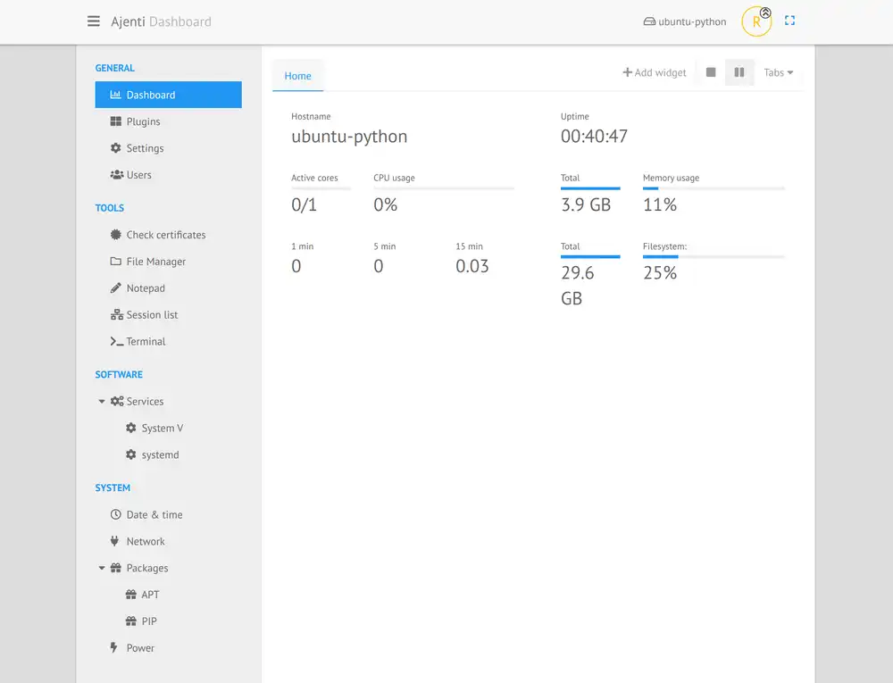

# Gérer son serveur en ligne via Ajenti



A l'instar de Webmin ou encore Vesta, Ajenti est un panel
d'administration de serveur. Simple et efficace, il vous permettra
d'effectuer la grande majorité des actions courantes (Reboot du
serveur, edition des configurations, du firewall...)

L'alternative packagée dans les dépôts Debian/Ubuntu est [Cockpit](https://cockpit-project.org/).

## Installation

Ajenti n'est pas dans les dépôts Debian/Ubuntu : on passe par le script officiel, qui installe Ajenti 2 depuis PyPI dans un virtualenv (`/opt/ajenti`) et crée le service systemd. C'est la méthode recommandée depuis Debian 12 et Ubuntu 24.04, où le `pip install` système échoue avec "externally managed environment" :

```bash
curl https://raw.githubusercontent.com/ajenti/ajenti/master/scripts/install-venv.sh | sudo bash -s -
```

Pour plus de méthode d'installation, aller voir le [lien officiel](https://docs.ajenti.org/en/latest/man/install.html#installing)

Si l'installation est bonne, vous pourrez accéder à Ajenti en **HTTPS** sur le port 8000 (`https://<ip>:8000`, certificat auto-signé). L'authentification passe par les comptes du système : on se connecte avec **root** et le mot de passe root du serveur, ou avec un autre utilisateur.
