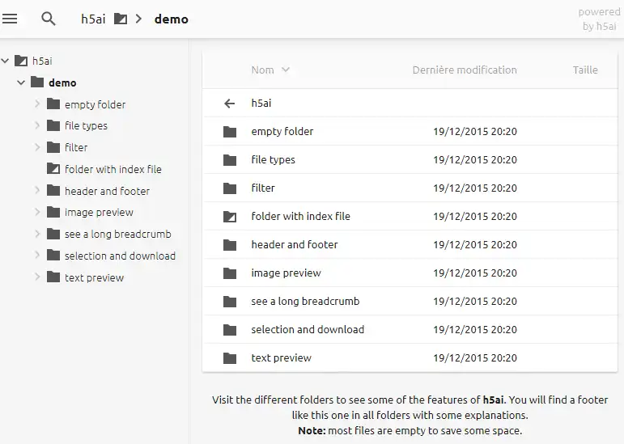

# Partager ses fichiers avec H5ai



## Présentation

h5ai est un index amélioré afin de partager facilement tous vos
fichiers... Celui-ci remplacera aisément un index fade et sans gout.
Celui-ci est disponible pour Apache, lighttpd et nginx, à condition d'avoir au minimum PHP 7.0 pour la 0.30.0 (PHP 5.5 suffisait jusqu'à la 0.29.2).

## Installation

<div class="steps" markdown>

1. Tout d'abord, nous devons faire un lien symbolique vers notre www et
    le folder que nous souhaitons rendre accessible publiquement.

    Pour moi, je souhaite rendre `/home/jeremy/files/` accessible publiquement

    ```bash
    ln -s /home/jeremy/files/ /var/www/downloads
    ```

    Il convient comme nom d'usage d'utiliser downloads en folder de
    destination

2. Puis dans ce dossier, nous allons télécharger h5ai

    ```bash
    cd /var/www/downloads/
    wget https://github.com/lrsjng/h5ai/releases/download/v0.30.0/h5ai-0.30.0.zip
    ```

    Les versions disponibles sont sur les [releases GitHub](https://github.com/lrsjng/h5ai/releases) : l'ancien site `release.larsjung.de` ne répond plus en HTTPS (certificat invalide).

3. Enfin, nous extrayons l'archive, puis nous renommons `_h5ai` en
    **.h5ai** afin de ne pas le voir dans l'explorateur.

    ```bash
    unzip h5ai-0.30.0.zip
    mv _h5ai .h5ai
    ```

4. On n'oublie pas de donner les droits adéquats

    ```bash
    chown -R www-data:www-data .h5ai
    ```

5. Et enfin, on créer le server-block nginx adéquat, sans oublier de faire le bon CNAME

    ```nginx
    server {
        server_name downloads.titi.ovh;
        listen 80;
        listen [::]:80;
        return 301 https://$host$request_uri;
    }
    server {
        listen 443 ssl;
        listen [::]:443 ssl;
        http2 on;
        server_name downloads.titi.ovh;

        error_log /var/log/nginx/downloads.error.log;
        access_log /var/log/nginx/downloads.access.log;

        include /etc/nginx/conf.d/cache.conf;
        include /etc/nginx/conf.d/php.conf;
        include /etc/nginx/conf.d/ssl.conf;
        include /etc/nginx/conf.d/file_protect.conf;

        auth_basic "Downloads";
        auth_basic_user_file "/etc/nginx/passwd/rutorrent_passwd";

        root /var/www/downloads;
        index  index.html  index.php /.h5ai/public/index.php;
    }
    ```

    La ligne **index** est cruciale : son dernier élément, en chemin absolu, renvoie chaque dossier sans `index.html` vers h5ai, qui fait le listing lui-même. Pas besoin d'`autoindex on`. Avant nginx 1.25.1, on garde l'ancienne syntaxe `listen 443 ssl http2;` à la place de `http2 on;`.

</div>
