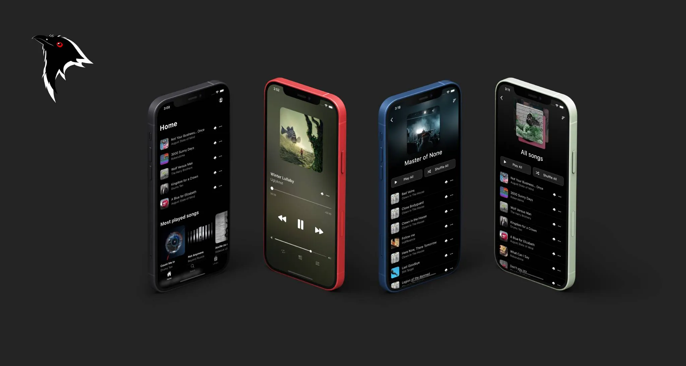

# Streamer sa musique depuis Koel



[Koel](https://koel.dev/) est un streamer musical self-hosted avec une interface proche de Spotify.
Support FLAC (transcodage FFmpeg vers AAC), gestion de comptes, interface mobile. Toujours maintenu, avec une release par mois environ.

## Docker (recommandé)

L'image officielle est `phanan/koel`, taguée par version. On crée un `.env` vide à côté du compose et on le monte dans le conteneur : `koel:init` y écrit l'`APP_KEY` générée au premier démarrage. Sans ce fichier persistant, une recréation du conteneur génère une nouvelle clé et tout ce qui est chiffré devient illisible.

```bash
touch .env
```

Puis le `docker-compose.yml` :

```yaml
services:
  koel:
    image: phanan/koel:<koel_version>
    ports:
      - "80:80"
    environment:
      DB_CONNECTION: mysql
      DB_HOST: db
      DB_PORT: 3306
      DB_DATABASE: koel
      DB_USERNAME: koel
      DB_PASSWORD: koelpassword
      FORCE_HTTPS: "false"  # passer à true derrière un reverse proxy HTTPS
    volumes:
      - ./.env:/var/www/html/.env
      - music:/music
      - images:/var/www/html/storage/app/public/images
      - search_index:/var/www/html/storage/search-indexes
    depends_on:
      db:
        condition: service_healthy

  db:
    image: mysql:8.4
    environment:
      MYSQL_DATABASE: koel
      MYSQL_USER: koel
      MYSQL_PASSWORD: koelpassword
      MYSQL_ROOT_PASSWORD: rootpassword
    volumes:
      - mysql_data:/var/lib/mysql
    healthcheck:
      test: ["CMD", "mysqladmin", "ping", "-h", "localhost"]
      interval: 10s
      timeout: 5s
      retries: 5

volumes:
  music:
  images:
  search_index:
  mysql_data:
```

Le volume `images` garde les pochettes et les avatars : sans lui, ils disparaissent à chaque recréation du conteneur.

On lance :

```bash
docker compose up -d
```

À chaque démarrage, le conteneur lance `koel:init` (clé, migrations, compte admin au premier passage). L'interface est accessible sur `http://localhost`. Identifiants par défaut : `admin@koel.dev` / `KoelIsCool`, qu'on change tout de suite :

```bash
docker compose exec koel php artisan koel:admin:change-password
```

## Installation manuelle

L'archive de release contient déjà les dépendances PHP (`vendor/`) et le front compilé : pas besoin de Composer ni de Node, qui demanderait une version 22.18+ absente de Debian 13 (20.19).

<div class="steps" markdown>

### Prérequis

- PHP 8.3+ avec les extensions `bcmath`, `curl`, `exif`, `gd`, `mbstring`, `mysql`, `xml`, `zip`
- MySQL 8+ ou MariaDB 10.6+
- FFmpeg (optionnel, pour le transcodage FLAC)

Debian 13 fournit PHP 8.4 :

```bash
apt install php8.4-fpm php8.4-{bcmath,curl,gd,mbstring,mysql,xml,zip} \
    mariadb-server ffmpeg
```

### Base de données

```sql
CREATE DATABASE koel DEFAULT CHARACTER SET utf8mb4 DEFAULT COLLATE utf8mb4_unicode_ci;
CREATE USER 'koel'@'localhost' IDENTIFIED BY 'koelpassword';
GRANT ALL PRIVILEGES ON koel.* TO 'koel'@'localhost';
```

### Installation

On récupère l'archive de la release et on la donne à `www-data`, qui doit pouvoir écrire le `.env` et `storage/` :

```bash
cd /var/www
curl -fsSL https://github.com/koel/koel/releases/download/v<koel_version>/koel-v<koel_version>.tar.gz | tar xz
chown -R www-data:www-data /var/www/koel
```

### Initialisation et configuration

`koel:init` gère tout en une commande : `.env`, génération de clé, migrations, compte admin, chemin de la musique et scheduler. `--no-assets` saute le build du front, déjà dans l'archive. On le lance en `www-data`, pour que le scheduler s'installe dans sa crontab :

```bash
cd /var/www/koel
sudo -u www-data php artisan koel:init --no-assets
```

Le compte admin par défaut : `admin@koel.dev` / `KoelIsCool` - à changer immédiatement.

Les variables à vérifier dans `.env` après init. Le `.env.example` d'où il est tiré met `TRANSCODE_FLAC=false` : sans le repasser à `true`, les FLAC sont streamés tels quels.

```ini
DB_CONNECTION=mysql
DB_HOST=127.0.0.1
DB_DATABASE=koel
DB_USERNAME=koel
DB_PASSWORD=koelpassword

# Transcodage FLAC vers AAC
TRANSCODE_FLAC=true
FFMPEG_PATH=/usr/bin/ffmpeg
TRANSCODE_BIT_RATE=256

# Optionnel : Last.fm
LASTFM_API_KEY=
LASTFM_API_SECRET=
```

Le dossier de musique est demandé par `koel:init` et stocké en base, il se change ensuite dans l'interface.

### nginx

```nginx
server {
    listen 80;
    server_name music.example.com;
    return 301 https://$host$request_uri;
}

server {
    listen 443 ssl;
    server_name music.example.com;
    root /var/www/koel/public;

    ssl_certificate /etc/ssl/private/certificate.crt;
    ssl_certificate_key /etc/ssl/private/certificate.key;

    index index.php;

    location / {
        try_files $uri $uri/ /index.php?$query_string;
    }

    location ~ \.php$ {
        fastcgi_pass unix:/run/php/php8.4-fpm.sock;
        fastcgi_param SCRIPT_FILENAME $realpath_root$fastcgi_script_name;
        include fastcgi_params;
    }
}
```

</div>

## Synchronisation de la bibliothèque

Le scheduler installé par `koel:init` scanne la musique tous les jours, pas besoin de cron à la main. Pour forcer un re-scan :

```bash
sudo -u www-data php artisan koel:scan
```

En Docker, l'image ne démarre pas de démon cron (seulement Apache) : le scan quotidien ne tourne pas tout seul. On le planifie depuis la crontab de l'hôte, dans le dossier du compose :

```bash
0 4 * * * cd /opt/koel && docker compose exec -T --user www-data koel php artisan koel:scan >/dev/null 2>&1
```
