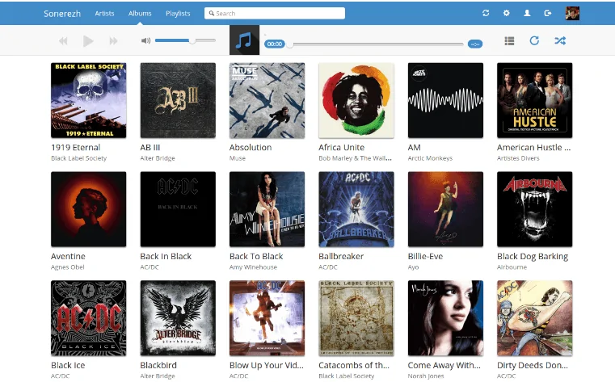

# Sonerezh

!!! warning "Projet abandonné"
    Plus aucun commit ni release sur le dépôt GitHub depuis la 1.2.6 de septembre 2019 (il n'est pas archivé, mais le projet est à l'arrêt), et l'appli ne tourne pas en PHP 8. Pour le self-hosting de musique, préférer [Navidrome](https://www.navidrome.org/) ou [Koel](https://koel.dev/).



## Introduction

Sonerezh est une application web développée par Guillaume Leduc (Son
[blog](https://www.guillaume-leduc.fr/)) et son ami Itomiix (Son
[twitter](https://twitter.com/itomiix).

Tout comme les célébrissimes Deezer ou Spotify, nous pourrons écouter de
la musique en streaming, faire nos propres playlist... Mais pour cela,
nous devrons auparavant télécharger nos musiques sur nos serveurs.

Il s'agit d'un projet que je suis d'avant sa création via le blog de
Guillaume Leduc. Je l'ai toujours suivi avec attention, car il me
semblait excellent.

Le fait est qu'aujourd'hui, le projet a plus de 750 stars sur GitHub
et a dépassé de loin les attentes des développeurs

## Pré-requis

Pour installer Sonerezh, il nous faut bien évidemment un **environnement
LAMP** ou équivalent. Je vous invite à aller voir la page sur [le
wiki](../web/nginx/installation.md) que j'ai fais à cet effet.

Nous aurons également besoin du package **ffmpeg** pour convertir les FLAC en MP3. L'ancien **libav-tools** n'existe plus dans Debian, et Sonerezh appelle `ffmpeg` quand il ne trouve pas `avconv`.

Côté PHP, la dernière version (1.2.6) s'arrête à PHP 7.3 (CakePHP 2.10). En PHP 8, l'appli plante dès la première page (`Unknown named parameter $subject` dans CakePHP). Il faut donc un PHP 7.3, que le dépôt Sury fournit encore (voir [Installer une version custom de PHP](../web/nginx/php_custom_version.md)). Il faut aussi [Composer](https://getcomposer.org/) pour récupérer les dépendances.

## Installation

<div class="steps" markdown>

1. Avant toute chose, nous devrons préparer la BDD à recevoir notre
    Sonerezh :

    ```mysql
    mysql> CREATE DATABASE sonerezh;
    mysql> CREATE USER 'sonerezh'@'localhost' IDENTIFIED BY 'password';
    mysql> GRANT ALL PRIVILEGES ON sonerezh.* TO 'sonerezh'@'localhost';
    mysql> FLUSH PRIVILEGES;
    mysql> exit;
    ```

    N'oubliez pas de remplacer password par son mot de passe. Le `GRANT ... IDENTIFIED BY` d'origine est refusé par MySQL 8 (erreur de syntaxe), d'où le `CREATE USER` séparé.

2. Une fois cela fait, nous pourrons cloner le repo de Sonerezh sur notre serveur web. Le clone ne contient pas `app/Vendor/` (CakePHP, getID3) : sans `composer install`, l'appli ne démarre pas. Les archives de sonerezh.bzh répondent 404, le clone est donc la seule voie :

    ```bash
    cd /var/www
    sudo git clone https://github.com/Sonerezh/sonerezh.git music
    cd music && sudo composer install && cd ..
    ```

3. Et nous n'oublions pas de lui appliquer les droits et propriétaires
    appropriés

    ```bash
    sudo chown -R www-data: music/ && sudo chmod -R 775 music/
    ```

4. Une fois cela, nous passons au server-block de notre nginx

    ```nginx
    server {
        listen 80;
        listen [::]:80;
        return 301 https://$host$request_uri;
        server_name music.ndd.tld;
    }
    server {
        listen 443 ssl;
        listen [::]:443 ssl;
        http2 on;    # nginx 1.25.1+, avant : listen 443 ssl http2;
        server_name music.ndd.tld;
        root /var/www/music/app/webroot;

        access_log /var/log/nginx/music.access.log;
        error_log /var/log/nginx/music.error.log;

        location / {
            try_files $uri $uri/ /index.php?$args;
            expires 14d;
            add_header Cache-Control public;
        }

        # Serve static images from resized folder
        location ~* /([^/]+_[0-9]+x[0-9]+(@[0-9]+x)?\.[a-z]+)$ {
            try_files /img/resized/$1 /index.php?$args;
            expires 14d;
            add_header Cache-Control public;
        }

        include /etc/nginx/conf.d/file_protect;
        include /etc/nginx/conf.d/cache;
        include /etc/nginx/conf.d/php;
    }
    ```

</div>
