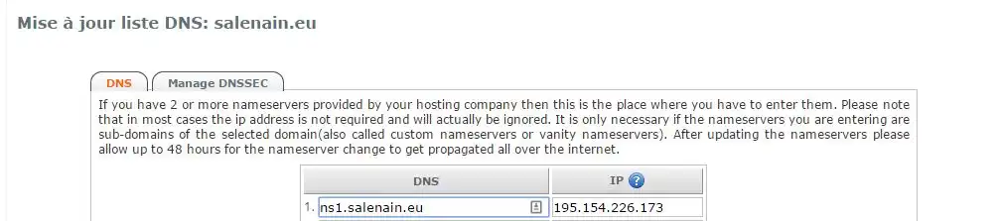

# Installer son NS ainsi que son resolveur DNS via BIND9

Pour se séparer au maximum des services tiers, on peut installer son propre [résolveur
DNS](https://www.bortzmeyer.org/son-propre-resolveur-dns.html) et paramétrer BIND9 comme serveur autoritaire.

## Comment fonctionne un NS

Un NS est un enregistrement DNS permettant d'avoir son propre serveur autoritaire.
Prenons l'exemple avec **wiki.jdelgado.fr** :

1. On interroge les ***root servers***, par exemple *g.root-servers.net*
2. Ce serveur indique le serveur à contacter - ici les serveurs autoritaires **du TLD .fr** : *d.nic.fr*, *f.ext.nic.fr*, *g.ext.nic.fr*
3. Ces serveurs indiquent quel serveur autoritaire **du nom de domaine**, dans notre cas **ns1.jdelgado.fr**
4. Et on obtient enfin l'IP du serveur.

Le serveur qu'on installe correspond à l'étape **3**.

## Comment fonctionne un résolveur DNS

Un *résolveur DNS* agit simplement : il résout n'importe quel nom de domaine et retourne son adresse IP.

L'intérêt d'avoir son propre résolveur DNS est de sortir le résolveur du FAI de la boucle : plus de *DNS Hijacking* de sa part (réponses modifiées, blocages, pub sur les NXDOMAIN). Par contre, les requêtes vers les serveurs racine, TLD et autoritaires partent toujours en clair : le FAI peut encore les voir et les intercepter. Contre la falsification, c'est la validation DNSSEC qui protège (`dnssec-validation auto`, active par défaut dans BIND9), et seulement sur les zones signées. Contre l'espionnage, il faut du chiffrement (DoT/DoH vers un résolveur de confiance).

Si on veut éviter le flicage sans monter son propre résolveur, il existe des projets comme
[OpenNIC](https://opennic.org/) qui liste le résolveur DNS libre le plus proche, ou
[DNS Watch](https://dns.watch/) - résolveur libre IPv4/IPv6 avec support DNSSEC, annoncé sans log (une promesse du fournisseur, pas un audit).

## Installation

### Résolveur DNS

De base, BIND9 écoute sur toutes les interfaces (port 53), mais il ne fait la résolution récursive que pour `localhost` et `localnets` (les réseaux directement connectés au serveur) : ce n'est pas un open resolver.

```bash
apt install bind9
```

Pour vérifier que BIND9 est bien installé, `dig +short @127.0.0.1 google.fr` doit retourner une IP Google.

Le dossier de configuration BIND9, `/etc/bind`, contient les fichiers `named.conf*` :

* `named.conf` - recense tous les fichiers de configuration
* `named.conf.default-zones` (Debian 12) ou `named.conf.root-hints` (Debian 13) - zones par défaut
* `named.conf.local` - vide par défaut, c'est ici qu'on fait toutes les modifications
* `named.conf.options` - configuration de base avec toutes les options

On y trouve aussi `rndc.key`, et sur Debian 12 `bind.keys`, `zones.rfc1918` et les fichiers de zone par défaut `db.*`.

Ne pas oublier d'éditer `/etc/resolv.conf` sous Linux pour utiliser le résolveur local. Si `/etc/resolv.conf` est un lien vers `/run/systemd/resolve/stub-resolv.conf` (systemd-resolved, le défaut sur Ubuntu), l'édition est écrasée : on met `DNS=127.0.0.1` dans `/etc/systemd/resolved.conf` à la place.

### Serveur autoritaire

Un serveur autoritaire fait "autorité" sur une zone donnée et sert tous ses enregistrements (SOA, NS, A, MX, CNAME...).

Généralement le registrar fait aussi serveur DNS, mais c'est souvent une usine à gaz - un simple BIND fait
l'affaire et est simple à mettre en œuvre.

Il faut d'abord mettre à jour la liste des NS chez le registrar :



Ici on indique que le serveur autoritaire sera `ns1.jdelgado.fr` soit `195.154.226.173`.

#### named.conf.local

On ajoute la zone à gérer par BIND9 :

```bash
zone "jdelgado.fr" IN {

        # Zone de type primaire (master avant BIND 9.18, toujours accepté)
        type primary;

        # Fichier de zone
        file "/etc/bind/jdelgado.fr/db.jdelgado.fr";

        # On autorise le transfert de la zone aux serveurs DNS secondaires, et seulement à eux
        allow-transfer { 217.70.177.40; 213.186.33.199; 173.245.58.105; 173.245.59.150; };

        # On autorise tout le monde à envoyer des requêtes vers cette zone
        allow-query { any; };

        # Prévenir les serveurs DNS secondaires qu'un changement a été effectué dans la zone maître
        notify yes;

};
```

On ne met dans `allow-transfer` que les vrais secondaires (ici Gandi, Kimsufi et Cloudflare) : toute IP listée peut récupérer la zone complète par AXFR. Un résolveur public comme `8.8.8.8` n'a rien à y faire.

Avant de recharger, on valide la config et la zone :

```bash
named-checkconf
named-checkzone jdelgado.fr /etc/bind/jdelgado.fr/db.jdelgado.fr
rndc reload
```

#### named.conf

On ajoute un include pour avoir des logs propres plutôt que tout dans syslog :

```bash
include "/etc/bind/named.conf.logging";
```

#### named.conf.logging

Le dossier de logs doit exister et appartenir à `bind`, sinon `named` refuse de démarrer (`configuring logging: file not found`). On utilise `/var/log/named` : c'est le seul dossier de logs autorisé par le profil AppArmor de Debian/Ubuntu.

```bash
mkdir -p /var/log/named
chown bind:bind /var/log/named
```

La catégorie `queries` suffit à activer le log des requêtes, pas besoin de `querylog yes;` :

```bash
logging {
    channel security_file {
        file "/var/log/named/security.log" versions 3 size 30m;
        severity dynamic;
    };

    channel b_query {
        file "/var/log/named/query.log" versions 2 size 10m;
        severity info;
    };

    channel general_file {
        file "/var/log/named/general.log" versions 3 size 5m;
        severity dynamic;
    };

    category queries { b_query; };
    category general { general_file; };
    category security { security_file; };
    category lame-servers { null; };
};
```

#### named.conf.options

```bash
acl allowQueried {
    188.166.95.206;
};

acl allowRecursion {
    localhost;
};
```
